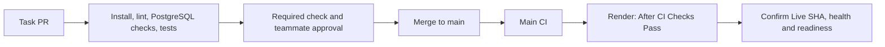

# PhishLens Pipeline

## Status

Backend scaffold CI and automatic deployment are implemented
and verified.

GitHub Actions installs dependencies, checks compatibility,
lints Python, tests /health, and checks Python compilation.

Render deploys main automatically after CI checks pass.
Automatic deployment was verified for commit 8a8634e,
followed by a successful public /health check.

PostgreSQL migration, repeatable seed, seed integrity and readiness-response tests
are implemented. Extension checks and AI tests remain pending.
Compilation is basic validation, not the
complete application build stage.

## Delivery Flow

Task branch → Pull request → Automated checks → Teammate approval
→ Merge to main → Automated checks → Automatic deployment
→ Deployed verification

## Workflow Triggers

The diagram describes current backend delivery. Extension packaging and real AI
smoke evidence remain outside current coverage, not silently skipped stages.

Workflow file: .github/workflows/ci.yml

- Every pull request triggers backend checks.
- Every push to main, including a merged PR, triggers backend checks.
- Render deploys changes to main after CI checks pass.

The workflow uses Python 3.12 on an Ubuntu runner.
Render is configured to use Python 3.12.10.

## Implemented Backend Checks

| Stage | Purpose | Command |
|---|---|---|
| Install runtime dependencies | Install pinned application packages | python -m pip install -r backend/requirements.txt |
| Install development dependencies | Install pinned checking tools | python -m pip install -r backend/requirements-dev.txt |
| Dependency compatibility | Detect incompatible installed dependencies | python -m pip check |
| Lint | Check backend Python code | python -m ruff check backend |
| Migrate twice | Verify versioned schema application and repeat execution | python -m alembic -c backend/alembic.ini upgrade head (run twice) |
| Seed twice | Insert synthetic demo records and verify repeat execution | python scripts/seed_demo.py (run twice) |
| Tests | Verify health, readiness responses, seeded records and relationship | python -m pytest backend/tests -q -p no:cacheprovider |
| Compilation | Check Python source compilation | python -m compileall -q backend/app |

Commands run from the repository root.

Disabling pytest's cache avoids a local cache-permission issue.
It does not disable tests or suppress test failures.

A failed command fails the job. Errors must not be suppressed
to produce a misleading successful run.

## Coverage Still Needed

- Chrome extension linting, validation, and packaging.
- Database-backed API and frontend verification.
- Mocked AI tests when the inference adapter is available.

Regular AI tests should use mocked inference without model downloads.
Successful actual-model calls must be recorded separately.

## Deployment

- Backend host: Render.
- Instance plan: Free.
- Service: phishlens-api.
- Deployment branch: main.
- Root directory: repository root; the field is blank.
- Python version: 3.12.10.
- Auto-Deploy: After CI Checks Pass.
- Public URL: https://phishlens-api-ocvt.onrender.com
- Health check path: /health.

Build command:

    python -m pip install -r backend/requirements.txt

Start command:

    python -m uvicorn backend.app.main:app --host 0.0.0.0 --port $PORT

Render supplies PORT at runtime.

Automatic deployment was verified after PR #12 merged:
commit 8a8634e became Live without a manual deployment trigger.

Public /health returned:

    {"status":"ok","service":"phishlens-api"}

This verifies the API process only.
It does not establish database, frontend, or AI integration.

## Merge Protections

Main is configured to require:

- A pull request.
- At least one teammate approval.
- Passing Backend checks from GitHub Actions.
- Resolved review conversations.

Stale approvals are dismissed after new commits.
Administrator bypass, force pushes, and branch deletion are disabled.

Review enforcement was observed on setup PR #2.
The required backend check and teammate approval were verified
on PR #11 before merging.

## Database Connections

The selected database is PostgreSQL hosted on Neon.

- Production branch: production.
- Development branch: development.
- Region: AWS Asia Pacific 1 (Singapore).
- Databases observed: neondb and phishlens_dev. The migrated demo database is
  phishlens_dev; confirm the Neon branch rather than infer it from the name.
- DATABASE_URL: currently read by application, Alembic and the seed. Runtime
  configuration uses a pooled URL; migration verification used a direct URL.
- MIGRATION_DATABASE_URL: placeholder for planned separation; not currently read
  by the migration code.

Use the intended branch and database for every operation. Do not assume setting
MIGRATION_DATABASE_URL changes Alembic behavior. Driver: psycopg; URL normalization
is implemented in backend/core/config.py.

Routine CI database checks use an isolated PostgreSQL 17 test database.
Ordinary PR checks must not use production Neon credentials.

Neon branches are provisioned.
Migration 0001_initial_schema and repeated seed were verified locally, and the
production dashboard showed the tables and synthetic records. Public /ready
verified a deployed SELECT 1. Complete frontend/record persistence verification
remains pending.

## Secrets

- Local credentials belong in ignored .env files.
- .env.example contains configuration placeholders only.
- Deployment secrets belong in the host or CI secret store.
- Development and production use separate configuration.
- Database credentials and backend secrets must never be
  included in the Chrome extension.
- Private emails and datasets must not enter Git.

## Verified Evidence

- [Backend scaffold PR #11](https://github.com/kendshhh/PhishLens/pull/11)
- [Runbook PR #12](https://github.com/kendshhh/PhishLens/pull/12)
- [Intentional failing CI run](https://github.com/kendshhh/PhishLens/actions/runs/38430884810)
- [Repaired passing CI run](https://github.com/kendshhh/PhishLens/actions/runs/38431990720)
- [Runbook PR CI run](https://github.com/kendshhh/PhishLens/actions/runs/38501111554)
- [Public health endpoint](https://phishlens-api-ocvt.onrender.com/health)

The intentional failure changed the expected HTTP status from
200 to 201. Restoring 200 produced passing CI.

Recorded deployment observations:
- First deployment: commit 717334d; 50.3 seconds.
- Automatic deployment: commit 8a8634e; 44.9 seconds.
- Public health response verified after automatic deployment.

Deployment duration is not complete merge-to-live lead time.
These observations do not prove an optimization trend.

## Documentation and Remaining Verification

Update docs/devops/metrics.md with actual measurements,
sample counts, and supporting links.

Use docs/devops/runbook.md for deployment and recovery procedures.

Still required:
- Database-backed frontend verification.
- Confirmation that records persist across redeployments.
- Extend the measured CI snapshot and collect workflow wall-clock timings.
- Merge-to-live lead time.
- Collect full restoration timings and Render deployment links.
- Measured before-and-after optimization results.

Backend scaffold CI, automatic deployment, and public health
verification are complete. Full application integration,
frontend/AI integration, full recovery timings, and optimization evidence remain
pending. CI job averages and success rates are recorded in docs/devops/metrics.md;
the rollback drill and failed restoration are recorded in docs/devops/incidents.md.

## Database verification and current CI coverage

CI starts isolated PostgreSQL 17, applies migrations twice, seeds twice, and
asserts the fixed demo records and user relationship. Readiness success/failure
responses are tested with mocks. Public /ready independently returned HTTP 200
and database connected; that is a real deployed SELECT 1, not a schema or
frontend integration test. Production/environment selection is configured in
Render, not inferred from the endpoint response.

The measured snapshot contains 23 backend jobs, 20 passing and 3 failing
(including two deliberate drills). See [CI run evidence](docs/devops/ci-run-evidence.csv)
for source timestamps.
No optimization claim is made from changing durations or changing CI coverage.
