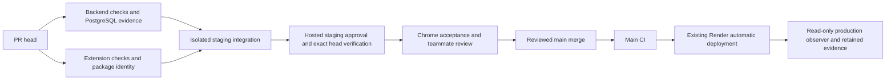
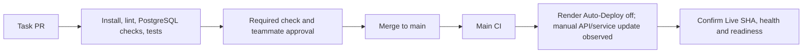

# PhishLens Pipeline

## Current release update — November 23, 2026

**Release remains NO-GO.** The current evidence and ordered blockers are in
[`docs/devops/release-record-2026-11-23.md`](docs/devops/release-record-2026-11-23.md).
This update supersedes the November 22 snapshot below; that dated detail is kept
for history and must not be read as current staging or production evidence.

## Historical repository and workflow audit — November 22, 2026

**Release: NO-GO.** This status separates the current remote repository from
local, uncommitted work. `origin/main` was verified at
[`f957cd3d22651ac3b6721a4d16dffba27fb6ee40`](https://github.com/kendshhh/PhishLens/commit/f957cd3d22651ac3b6721a4d16dffba27fb6ee40)
(PR #278, Neon pooler-host normalization).
The local branch is `codex/ai-evaluation-spend-20261114` at
`16f955321caf5dc368181be7ce5c00643750545d`, twelve commits behind `main`, with
many pre-existing modified and untracked files. No local changes were staged,
committed, pushed, or deployed during this audit.

### Workflow as checked

The remote `main` CI workflow still contains a PR-triggered `Hosted staging`
job that exposes `RENDER_STAGING_API_KEY` to workflow code selected by a PR.
That trust boundary is unsafe: a PR change to a script or workflow step could
expose the deploy credential. The local `ci.yml` change removes that job and
leaves staging deployment to `Secretary preview`, a `workflow_run` controller
that checks out the default branch before using protected staging credentials.
This correction is only in the dirty workspace; it does not protect `main` until
reviewed and merged.

The trusted preview currently checks the exact PR source deployment and, in
Neon Auth mode, proves health, readiness, version, and anonymous saved-report
rejection. It does not prove authenticated CRUD or the authenticated extension
journey. Remote `main` can publish a green `Secretary staging` commit status
while its detailed check says Auth acceptance is pending. The local controller
change makes that required status fail until authenticated acceptance passes.
That status correction also remains unmerged and needs a subsequent PR run to
verify the installed default-branch controller.

The current `main` commit's backend, extension, workflow-lint, dependency,
CodeQL, and deterministic AI checks passed. Its Secretary `preview` job was
skipped on the main push. The scheduled [production SHA/health check](https://github.com/kendshhh/PhishLens/actions/runs/45001981909)
failed at 2026-11-22 08:15 UTC while comparing production endpoints with `main`;
production is still on `811980c`, not `f957cd3`. PR #266's latest hosted
staging run failed the exact database/Auth mapping preflight before deployment,
so authenticated acceptance was skipped. PR #251, based on `f957cd3`, also
failed that mapping preflight; its deploy and authenticated CRUD steps were
skipped. Neither PR demonstrates product acceptance.

`Staging integration` exercises the real API against disposable PostgreSQL; it
is not hosted Neon acceptance. Browser package checks use CI artifacts; they do
not establish that the installed extension, hosted backend, Auth, and approved
model passed together. Wilber's November 22 report confirms the already
documented approved historical English TF-IDF v12a evaluation: 190/200 phishing
messages detected (95% recall), one false alert among 1,000 legitimate messages
(0.1%), and 1,200/1,200 valid results. The [frozen study record](docs/ai/sprint-4-release-evidence.md)
limits this pass to advisory use on its historical source-pair cohort. It does
not establish contemporary-source performance, separate spam quality, human
explanation quality, production provider acceptance, or acceptance of the
current extension/backend release candidate. The 40-case synthetic development
results are weak and are not a held-out release-quality evaluation; the
historical cohort's numeric thresholds do not generalize into a broad current
release-quality decision.

### Live service and controls

Render metadata reports production Auto-Deploy off and live SHA
`811980c2cbf70d9957146bf329627f0826a018f1`, behind current `main` at
`f957cd3d22651ac3b6721a4d16dffba27fb6ee40`. A previous GET-only probe found
health/readiness ready and analysis disabled; after the latest service update,
no new production endpoint probe was made. Staging service
`srv-db92irlg1s2s739404i0` also has Auto-Deploy off and is Git-backed to `main`.
Render deploy metadata reports its latest live deploy as
`6b6b83d5ef261e10e4312a78b5e2f3953b0e36ec`; later attempts at its parent
`561c19d` failed or were canceled, and no deploy of newer `f957cd3` is evidenced.
A subsequent `/version` request timed out. Thus the
current staging runtime and Auth/CRUD path are **not verified**.

The supplied read-only GitHub environment review reports staging mapped to Neon
project `hidden-shadow-38533062` / branch `br-broad-feather-b3261w7l` and
production mapped to project `patient-bird-25428852`. Render does not expose
the relevant variable values, so this mapping has not been tied to the running
service's runtime, migration, and Auth connections. The separate PR251 project
`ancient-brook-17208049` / branch `br-rough-sea-a1l6ehi1` exists and is ready,
but is not selected; its catalog review reports no public application tables
or Alembic history. Its project metadata permits public connections and has no
IP allowlist. No migration or data change was made.

There is source drift to resolve before changing staging: this local checkout
and current `main` [`start_staging.py`](scripts/start_staging.py) pin the older
`ep-soft-fog` endpoint, while the supplied deployed-source review says live SHA
`6b6b83d` reads an environment-provided mapping. PR #278 changed
`scripts/secretary/preview.py` host normalization, not the startup pin. Do not
alter the pin until the authorized owner confirms the intended project/branch
and complete host/database/role/Auth mapping. The current workflow still does
not build or promote one immutable backend image digest; a checked extension
ZIP is not backend image provenance.

The supplied GitHub settings review reports staging self-review is allowed and
its deploy refs include stale `refs/pull/33/merge`. Production blocks
self-review but admin bypass is enabled, with one configured reviewer. The
active main ruleset requires one approval and `Backend checks`, `Extension
checks`, `Staging integration`, and `Secretary staging`; deployment approval
is not yet demonstrably independent and non-bypassable. No release tag or
approved versioned production promotion is recorded.

No automatic Neon snapshot schedule is reported. The current manual snapshot
and isolated restored branch expire November 27, 2026; service RTO/RPO remain
unmeasured. Render `notifyOnFail=default` does not prove a tested alert route.

The active `main` ruleset requires `Backend checks`, `Extension checks`,
`Staging integration`, and `Secretary staging`; a separate active ruleset
requires one approval. Classic branch-protection details were unavailable to
the connected GitHub integration. The current hosted staging job and the
required-status behavior must be reconciled on `main` before treating this as a
safe release gate.

Keep the release at **NO-GO**. The historical English TF-IDF v12a evaluation
has an approved advisory pass for that cohort (95% phishing recall, 0.1%
legitimate false-positive rate, 1,200/1,200 valid outputs); broad contemporary
model quality and production provider acceptance remain open. The release also
needs authenticated staging CRUD and extension acceptance on one exact
candidate, safe required-status and environment approval enforcement,
same-digest versioned promotion, exact-SHA post-deploy acceptance, and current
rollback/recovery proof. See
[`docs/devops/README.md`](docs/devops/README.md) for the evidence index.
## Historical delivery and acceptance snapshot — November 15, 2026

> The following November 15 snapshot is preserved for history and is superseded
> by the November 22 status above.

The [November 15 Kendra DevOps status](docs/devops/kendra-devops-status-2026-11-15.md)
and [November 15 staging acceptance](docs/devops/staging-acceptance-2026-11-15.md)
remain useful historical evidence; neither describes the current production SHA.

At the November 15 staging acceptance, GitHub `main` was
[`8c4795f5a4ef4e55c44ff44e98ffd6413cb21c6f`](https://github.com/kendshhh/PhishLens/commit/8c4795f5a4ef4e55c44ff44e98ffd6413cb21c6f) (PR #215). It later advanced through [`c568b7a39a7abf3a99ed7aa318d490397d21bd30`](https://github.com/kendshhh/PhishLens/commit/c568b7a39a7abf3a99ed7aa318d490397d21bd30) (PR #224), [`bfa0d61040ea671a81317102f2de536cf86a9844`](https://github.com/kendshhh/PhishLens/commit/bfa0d61040ea671a81317102f2de536cf86a9844) (PR #221), and [`56fba3952b588d289cf539623f9b4149b03258fc`](https://github.com/kendshhh/PhishLens/commit/56fba3952b588d289cf539623f9b4149b03258fc) (PR #226), to current snapshot SHA [`6544364b07c0fcc9fcbc9ee8d405d96d5d1f414c`](https://github.com/kendshhh/PhishLens/commit/6544364b07c0fcc9fcbc9ee8d405d96d5d1f414c) (PR #231, removal of the unused Vercel landing page). PR #224 changed the browser-acceptance harness and added evidence; PR #221 added a documentation audit; PR #226 hardened hosted-staging PostgreSQL URL validation and added offline regressions. The staging run below verifies application SHA `8c4795f5a4ef4e55c44ff44e98ffd6413cb21c6f` as deployed at that time, before PR #226's fix, not a deployment of current `main`.

The repository is public, as intended by the owner. The API-visible active main
ruleset #26782191 currently requires one approval and six status checks: Backend
checks, Extension checks, Staging integration, Workflow lint, CodeQL, and
Dependency security. It does not list an AI evaluation context. The deterministic
AI workflow path-filters its workload. The always-reported exact-name
`Deterministic AI Evaluation` job is a change proposed on the open PR #220 branch;
it has not yet merged into `main`. On that branch it runs the workload for
AI-related changes and emits an explicit not-applicable result for unrelated
changes. The connected GitHub API cannot read classic branch-protection settings;
an earlier PR checks view showed this context as Expected, and the exact context
is now reported successfully on PR #220. The AI owner approved a zero-tolerance
rule in [#93](https://github.com/kendshhh/PhishLens/issues/93): every selected
contract/failure case must run and pass, and applicable AI-change runs must
complete all 40 `synthetic-v1` cases with valid results, expected identity, zero
paid/external inference, and no model-weight downloads. The 40-case suite has no
numeric model-quality cutoff. Unrelated changes skip only the workload, not the
status job. A failed change detector fails closed. An absent or failing required
status is not a pass.

#### Observed required-check state on PR #220 — 2026-11-15

On earlier reviewed PR #220 heads, the path-filtered AI workload skipped for documentation-only changes while the separate exact-name context was still waiting to be reported. The open PR #220 workflow revision now reports that context; on head `b0a7591b4a04a7c553d18f9cbde5e3c8ba83353f`, [AI run 43717709615](https://github.com/kendshhh/PhishLens/actions/runs/43717709615) passed the detector, contract tests, and full 40-case TF-IDF development workload. Its explicit N/A step was skipped because the PR includes the AI workflow change. This demonstrates the proposed PR branch behavior, not behavior merged to `main`, and does not establish AI quality. Use the [live PR checks](https://github.com/kendshhh/PhishLens/pull/220/checks) for the latest revision; verify the N/A path on a future unrelated-change PR.

### Live service targets

- **Production:** Render's last live deployment is
  `205ec26f8b5d04104a6e8fdfa0c9efa490ecdf02`, behind `main`. `/health` and
  `/ready` return HTTP 200, but `/model-info` reports
  `provider_mode=unavailable`. The [exact-SHA production smoke
  #43610307606](https://github.com/kendshhh/PhishLens/actions/runs/43610307606)
  targeted this deployed SHA and failed at provider preflight, not SHA
  validation; it made zero analysis requests, paid provider calls, or database
  writes. Separately, the [production-drift check
  #43639445224](https://github.com/kendshhh/PhishLens/actions/runs/43639445224)
  failed because production's SHA did not match then-current `main` SHA `8c4795f`. Production
  behavior is not accepted.
- **Staging:** Render was live on exact application SHA `8c4795f5a4ef4e55c44ff44e98ffd6413cb21c6f` during
  the November 15 acceptance (then-current `main`, PR #215). After PR #224,
  `main` advanced from `8c4795f` through PR #224, PR #221, and PR #226 (`56fba39`), then to current snapshot SHA `6544364b07c0fcc9fcbc9ee8d405d96d5d1f414c` through PR #231. PR #226 fixed the hosted-staging URL identity guard; the November 15 run predates that fix and did not test it. The recorded CRUD run remains evidence for SHA `8c4795f5a4ef4e55c44ff44e98ffd6413cb21c6f`; no deploy of current `main` is claimed. This is one backend staging run, not browser or
  production acceptance.
- **Restore and objectives:** The November 14 production snapshot restore
  changed Neon branch identity/default topology and is not accepted as a safe
  restore rehearsal. Recovery time was not measured. Team-approved SLI/SLO and
  RPO/RTO targets are absent.

### Remaining delivery gates

The provider-mode failure currently blocks production feature acceptance. A
current-main production deploy, known-good provider configuration, and
successful exact-SHA changed-behavior smoke remain outstanding. The production
smoke workflow is manual-only: no deploy-ended webhook trigger is configured or
verified. Render documents workspace webhooks as a Pro-or-higher feature, but
the current workspace plan is not exposed by the connected read-only metadata.
The AI owner has approved the [#93 deterministic rule](https://github.com/kendshhh/PhishLens/issues/93#issuecomment-6891138424). The always-reported exact `Deterministic AI Evaluation` context is implemented on the open PR #220 branch and has not yet merged to `main`; AI-related changes run the full workload and unrelated changes report explicit N/A. On PR branch head `b0a7591b4a04a7c553d18f9cbde5e3c8ba83353f`, [run 43717709615](https://github.com/kendshhh/PhishLens/actions/runs/43717709615) passed the exact-name check and full deterministic workload. The N/A step was skipped because this PR changes the AI workflow; verify that path on a future unrelated-change PR. The 40-case development suite has no numeric model-quality cutoff. Separately, [#92](https://github.com/kendshhh/PhishLens/issues/92#issuecomment-6891137984) accepts TF-IDF v12a for advisory screening only on the frozen English source-pair cohort, with approved thresholds of at least 90% phishing recall, at most 3% legitimate-only false positives, and 100% valid output. Broader contemporary-source evaluation remains open. The per-run cost estimate is not a provider-side quota or shared spend budget. Participant-sourced team records, approved reliability targets, and safe restore evidence are also outstanding.
GitHub still reports 15 open Dependabot alerts (12 high `pyasn1`, 3 medium
`opentelemetry-api`) despite the patched versions pinned in the requirements;
reconcile the alert state before treating those findings as resolved.

The latest delivery metrics end at `2026-11-14 03:12 UTC`: PR workflow
median 4.58 minutes (`n=682` attempts across 110 branches), main pipeline
median 1.18 minutes (`n=86` successful pushes), 69 production deploy records,
and 64 matched merge-to-live samples. Recovery time is unknown (`n=0`). The
optimization comparison is only `n=2` before and `n=2` after for Backend jobs;
it does not establish an end-to-end improvement. See
[metrics](docs/devops/metrics.md) and [optimization evidence](docs/devops/optimizations.md).

## Historical delivery and acceptance snapshot — November 14, 2026

> The following section preserves the previous November 14 point-in-time
> snapshot. Its SHA and service observations are superseded by the current
> section above.

This dated snapshot supersedes the October 28 observations below. GitHub
`main` is `36cb0d4c1c197b5a4a2bead38dcf9fa966719f53` (PR #199, refresh delivery
and deployment metrics). The repository is public, as intended by the owner.
The active main ruleset requires one review approval and ten status
checks, including `Dependency security` and
`Dependency graph review (GitHub Advanced Security)`. The AI evaluation check
is running on AI-changing PRs but is not yet a required main check.

Two focused DevOps PRs remain open: [#196 AI evaluation and spend
controls](https://github.com/kendshhh/PhishLens/pull/196) and [#198 production
smoke and acceptance](https://github.com/kendshhh/PhishLens/pull/198). PR #197
dependency security and PR #199 delivery metrics have merged. Both open PRs
are based on current main; #196 still has a requested-changes review and #198
needs review.

The GitHub Dependabot API still lists fifteen open alerts: twelve high
`pyasn1` alerts and three medium `opentelemetry-api` alerts across the three
requirements manifests. Current main pins `pyasn1==0.6.5` and
`opentelemetry-api==1.45.2`, above the reported vulnerable ranges, and the new
dependency checks pass on the rebased PRs. Reconcile the still-open alert
records with GitHub's refreshed dependency graph; do not treat the API count
alone as evidence that the pinned versions remain vulnerable or as evidence
that the alerts are closed.
The first `Dependency graph review` run failed because the graph was disabled.
I enabled the repository dependency graph through GitHub's vulnerability-alerts
setting and reran the job; it passed. That check is now active in the main
ruleset.

A fresh Gitleaks v8.30.1 history scan across all refs after the sync/rebase
found no leaks. This records the credential scan result; it
does not establish broader application security.

### Live service targets

- **Production:** Render serves SHA
  `76551f68ff7dc02971cf127fa82f1f35e79cc2ab`; `/health` and `/ready` return
  200, but `/model-info` reports `provider_mode=unavailable`. The exact-SHA
  feature smoke therefore failed before inference and made zero analysis
  requests, provider calls, or database writes. Production AI behavior is not
  accepted. See the [smoke procedure](docs/devops/production-deploy-smoke.md)
  and [reliability record](docs/devops/reliability-acceptance-2026-11-14.md).
- **Staging:** Render currently serves
  `3b6101b0d77d3a5282d245c83b29c3b684fe780d` from open PR #61's test branch,
  not main. The Render host was matched to Neon
  branch `pr-58-staging`; `/version`, `/health`, `/ready`, and `/model-info`
  passed. Guarded synthetic CRUD passed on this exact SHA and cleaned up record
  `56ee2dc4-7dd9-4e6d-bb3e-8c14638146e7`. This establishes backend behavior for
  the test branch; it does not establish current-main or browser-extension
  acceptance. Earlier `8c02a7c` and `c3ce2fff` acceptances were superseded when
  staging changed. See the
  [staging acceptance record](docs/devops/staging-acceptance-2026-11-14.md).
- **Restore and objectives:** The November 14 production snapshot restore changed
  Neon branch identity/default topology, so it is not accepted as a safe restore
  rehearsal. Recovery time was not measured. Team-approved SLI/SLO and RPO/RTO
  targets are absent; proposed targets remain explicitly unapproved.

### Candidate workflow changes and remaining gates

PR #196 adds a deterministic 40-case, provider-free evaluation for AI logic,
prompt, and model-setting changes. The run reports 65% binary accuracy, 18.75%
phishing recall, and 6.25% legitimate false positives; all eight spam cases
were classified as legitimate. No quality threshold or holdout approval has
been recorded, so a green deterministic job is not an AI quality approval. The
configured runtime Gemini cost guard is an estimate per request, and the local
evaluation scripts enforce per-run request/dollar ceilings. There is no shared
daily/monthly production budget or verified provider-side quota, and no paid
provider run was made.

PR #198 adds exact-SHA post-deploy behavior checks, but the workflow is manual
because Render currently has no production deployment event for this service and
workspace webhooks require a higher Render plan. It does not yet run immediately
after every production deploy. An uptime monitor is also not configured.

The merged metrics log records a frozen 28-day run-level sample through
2026-11-14 03:12 UTC, before PRs #197 and #199 merged, and the comparison limits.
The PR workflow median is 4.58 minutes (682 attempts across 110 head branches), but the
mean is 175.87 minutes because protected staging waits sometimes last days. Main
pipeline median is 1.18 minutes (86 successful pushes). There were 69 production
deploy records, zero failures observed, and 64 matched merge-to-live samples
(median 3.42 minutes). With zero failures, time-to-recovery sample size is zero
and recovery time is unknown. The existing pipeline optimization comparison is
still only n=2 before and n=2 after at the Backend-job level; no end-to-end
improvement has been established. See [the metrics log](docs/devops/metrics.md)
and [optimization log](docs/devops/optimizations.md).

Participant-sourced standup, retrospective, and consultation evidence is still
missing. No records have been reconstructed or invented. The production
post-deploy trigger, approved reliability targets, safe restore proof, accepted
AI quality threshold, and participant records remain release/course gaps.

## Historical main and stage observation — October 28, 2026

Observed at 2026-10-28 15:39 UTC: GitHub `main` pointed to
[`6414914dfa8eb8322839597c4cd6912145a442a0`](https://github.com/kendshhh/PhishLens/commit/6414914dfa8eb8322839597c4cd6912145a442a0).
Main CI run [40715810349](https://github.com/kendshhh/PhishLens/actions/runs/40715810349)
passed Backend and Extension checks; [Workflow lint run 40715810515](https://github.com/kendshhh/PhishLens/actions/runs/40715810515)
also passed. Render production deployment `dep-dbh18p6i0phs73d1mtag` was live on
that exact SHA. Read-only GET requests to `/version`, `/health`, and `/ready` each
returned HTTP 200; `/version` reported that SHA and `production`, `/health`
reported `ok`, and `/ready` reported the database connected. This is a dated
observation, not a claim about later `main` commits.

The staging service has auto-deploy off and is selected by exact commit from the
hosted workflow. Staging deployment and guarded CRUD records in
[staging.md](docs/devops/staging.md) are commit-specific; verify the recorded SHA
before reusing them as current evidence. The 2026-10-28 15:43 UTC read found
staging live on `57da457be77fcf7a132e3a5e2f0d704c676040d6`; its endpoints were
healthy, but that SHA diverges from current main and PR #86 head. The last exact
staging CRUD result is from a deactivated earlier SHA, so current candidate CRUD
acceptance remains pending.

PR CI installs locked dependencies, runs backend and extension quality gates,
requires disposable PostgreSQL CRUD tests, performs isolated API/client integration,
and verifies the exact hosted staging target. Main CI runs backend and extension
checks before an observed Render deployment. The current Render setting says
auto-deploy off while the latest production deployment says `new_commit`; do not
assume automatic deployment. Chrome acceptance and production CRUD persistence
remain separate evidence items.

Draft PRs skip the hosted staging deployment. Main pushes skip PR-only staging
jobs; production follows the existing after-checks auto-deploy. The shared staging
queue is serialized and deployment approval still applies. Package identity does
not establish installed Chrome acceptance.

With `REPORT_AUTH_MODE=neon`, the protected `Secretary staging` status passes
only after exact-head identity, health/readiness and the anonymous saved-report
`401` Bearer challenge are verified. The detailed `Secretary staging
verification` Check Run remains `action_required` while authenticated saved-report
acceptance is pending; it produces no CRUD evidence or staging package. Treat
that Auth acceptance as a separate approved gate, and do not treat the preflight
pass as Auth or release acceptance. Demo mode continues to require seeded
history and synthetic CRUD.
[Auth acceptance runbook](docs/auth-backend-acceptance-runbook.md)

## PostgreSQL evidence gate (#38, closed)

Before migrations, `python scripts/ci_backend.py --check-environment` requires the
explicit local disposable PostgreSQL service URL, `RUN_DATABASE_TESTS=1` and
`AI_MODE=mock`. Missing configuration cannot fall back to a hosted `.env` target.
Existing migration/repeated seed, lint/build, extension and AI mocked tests remain.

`python scripts/ci_backend.py` runs the complete backend suite and retains fresh
JUnit XML plus a SHA-labeled JSON summary as `Backend-Test-Evidence`, including
when pytest fails. Missing, skipped or failed expected seed/relationship and
HTTP/PostgreSQL tests fail the job. An unrelated passing client test cannot
substitute for these tests. Missing reports fail the gate. Earlier job failures
can produce no report; artifact upload warns in that case and cannot make CI pass.

The report gate requires the real PostgreSQL history and saved-analysis CRUD test
IDs listed in `scripts/ci_backend.py`. Missing, skipped, or failing IDs fail the
job. PR #80 added persistent create/read/list/update/delete and failure-path
coverage. This verifies the disposable CI database; it does not by itself establish
live Chrome behavior or production record persistence.

## Deterministic AI and failure evidence gates (#93/#95)

Backend checks run with `AI_MODE=mock` and now require the existing database
constraint-recovery and invalid-evidence/no-save/recovery cases. The same backend
artifact includes `ai-regression.json`: the source SHA, frozen synthetic
development-case version/hash and label inventory, selected deterministic AI
contract-test counts, failures, and simulated failure IDs. It deliberately does
not report model predictions or accuracy. Required AI and failure-path test cases,
including expected parameter counts, are explicit in `scripts/ai_ci_report.py`.
The #93 owner decision approves zero missing, failed, or skipped selected
contract/failure cases and requires the applicable 40-case run to return valid
results with expected identity and no paid/external inference or model download.
The backend artifact alone does not verify enforcement of the full approved rule
or the required ruleset context on unrelated changes; those checks remain open.
The 40-case suite has no numeric model-quality cutoff. The separate #92
acceptance is limited to TF-IDF v12a advisory screening on its frozen
English source-pair cohort; broader contemporary evaluation remains open. No
live provider or model weights are used in ordinary pull request CI.

`docs/devops/ai-provider-smoke.md` documents the separate manual
`.github/workflows/ai-provider-smoke.yml`. It requires the protected `staging`
environment, explicit dispatch confirmation, the exact staging `/version` SHA,
and a healthy `/ready` check before one fixed synthetic request. It has no
schedule and is blocked until the AI/staging owners configure an approved
provider-side budget and cost cap. The smoke uses the non-persisting `/analyses`
route, so a successful run creates no database record. No provider request was
made while preparing this change.

## Implementation status and historical notes

The live configuration summary is the November 22 audit at the top of this
file and the [November 22 release record](docs/devops/release-record-2026-11-22.md).
This lower implementation reference contains older settings and examples; do
not treat old branch names, deployment modes, or protection snapshots below as
current unless they are restated in the dated record.

### Workflow checks and evidence

The DevOps Secretary workflows in `.github/workflows/secretary-*.yml` separate
trusted evidence reporting, exact-SHA staging deployment, and read-only production
observation. They do not approve, merge, write fixes, change secrets, or roll back.
See [the operator guide](docs/devops/secretary.md),
[course mapping](docs/devops/secretary-course.md), and
[verification guide](docs/devops/secretary-verification.md).

`Hosted staging` uses the protected `staging` environment, but its effective
Render-to-Neon target is not verified. The latest supplied GitHub environment
review names `hidden-shadow-38533062` / `br-broad-feather-b3261w7l`; PR251's
separate `ancient-brook-17208049` / `br-rough-sea-a1l6ehi1` project is not
selected and has no app tables or Alembic history. Older references to
`pr-58-staging` are historical only. Verify runtime, migration, Auth, project,
branch and role identities before any migration or write. Chrome and
real-provider acceptance remain separate evidence items. See
[staging.md](docs/devops/staging.md).

The [October 28 backlog audit](docs/devops/backlog-audit-2026-10-28.md) maps the
open assigned issues to implementation, evidence, and team-owned acceptance gates.

The historical snapshots below predate these changes. In current source,
extension packaging and mocked AI/provider tests already exist; statements below
that call them pending are historical, not a claim about current CI coverage.

The remote `main` workflow currently contains a PR-triggered hosted staging job;
the top audit records the credential trust-boundary concern and the local
candidate correction. Render staging is Git-backed to `main` with Auto-Deploy
off, and the latest successful live deployment is `6b6b83d`; subsequent attempts
at `561c19d` did not become live. This is not exact-candidate Auth/CRUD
acceptance. Verify the protected environment target and roles before migrations
or writes. See
[staging setup and verification](docs/devops/staging.md) for configuration,
required checks, Chrome verification, and current rollout status. Historical
observations below do not establish that the new hosted staging gate has passed.

Historical baseline notes:

Backend scaffold CI and automatic deployment are implemented and verified.

GitHub Actions installs dependencies, checks compatibility,
lints Python, tests /health, and checks Python compilation.

Render deploys main automatically after CI checks pass.
Automatic deployment was verified for commit 8a8634e,
followed by a successful public /health check.

PostgreSQL migration, repeatable seed, seed integrity and readiness-response tests
are implemented. The extension and AI status in that historical snapshot is not
the current CI status.
Compilation is basic validation, not the
complete application build stage.

## Delivery workflow structure — deployment trigger unresolved

Task branch → Pull request → Automated checks → Staging integration and hosted
verification → Chrome verification and teammate approval → Merge to main →
Automated checks → Render deployment (current trigger not verified) → Deployed
verification

## Workflow Triggers

The diagram describes workflow structure, not a controlled release promotion.
Render metadata reports Auto-Deploy off for production and staging. The latest
production live deployment was recorded with trigger `service_updated`; the
latest successful staging deployment was triggered by API. CI can validate and
package the extension; installed Chrome behavior and real-provider AI remain
separate acceptance gates.

Workflow file: .github/workflows/ci.yml

- Every pull request triggers backend checks.
- Every push to main, including a merged PR, triggers backend checks.
- Render metadata currently says Auto-Deploy is off on both services. Latest
  production and staging deploys were service/API initiated; no same-digest
  staging-to-production promotion is evidenced.

The workflow uses Python 3.12 on an Ubuntu runner.
Render is configured to use Python 3.12.10.

## Implemented Backend Checks

| Stage | Purpose | Command |
|---|---|---|
| Install runtime dependencies | Install pinned application packages | python -m pip install -r backend/requirements.txt |
| Install development dependencies | Install pinned checking tools | python -m pip install -r backend/requirements-dev.txt |
| Dependency compatibility | Detect incompatible installed dependencies | python -m pip check |
| Lint | Check backend Python code | python -m ruff check backend |
| Migrate twice | Verify versioned schema application and repeat execution | python -m alembic -c backend/alembic.ini upgrade head (run twice) |
| Seed twice | Insert synthetic demo records and verify repeat execution | python scripts/seed_demo.py (run twice) |
| Tests | Verify health, readiness responses, seeded records and relationship | python -m pytest backend/tests -q -p no:cacheprovider |
| Compilation | Check Python source compilation | python -m compileall -q backend/app |

Commands run from the repository root.

Disabling pytest's cache avoids a local cache-permission issue.
It does not disable tests or suppress test failures.

A failed command fails the job. Errors must not be suppressed
to produce a misleading successful run.

## Coverage Still Needed

- Install and render the exact staging package in Chrome.
- Verify production saved-record persistence across refresh or a safe redeploy.
- Run the manual real-provider staging smoke after owners confirm the provider, model and budget; keep the schedule disabled.
- Select and measure another safe whole-job optimization; the npm download-cache
  trial did not improve Extension checks and was removed.

Regular AI tests should use mocked inference without model downloads.
Successful actual-model calls must be recorded separately.

## Deployment

- Backend host: Render.
- Instance plan: Free.
- Service: phishlens-api.
- Deployment branch: main.
- Root directory: repository root; the field is blank.
- Python version: 3.12.10.
- Auto-Deploy: off in the November 22 Render metadata. Latest live production
  deployment `dep-dc1716etlv9c73b8nl0g` is SHA
  `811980c2cbf70d9957146bf329627f0826a018f1` with trigger `service_updated`.
- Public URL: https://phishlens-api-ocvt.onrender.com
- Health check path: /health.

Staging is a separate native Python Render service, `phishlens-staging`
(`srv-db92irlg1s2s739404i0`), on branch `main`, with Auto-Deploy off and start
command `python scripts/start_staging.py`. Its latest live deploy is
`dep-dc14umnf3r2c73bl1c20`, SHA
`6b6b83d5ef261e10e4312a78b5e2f3953b0e36ec`, triggered by API. Later attempts at
`561c19d` failed or were canceled. The service's runtime and migration
environment values are not exposed by Render metadata.

Build command:

    python -m pip install -r backend/requirements.txt

Start command:

    python -m uvicorn backend.app.main:app --host 0.0.0.0 --port $PORT

Render supplies PORT at runtime.

Automatic deployment was verified after PR #12 merged:
commit 8a8634e became Live without a manual deployment trigger.

Public /health returned:

    {"status":"ok","service":"phishlens-api"}

This verifies the API process only.
It does not establish database, frontend, or AI integration.

## Merge Protections

The supplied November 22 review reports the active `main` ruleset requires one
approval and four checks: `Backend checks`, `Extension checks`, `Staging
integration`, and `Secretary staging`. The connected GitHub integration could
not read classic branch-protection details. The same supplied review reports
staging allows self-review and has stale `refs/pull/33/merge`; production blocks
self-review but allows admin bypass and has one reviewer. Treat environment
approval as incomplete until those settings are corrected and independently
verified. The October 31 record below is historical only.

Historical setup evidence showed main requiring:

- A pull request.
- At least one teammate approval.
- Passing Backend checks from GitHub Actions.
- Resolved review conversations.

Stale approvals are dismissed after new commits.
Administrator bypass, force pushes, and branch deletion are disabled.

Review enforcement was observed on setup PR #2, and Backend checks plus teammate
approval were verified on PR #11. The dated repository-UI observation above
records the current rule separately from that historical evidence.

## Database Connections

The selected database is PostgreSQL hosted on Neon.

- Production project: `patient-bird-25428852`; exact branch is not confirmed in
  this record.
- Staging project reported by current GitHub environment values:
  `hidden-shadow-38533062`, branch `br-broad-feather-b3261w7l`.
- PR251 candidate project: `ancient-brook-17208049`, branch
  `br-rough-sea-a1l6ehi1` (`staging-root`), separate and ready but not selected;
  the supplied catalog review found no public app tables or Alembic history.
- Region: AWS Asia Pacific 1 (Singapore).
- Databases observed: neondb and phishlens_dev. The migrated demo database is
  phishlens_dev; confirm the Neon branch rather than infer it from the name.
- Local `DATABASE_URL`: read by the application, Alembic and seed. Use only the
  development target for local work.
- Staging runtime and `STAGING_MIGRATION_DATABASE_URL` host/database/role
  identities are not verified against the running Render service. The supplied
  catalog review reports app-role access on existing staging includes CRUD on
  `users`, plus read access to `alembic_version`; review least privilege with
  the database owner before relying on the role.

Use the intended branch and database for every operation. `.env.example` omits
hosted secrets and contains no unused `MIGRATION_DATABASE_URL` placeholder. Driver:
psycopg; URL normalization is implemented in backend/core/config.py.

Routine CI database checks use an isolated PostgreSQL 17 test database.
Ordinary PR checks must not use production Neon credentials.

CI verifies PostgreSQL migrations, repeatable seed, seed integrity, and saved CRUD
on disposable PostgreSQL. Production `/ready` returned HTTP 200 with a connected
database on October 28; this is a `SELECT 1`, not proof of production record
persistence or Chrome behavior.

## Secrets

- Local credentials belong in ignored .env files.
- .env.example contains configuration placeholders only.
- Deployment secrets belong in the host or CI secret store.
- Development and production use separate configuration.
- Database credentials and backend secrets must never be
  included in the Chrome extension.
- Private emails and datasets must not enter Git.

## Verified Evidence

- [October 28 main CI run](https://github.com/kendshhh/PhishLens/actions/runs/40715810349)
- [October 28 Workflow lint run](https://github.com/kendshhh/PhishLens/actions/runs/40715810515)
- Main SHA `6414914dfa8eb8322839597c4cd6912145a442a0` live in Render deployment `dep-dbh18p6i0phs73d1mtag`; `/version`, `/health`, and `/ready` returned HTTP 200 at 2026-10-28 15:39 UTC.
- [October 28 backlog audit](docs/devops/backlog-audit-2026-10-28.md)

- [Backend scaffold PR #11](https://github.com/kendshhh/PhishLens/pull/11)
- [Runbook PR #12](https://github.com/kendshhh/PhishLens/pull/12)
- [Intentional failing CI run](https://github.com/kendshhh/PhishLens/actions/runs/38430884810)
- [Repaired passing CI run](https://github.com/kendshhh/PhishLens/actions/runs/38431990720)
- [Runbook PR CI run](https://github.com/kendshhh/PhishLens/actions/runs/38501111554)
- [Public health endpoint](https://phishlens-api-ocvt.onrender.com/health)

The intentional failure changed the expected HTTP status from
200 to 201. Restoring 200 produced passing CI.

Recorded deployment observations:
- First deployment: commit 717334d; 50.3 seconds.
- Automatic deployment: commit 8a8634e; 44.9 seconds.
- Public health response verified after automatic deployment.

Deployment duration is not complete merge-to-live lead time.
These observations do not prove an optimization trend.

## Documentation and Remaining Verification

See [metrics.md](docs/devops/metrics.md) for dated measurements and
[runbook.md](docs/devops/runbook.md) for delivery and recovery steps. Remaining
evidence includes installed-Chrome behavior, production persistence after refresh
or redeploy, controlled optimization results, full restoration duration, and the
real-provider evaluation. Unknown measurements remain marked unknown.

## Database verification and current CI coverage

CI starts isolated PostgreSQL 17, applies migrations twice, seeds twice, and
asserts the fixed demo records and user relationship. Readiness success/failure
responses are tested with mocks. Public /ready independently returned HTTP 200
and database connected; that is a real deployed SELECT 1, not a schema or
frontend integration test. Production/environment selection is configured in
Render, not inferred from the endpoint response.

The measured snapshot contains 23 backend jobs, 20 passing and 3 failing
(including two deliberate drills). See [CI run evidence](docs/devops/ci-run-evidence.csv)
for source timestamps.
No optimization claim is made from changing durations or changing CI coverage.
