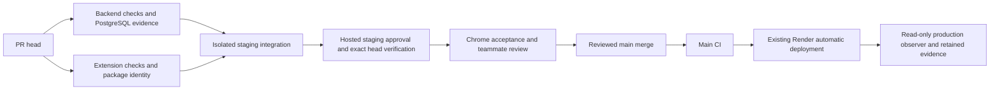
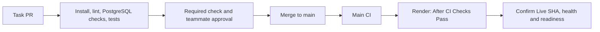

# PhishLens Pipeline

## Main and stage observation — October 28, 2026

Observed at 2026-10-28 15:39 UTC: GitHub `main` pointed to
[`6414914dfa8eb8322839597c4cd6912145a442a0`](https://github.com/kendshhh/PhishLens/commit/6414914dfa8eb8322839597c4cd6912145a442a0).
Main CI run [40715810349](https://github.com/kendshhh/PhishLens/actions/runs/40715810349)
passed Backend and Extension checks; [Workflow lint run 40715810515](https://github.com/kendshhh/PhishLens/actions/runs/40715810515)
also passed. Render production deployment `dep-dbh18p6i0phs73d1mtag` was live on
that exact SHA. Read-only GET requests to `/version`, `/health`, and `/ready` each
returned HTTP 200; `/version` reported that SHA and `production`, `/health`
reported `ok`, and `/ready` reported the database connected. This is a dated
observation, not a claim about later `main` commits.

The staging service has auto-deploy off and is selected by exact commit from the
hosted workflow. Staging deployment and guarded CRUD records in
[staging.md](docs/devops/staging.md) are commit-specific; verify the recorded SHA
before reusing them as current evidence. The 2026-10-28 15:43 UTC read found
staging live on `57da457be77fcf7a132e3a5e2f0d704c676040d6`; its endpoints were
healthy, but that SHA diverges from current main and PR #86 head. The last exact
staging CRUD result is from a deactivated earlier SHA, so current candidate CRUD
acceptance remains pending.

PR CI installs locked dependencies, runs backend and extension quality gates,
requires disposable PostgreSQL CRUD tests, performs isolated API/client integration,
and verifies the exact hosted staging target. Main CI runs backend and extension
checks before Render's `checksPass` auto-deploy. Chrome acceptance and production
CRUD persistence remain separate evidence items.

Draft PRs skip the hosted staging deployment. Main pushes skip PR-only staging
jobs; production follows the existing after-checks auto-deploy. The shared staging
queue is serialized and deployment approval still applies. Package identity does
not establish installed Chrome acceptance.

## PostgreSQL evidence gate (#38, closed)

Before migrations, `python scripts/ci_backend.py --check-environment` requires the
explicit local disposable PostgreSQL service URL, `RUN_DATABASE_TESTS=1` and
`AI_MODE=mock`. Missing configuration cannot fall back to a hosted `.env` target.
Existing migration/repeated seed, lint/build, extension and AI mocked tests remain.

`python scripts/ci_backend.py` runs the complete backend suite and retains fresh
JUnit XML plus a SHA-labeled JSON summary as `Backend-Test-Evidence`, including
when pytest fails. Missing, skipped or failed expected seed/relationship and
HTTP/PostgreSQL tests fail the job. An unrelated passing client test cannot
substitute for these tests. Missing reports fail the gate. Earlier job failures
can produce no report; artifact upload warns in that case and cannot make CI pass.

The report gate requires the real PostgreSQL history and saved-analysis CRUD test
IDs listed in `scripts/ci_backend.py`. Missing, skipped, or failing IDs fail the
job. PR #80 added persistent create/read/list/update/delete and failure-path
coverage. This verifies the disposable CI database; it does not by itself establish
live Chrome behavior or production record persistence.

## Status

## Current checks and evidence

The DevOps Secretary workflows in `.github/workflows/secretary-*.yml` separate
trusted evidence reporting, exact-SHA staging deployment, and read-only production
observation. They do not approve, merge, write fixes, change secrets, or roll back.
See [the operator guide](docs/devops/secretary.md),
[course mapping](docs/devops/secretary-course.md), and
[verification guide](docs/devops/secretary-verification.md).

`Hosted staging` requires the protected `staging` environment and the isolated
Neon `pr-58-staging` target. The controller checks target identities without
logging credentials. The environment owner must still verify the database branch
mapping and app-role privileges in Render/Neon. Chrome and real-provider acceptance
remain manual evidence items. See [staging.md](docs/devops/staging.md).

The [October 28 backlog audit](docs/devops/backlog-audit-2026-10-28.md) maps the
open assigned issues to implementation, evidence, and team-owned acceptance gates.

The historical snapshots below predate these changes. In current source,
extension packaging and mocked AI/provider tests already exist; statements below
that call them pending are historical, not a claim about current CI coverage.

Pre-merge staging is added in `.github/workflows/ci.yml`: component checks,
isolated API/database/extension-client integration, then exact-commit Render
staging verification. Hosted staging requires credentials for the dedicated
Neon `pr-58-staging` branch and database `phishlens_dev`, plus a GitHub deployment
secret. Privately verify Render's Neon branch mapping before migrations or writes.
See
[staging setup and verification](docs/devops/staging.md) for configuration,
required checks, Chrome verification, and current rollout status. Historical
observations below do not establish that the new hosted staging gate has passed.

Historical baseline notes:

Backend scaffold CI and automatic deployment are implemented and verified.

GitHub Actions installs dependencies, checks compatibility,
lints Python, tests /health, and checks Python compilation.

Render deploys main automatically after CI checks pass.
Automatic deployment was verified for commit 8a8634e,
followed by a successful public /health check.

PostgreSQL migration, repeatable seed, seed integrity and readiness-response tests
are implemented. The extension and AI status in that historical snapshot is not
the current CI status.
Compilation is basic validation, not the
complete application build stage.

## Delivery Flow

Task branch → Pull request → Automated checks → Staging integration and hosted verification → Chrome verification and teammate approval
→ Merge to main → Automated checks → Automatic deployment
→ Deployed verification

## Workflow Triggers

The diagram describes current delivery. CI validates and packages the extension;
installed Chrome behavior and real-provider AI remain separate acceptance checks.

Workflow file: .github/workflows/ci.yml

- Every pull request triggers backend checks.
- Every push to main, including a merged PR, triggers backend checks.
- Render deploys changes to main after CI checks pass.

The workflow uses Python 3.12 on an Ubuntu runner.
Render is configured to use Python 3.12.10.

## Implemented Backend Checks

| Stage | Purpose | Command |
|---|---|---|
| Install runtime dependencies | Install pinned application packages | python -m pip install -r backend/requirements.txt |
| Install development dependencies | Install pinned checking tools | python -m pip install -r backend/requirements-dev.txt |
| Dependency compatibility | Detect incompatible installed dependencies | python -m pip check |
| Lint | Check backend Python code | python -m ruff check backend |
| Migrate twice | Verify versioned schema application and repeat execution | python -m alembic -c backend/alembic.ini upgrade head (run twice) |
| Seed twice | Insert synthetic demo records and verify repeat execution | python scripts/seed_demo.py (run twice) |
| Tests | Verify health, readiness responses, seeded records and relationship | python -m pytest backend/tests -q -p no:cacheprovider |
| Compilation | Check Python source compilation | python -m compileall -q backend/app |

Commands run from the repository root.

Disabling pytest's cache avoids a local cache-permission issue.
It does not disable tests or suppress test failures.

A failed command fails the job. Errors must not be suppressed
to produce a misleading successful run.

## Coverage Still Needed

- Install and render the exact staging package in Chrome.
- Verify production saved-record persistence across refresh or a safe redeploy.
- Run the planned real-provider evaluation and scheduled smoke separately from mock CI.
- Select and measure another safe whole-job optimization; the npm download-cache
  trial did not improve Extension checks and was removed.

Regular AI tests should use mocked inference without model downloads.
Successful actual-model calls must be recorded separately.

## Deployment

- Backend host: Render.
- Instance plan: Free.
- Service: phishlens-api.
- Deployment branch: main.
- Root directory: repository root; the field is blank.
- Python version: 3.12.10.
- Auto-Deploy: After CI Checks Pass.
- Public URL: https://phishlens-api-ocvt.onrender.com
- Health check path: /health.

Build command:

    python -m pip install -r backend/requirements.txt

Start command:

    python -m uvicorn backend.app.main:app --host 0.0.0.0 --port $PORT

Render supplies PORT at runtime.

Automatic deployment was verified after PR #12 merged:
commit 8a8634e became Live without a manual deployment trigger.

Public /health returned:

    {"status":"ok","service":"phishlens-api"}

This verifies the API process only.
It does not establish database, frontend, or AI integration.

## Merge Protections

Historical setup evidence showed main requiring:

- A pull request.
- At least one teammate approval.
- Passing Backend checks from GitHub Actions.
- Resolved review conversations.

Stale approvals are dismissed after new commits.
Administrator bypass, force pushes, and branch deletion are disabled.

Review enforcement was observed on setup PR #2, and Backend checks plus teammate
approval were verified on PR #11. Current effective rules were not independently
read during this audit; verify them in GitHub before treating the historical list
as the current protection state.

## Database Connections

The selected database is PostgreSQL hosted on Neon.

- Production branch: production.
- Development branch: development.
- Hosted staging branch: `pr-58-staging`.
- Region: AWS Asia Pacific 1 (Singapore).
- Databases observed: neondb and phishlens_dev. The migrated demo database is
  phishlens_dev; confirm the Neon branch rather than infer it from the name.
- Local `DATABASE_URL`: read by the application, Alembic and seed. Use only the
  development target for local work.
- Hosted staging `DATABASE_URL`: restricted app role for API requests and seed.
- Hosted staging `STAGING_MIGRATION_DATABASE_URL`: separate migration role used
  only for startup migrations; see [staging.md](docs/devops/staging.md).

Use the intended branch and database for every operation. `.env.example` omits
hosted secrets and contains no unused `MIGRATION_DATABASE_URL` placeholder. Driver:
psycopg; URL normalization is implemented in backend/core/config.py.

Routine CI database checks use an isolated PostgreSQL 17 test database.
Ordinary PR checks must not use production Neon credentials.

CI verifies PostgreSQL migrations, repeatable seed, seed integrity, and saved CRUD
on disposable PostgreSQL. Production `/ready` returned HTTP 200 with a connected
database on October 28; this is a `SELECT 1`, not proof of production record
persistence or Chrome behavior.

## Secrets

- Local credentials belong in ignored .env files.
- .env.example contains configuration placeholders only.
- Deployment secrets belong in the host or CI secret store.
- Development and production use separate configuration.
- Database credentials and backend secrets must never be
  included in the Chrome extension.
- Private emails and datasets must not enter Git.

## Verified Evidence

- [October 28 main CI run](https://github.com/kendshhh/PhishLens/actions/runs/40715810349)
- [October 28 Workflow lint run](https://github.com/kendshhh/PhishLens/actions/runs/40715810515)
- Main SHA `6414914dfa8eb8322839597c4cd6912145a442a0` live in Render deployment `dep-dbh18p6i0phs73d1mtag`; `/version`, `/health`, and `/ready` returned HTTP 200 at 2026-10-28 15:39 UTC.
- [October 28 backlog audit](docs/devops/backlog-audit-2026-10-28.md)

- [Backend scaffold PR #11](https://github.com/kendshhh/PhishLens/pull/11)
- [Runbook PR #12](https://github.com/kendshhh/PhishLens/pull/12)
- [Intentional failing CI run](https://github.com/kendshhh/PhishLens/actions/runs/38430884810)
- [Repaired passing CI run](https://github.com/kendshhh/PhishLens/actions/runs/38431990720)
- [Runbook PR CI run](https://github.com/kendshhh/PhishLens/actions/runs/38501111554)
- [Public health endpoint](https://phishlens-api-ocvt.onrender.com/health)

The intentional failure changed the expected HTTP status from
200 to 201. Restoring 200 produced passing CI.

Recorded deployment observations:
- First deployment: commit 717334d; 50.3 seconds.
- Automatic deployment: commit 8a8634e; 44.9 seconds.
- Public health response verified after automatic deployment.

Deployment duration is not complete merge-to-live lead time.
These observations do not prove an optimization trend.

## Documentation and Remaining Verification

See [metrics.md](docs/devops/metrics.md) for dated measurements and
[runbook.md](docs/devops/runbook.md) for delivery and recovery steps. Remaining
evidence includes installed-Chrome behavior, production persistence after refresh
or redeploy, controlled optimization results, full restoration duration, and the
real-provider evaluation. Unknown measurements remain marked unknown.

## Database verification and current CI coverage

CI starts isolated PostgreSQL 17, applies migrations twice, seeds twice, and
asserts the fixed demo records and user relationship. Readiness success/failure
responses are tested with mocks. Public /ready independently returned HTTP 200
and database connected; that is a real deployed SELECT 1, not a schema or
frontend integration test. Production/environment selection is configured in
Render, not inferred from the endpoint response.

The measured snapshot contains 23 backend jobs, 20 passing and 3 failing
(including two deliberate drills). See [CI run evidence](docs/devops/ci-run-evidence.csv)
for source timestamps.
No optimization claim is made from changing durations or changing CI coverage.
