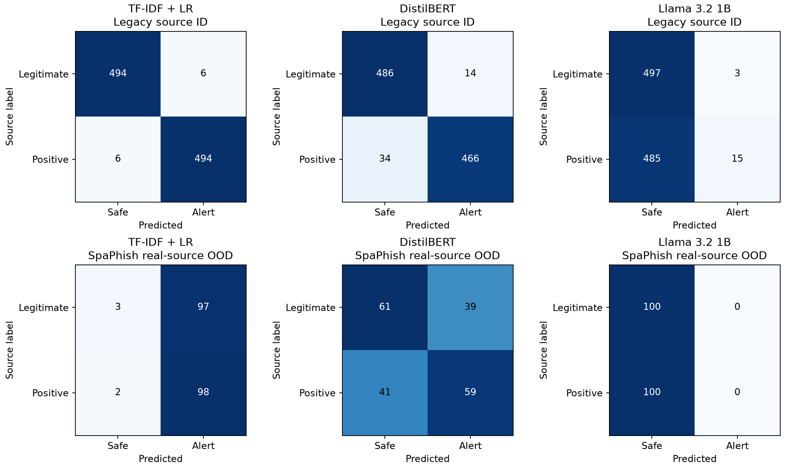
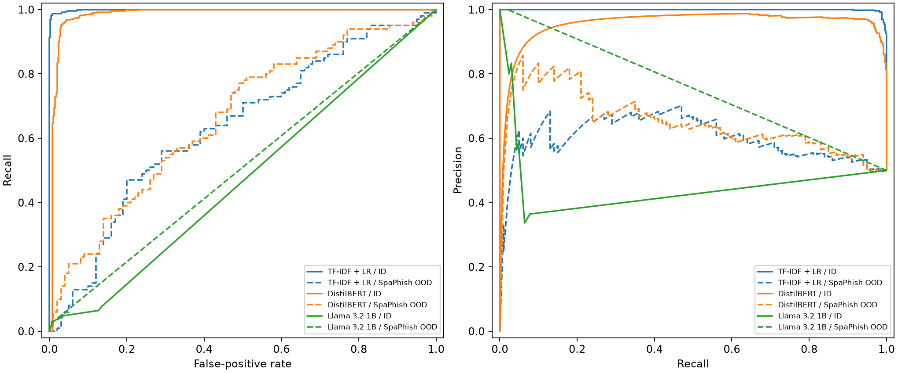
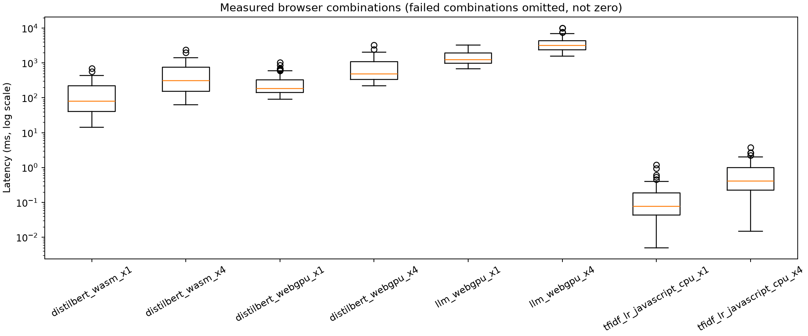
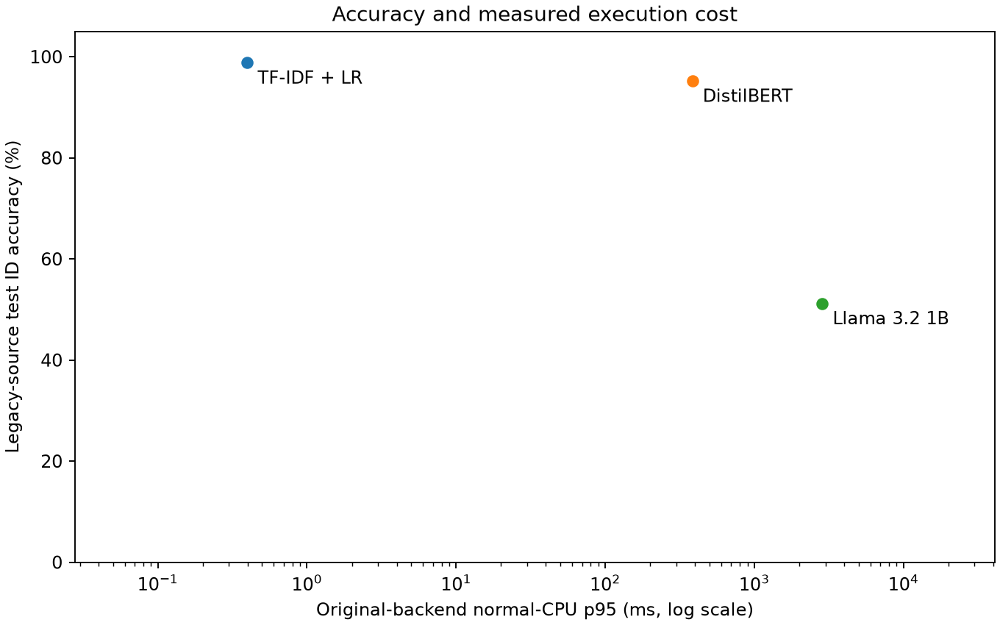
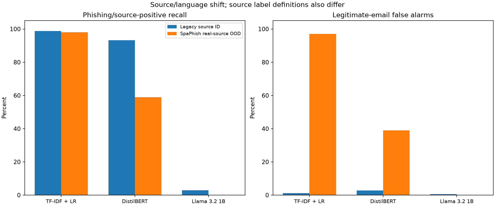

# Real-source benchmark follow-up

**No synthetic email dataset, generated variant, translated message, or instantiated template was used in this follow-up.** The historical pilot remains separate. This report reuses its already-scored real legacy-source test and adds a frozen real-source SpaPhish challenge.

## What was measured

- Training: the original 55,233 grouped real-source Kaggle messages; no retraining.
- Validation: the original 2,000 real-source messages, including 1,000 legitimate messages. Thresholds stay fixed at the original 2% empirical validation FPR target.
- Test ID: the original 1,000 held-out real-source emails, using saved predictions once, without rescoring.
- The source was originally grouped into 70/15/15 train/validation/test pools. The saved pilot then sampled whole groups from the validation and test pools to reduce runtime; 2,000 and 1,000 are the evaluated subsets, not the full 15% pools.
- External challenge: 200 SpaPhish messages, 100 per publisher class, in 199 duplicate groups. The publisher describes a Spanish collection, with some English/mixed-text cases observed. No language filter or translation was applied. Publisher-expert labels are 0 legitimate / 1 phishing.
- The source release contains 1,395 collected, publisher-anonymized messages. Shared preparation retained 1,393 after removing two exact duplicate inputs. The publisher replaced identifying details; this is disclosed real-source anonymization, not a claim of untouched raw captures.
- Shared truncation cut 27/200 challenge inputs. Every model receives the same subject/body text and first-2000/last-300 rule. Human justifications and label/metadata columns never enter model input.

## Main results

| Model | Legacy ID recall | Legacy ID FPR | SpaPhish real OOD recall | SpaPhish real OOD FPR | OOD valid output | OOD ECE |
|---|---:|---:|---:|---:|---:|---:|
| TF-IDF + LR | 98.8% | 1.2% | 98.0% | 97.0% | 100.0% | 0.391 |
| DistilBERT | 93.2% | 2.8% | 59.0% | 39.0% | 100.0% | 0.466 |
| Llama 3.2 1B | 3.0% | 0.6% | 0.0% | 0.0% | 39.5% | 0.493 |

**Read recall together with false alarms.** The baseline catches 98/100 source-positive challenge messages but flags 97/100 legitimate messages, giving only 50.5% accuracy. DistilBERT catches 59/100 positives and falsely flags 39/100 legitimate messages (60% accuracy). The LLM issues no alerts at its frozen threshold, missing all 100 positives; its zero FPR does not establish useful protection.

For the LLM, 121/200 outputs are invalid: 65 label/confidence disagreements and 56 unterminated JSON strings, all of the latter also hitting the 128-token cap. The 79 valid scores comprise 77 zeros, one 0.5 and one 0.8; the validation tie rule requires strictly above 0.8. See [the detailed error reading](error_analysis.md) and [output failure counts](output_failure_audit.json). No output was repaired or threshold lowered after testing.

All classification confidence intervals, other requested metrics, source-topic FPR checks and curve coordinates are in [Graph.csv](Graph.csv). The original class/group bootstrap is retained (2,000 replicates, seed 42). Zero-event bootstrap intervals may collapse; absence of an observed error is not proof of zero risk. Small legitimate-topic slices additionally show exact binomial intervals, with their independence assumption. Balanced-test precision is not real-inbox precision. ECE is calculated from raw scores. A score multiplied by 100 can be displayed as a model risk score, but these poorly calibrated challenge results do not justify interpreting it as an established real-inbox probability.

## Labels, verdicts and the frozen alert levels

For SpaPhish, 0 means publisher-annotated legitimate communication and 1 means publisher-annotated phishing. The older Kaggle positive class includes spam/fraud beyond strict phishing, so it is called source-positive where that distinction matters. The baseline learns those older binary labels. DistilBERT phishing risk sums the upstream phishing-class probabilities at indices 1 and 3; legitimate indices are 0 and 2. The LLM has no native phishing head: its frozen prompt defines label 0/1 and confidence as probability of phishing. An alert requires a valid output at or above the validation-selected threshold. Invalid output is safe/p=0 and reduces valid-output rate.

| Model | Primary threshold | Achieved validation FPR | Secondary 0.5%-target threshold | Achieved secondary validation FPR |
|---|---:|---:|---:|---:|
| TF-IDF + LR | 0.51855326429291304 | 2.00% | 0.72848537039451011 | 0.50% |
| DistilBERT | 0.99977416464072144 | 2.00% | 0.99996269548256922 | 0.50% |
| Llama 3.2 1B | 0.80000000000000016 | 0.50% | 0.80000000000000016 | 0.50% |

The primary 2% target alone determines the gates and reported test operating points. The secondary threshold is preserved validation-only calibration information; no deployment wording or additional successful test claim is implied. A threshold can lie just above a tied score, as for the LLM at 0.8.

## Interpretation and decision

**No model is a fully qualified winner under the original framework.** Original cutoffs and weights were copied before new inference. Known failed gates remain failures, while the absent validated adversarial holdout prevents a full robustness score. The source/language and source-label differences mean observed drops cannot be attributed to model architecture alone.

| Model | Gate outcome | Failed measured gates | Missing gate evidence |
|---|---|---|---|
| TF-IDF + LR | fail | test_ood_fpr, ece_worst_measured_test | test_adv_fpr |
| DistilBERT | fail | test_ood_fpr, test_ood_recall, ece_worst_measured_test, p95_ms_worst_required_browser_case, cold_start_ms_worst_required_browser_case | test_adv_fpr |
| Llama 3.2 1B | fail | test_id_recall, test_ood_recall, ece_worst_measured_test, valid_output_rate_worst_measured_test, p95_ms_worst_required_browser_case, cold_start_ms_worst_required_browser_case, consistency | test_adv_fpr |

Survivor-only weighted ranking and +/-10-point weight sensitivity are not applicable because there are no fully qualified survivors. Missing adversarial balanced accuracy was not invented or replaced with synthetic data. The original exact McNemar/Holm comparison of the same cached test_id predictions is retained in [comparisons.json](comparisons.json); duplicate/campaign dependence limits its interpretation.

## Browser measurements

| Model / requested backend | CPU slowdown | Status | p95 ms | Worst cold start ms |
|---|---:|---|---:|---:|
| DistilBERT / wasm | 1x | measured | 384.17 | 1104.63 |
| DistilBERT / wasm | 4x | measured | 1296.04 | 3142.03 |
| DistilBERT / webgpu | 1x | measured | 608.24 | 1075.76 |
| DistilBERT / webgpu | 4x | measured | 1726.68 | 3875.91 |
| Llama 3.2 1B / wasm | 1x | timeout_incomplete |  |  |
| Llama 3.2 1B / wasm | 4x | timeout_incomplete |  |  |
| Llama 3.2 1B / webgpu | 1x | measured | 2855.96 | 4510.39 |
| Llama 3.2 1B / webgpu | 4x | measured | 6946.82 | 16496.05 |
| TF-IDF + LR / javascript_cpu | 1x | measured | 0.40 | 240.91 |
| TF-IDF + LR / javascript_cpu | 4x | measured | 1.85 | 534.88 |

Measured cases use 10 discarded warmups, 100 timed real validation emails and three fresh-page cold loads, in local Chrome with performance.now(). CPU throttling is applied by CDP before page loading. It does not reproduce a slower GPU or guarantee the same slowdown for workers. Cold measurements can retain OS/driver/shader caches. Common runtime loading can penalize the small baseline. JS heap excludes WASM/GPU allocations. Source HTML/PII ingestion is offline; common whitespace/truncation and tokenization remain inside model timing. Threshold application, strict server-side JSON validation and HTTP logging are outside the inference timer. The browser schema decoder is inside generation. Runtime errors and timeouts remain explicit failures/incomplete evidence, rather than fast zero-ms measurements. Both LLM/WASM probes exceeded the predefined 30-second first-validation-message cap; no 100-email WASM timing is claimed. Every measured combination received a separate, consistent three-trial cold-start collection without the CPU-control diagnostic; original cold readings and inference latency samples remain preserved. Model size is the pinned artifact size; loopback transfer includes runtime and is not Internet download time. End-to-end extension/cascade latency remains unmeasured.

## Legitimate controls and adversarial coverage

The selected challenge contains six source-labeled legitimate bank/payment-topic messages and three OTP-topic messages; they may overlap. Topic flags never assign the binary label. These are Spanish text slices with publisher truth, not independently authenticated bank-origin records. Their false-positive counts are useful diagnostics but too small for a general bank/OTP safety claim. TF-IDF flags 6/6 bank/payment and 2/3 OTP controls; DistilBERT flags 5/6 and 2/3; the LLM flags 0/6 and 0/3 while also missing every challenge phishing message. Exact intervals and the urgency slice are in Graph.csv.

The inspected Phishing Pot and cw-l sources do not establish a complete publisher-labeled adversarial email holdout with the requested technique coverage and matched controls. HTML-only structure, urgency and unusual Unicode were not redefined as verified adversarial truth. test_adv remains not assessed. The supplied homograph URL archive is not represented as an email dataset.

One source-positive message naturally contains 102 soft-hyphen characters (U+00AD), including within a brand name. The baseline and DistilBERT alert on this saved case; the LLM returns invalid output and therefore safe. This is a documented post-hoc real obfuscation case study, not an independent adversarial holdout or an adversarial false-positive estimate. See the exact case and limits in error_analysis.md.

## Why each step was used

The prospective [protocol](../protocol.md) explains all fourteen steps and their reasons; [source qualification](source_qualification.md) records admission and exclusions. In particular: publisher licensing/provenance supports defensible reuse; source-label verification avoids treating spam-folder membership as phishing truth; common preprocessing and frozen thresholds prevent unequal treatment or test tuning; group-aware sampling and confidence intervals account for repeated text; backend/throttle measurements test compatibility and execution cost; hard gates prevent a high weighted score from hiding a required failure.

The first shared-passage check stopped preparation. All eight candidate pairs were then verified as standard confidentiality-footer matches between unrelated Python mailing-list messages and a Spanish course-scheduling message. No message was removed and no matching threshold was relaxed. The failed attempt and specific pre-inference resolution are preserved in preparation_attempt_001.json and lineage_review.json. There are zero exact or >=90% lexical near matches across the full real training-source corpus and candidate. This does not prove campaign independence or absence from neural pretraining.

The README describes a semicolon delimiter, while the checksum-verified v5 CSV uses commas. All 47 schema fields and the stated class counts were checked against the actual release.

## Explanations and human review

A fresh real-only review selected 30 of 30 borderline messages: 14 have explanation text and 16 have no usable explanation. There are 30/30 submitted review decisions: 14 explanations have all three numerical scores, 16 missing explanations are recorded, and 0 decisions remain pending. No earlier synthetic-sample rating was transferred. The [submitted rating summary](human_review/summary.md) preserves original scores and notes; the [review form](human_review/review_form.html) contains the imported answers. Missing output is excluded from numerical quality averages and reported separately. A nonempty reason and valid JSON do not establish explanation quality.

| Submitted human dimension | Overall mean / 5 | Rated explanations | Legacy-source subset mean / 5 | Subset rated explanations |
|---|---:|---:|---:|---:|
| Correctness | 2.00 | 14 | 1.91 | 11 |
| Grounding | 2.07 | 14 | 1.91 | 11 |
| Helpfulness | 2.00 | 14 | 1.82 | 11 |

The submitter states that they do not read Spanish and expects English explanations. Correctness and grounding ratings on Spanish or mixed-language SpaPhish messages do not establish Spanish semantic explanation quality. Preserve those answers as submitted user impressions. The legacy-source subset is shown separately and is primarily English. Source subsets are descriptive and do not constitute a newly randomized review or independent expert validation.

The overall means retain all submitted scores, including three scored SpaPhish examples with Spanish/mixed source text. They are descriptive submitted impressions, not validated Spanish semantic-quality estimates. The legacy subset contains 11 scored explanations and is primarily English. One submitted note explicitly reports a non-English response. The user expects English explanations. The frozen prompt did not explicitly require English, so this is documented as an English-user usability limitation without adding a retrospective gate or changing the saved outputs. No independent second reviewer or inter-rater agreement was collected, and no AI scores replace human judgments.

## Status

| Work | Status |
|---|---|
| Real source download, license/schema/labels and whole-source overlap audit | Complete |
| Real-only challenge, shared input and locked thresholds | Complete |
| Three-model cached ID and single new OOD scored passes | Complete |
| Browser backend/4x attempts, latency, cold start, memory and sizes | Measured where supported; explicit error/timeout records elsewhere |
| Gates, Graph.csv, charts and run provenance | Complete; no fully qualified winner |
| Real adversarial email gate | Not assessed: qualifying evidence unavailable |
| Bank/payment and OTP text controls | Small real-source slices evaluated; broad bank safety unestablished |
| New real-only human explanation review | 30/30 decisions recorded; 14 explanations scored; Spanish semantic quality not validated |

## Charts from Graph.csv

Each chart is rendered from the saved CSV. Classification charts use the original primary thresholds or saved score curves; timing charts use measured browser samples.

## Sources and limits

SpaPhish: Bustio-Martinez et al., [Mendeley release v5](https://data.mendeley.com/datasets/hz2d6gz7pc/5), DOI 10.17632/hz2d6gz7pc.5, CC BY 4.0. Changes: shared text cleaning, identifier masking, deduplication, group sampling and declared truncation. Original messages are collected real-source, with publisher anonymization. Legacy corpus: [Al-Subaiey et al. 2024](https://arxiv.org/abs/2405.11619v1), [Phish No More dataset](https://doi.org/10.34740/kaggle/ds/5074342). Its positive labels include spam/fraud beyond strict phishing. Pinned model identities, label mappings, versions, hardware, hashes and prompt are in run_record.json.

Results apply to these sources, this prompt/adapter and this computer. They do not establish unbiased sampling of real inboxes, English-to-Spanish task equivalence, bank authenticity, real-campaign adversarial resistance, or a 2% deployment false-positive guarantee. The team retains the final model choice. Built with Llama; preserve the Llama 3.2 Community License and downloaded attribution notices.
