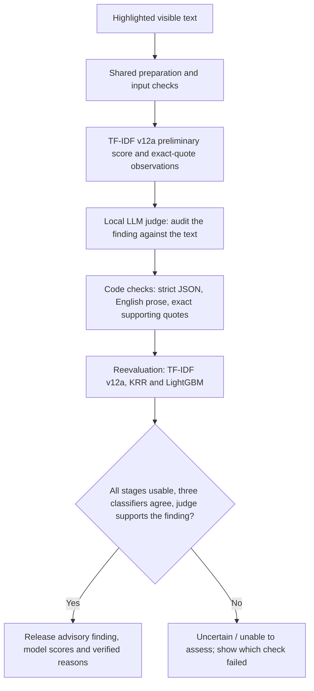

# Live per-scan judge and reevaluation — proposed v13 protocol

**Superseded as a benchmark plan:** the owner subsequently directed product
implementation, with no new benchmark. The actual implementation and software
verification are documented in `docs/ai/live-workflow.md`. Reserved/final cohorts
were not opened. This proposal is retained as planning history, not a claim of
completed new evaluation or an additional required approval.

Date: 29 October 2026, Asia/Manila.

The owner confirmed that every scan should run the full teacher-suggested
workflow, and that KRR means Kernel Ridge Regression. This proposal extends the
already implemented TF-IDF v12a pilot. It needs approval under the original
"Plan first ... wait for my approval" instruction before new training/scoring.
It does not reinterpret the existing v12a measurements as ensemble results.

## What a user scan will do



Every scan follows these stages, including low-scoring selections. No shortcut
skips the LLM. Processing remains local in Chrome. Initial TF-IDF output is
labelled preliminary until the final release gate finishes. An unavailable GPU,
missing model, timeout, invalid JSON or unsupported quote cannot become a
successful reviewed verdict. There is one judge call, no unbounded retry loop.

The original selected text is prepared once. All learned classifiers use the
same frozen TF-IDF representation; the judge's generated wording is never
appended to the email or used to rewrite the labels. The final reevaluation
stage receives the verified audit along with the classifier decisions. The
TF-IDF value can be reused byte-for-byte rather than recomputed unnecessarily.

## Exact model proposal

| Component | Proposed implementation | Why |
|---|---|---|
| Primary TF-IDF | Existing word+character LR C=1; SHA-256 `a2f13c256dd46c3267263f8de8f4f822206c5b0ceda96658713e2523a7f9559c` | Preserve the tested primary decision and comparison baseline |
| LLM judge | `onnx-community/Llama-3.2-1B-Instruct-ONNX`, revision `14007543b6dc92de88daf96a9aa85d2f95ace6ef`, existing `onnx/model_q4f16.onnx` artifact plus recorded dependencies | Verified existing local candidate; its new judge role still requires evaluation |
| KRR | Linear-kernel ridge regression, alpha=1, targets 0/1, zero intercept. Fit through the equivalent sparse primal ridge solve; verify against explicit linear-kernel KRR on small software fixtures | Avoid a full training-size squared kernel matrix and export a small weight vector |
| LightGBM | Binary classifier; 100 trees, max depth=3, 7 leaves, learning rate=0.05, min child samples=30, seed42, one CPU thread, no stochastic subsampling | Bounded training/runtime; adds nonlinear feature interactions |

Linear-kernel KRR is a deliberate, explicit kernel choice. It is not RBF KRR or
a claim to have trained another neural model. Its equivalence to the primal
ridge solve will be checked numerically, including sample weighting. If it does
not match, training/export stops rather than relabelling another algorithm KRR.
If sample-weighted equivalence is not implemented, use unweighted KRR and record
that difference; never silently claim source weighting was applied.

The LLM is a general instruct model, not a downloaded phishing classifier with
intrinsic phishing labels. Its schema defines the audit labels. Historical
Llama classifier failures remain visible and are a reason to measure this new
role carefully, not evidence that the judge already works reliably.

Judge generation: one frozen English prompt; temperature0, runtime seed42 where
supported, maximum128 new tokens, maximum1024 total input tokens including the
prompt and rule findings. The prompt must not silently truncate the shared
2,300-character email: if it cannot fit the complete input, return Uncertain.
Any runtime that cannot honor a requested seed records that limitation.

Judge output:

```json
{
  "audit": "supported",
  "evidence": [{"quote": "exact phrase from the prepared email", "reason": "One complete English sentence."}],
  "missing_context": false
}
```

`audit` is `supported`, `unsupported` or `uncertain`. These are audit decisions,
not human ground truth. At most two quotes; quote length<=160 and reason<=240.
Reject missing/extra keys, nonfinite values, invalid enum types, non-English
explanatory prose, unsupported quotes and incomplete output. Email quotes keep
their original language; generated prose must be English. No LLM-generated
confidence is presented as a calibrated phishing probability.

## Final release rule, frozen before evaluation

1. The primary v12a decision stays `raw_margin >=0`; displayed threshold88.71%.
2. KRR and LightGBM each receive a validation-only sigmoid score mapping and a
   separately selected alert cutoff with empirical validation FPR<=2%.
3. Release a reviewed advisory verdict only when all three classifier decisions
   agree, the judge returns `supported`, at least one exact audit quote passes,
   and every output satisfies its schema. Otherwise show Uncertain with the
   available observations and the disagreement/failure reason.
4. Show the original v12a research score and individually labelled reevaluator
   scores. Do not invent a mean "ensemble risk probability" or call agreement
   proof of authenticity. Below threshold never authenticates an email.

This unanimity policy may lower coverage and recall. Uncertain/unusable output
is counted as no alert for the original fail-open accuracy accounting, not
removed from the denominator. Report overall metrics, reviewed-result coverage,
and metrics conditional on coverage separately. A high score among released
answers alone is not a pass.

## Data and measurement protocol

Use only the already admitted nonsynthetic v12 data, subject to a new hash,
role-exposure and group-leakage audit. Existing v12a weights are not retrained.
Fit the two new evaluators on the 27,391 training/development records only.
Use the existing600 calibration records to fit their score mappings and the
existing1,100 threshold records (1,000 ham) to choose cutoffs. Judge prompt
development uses validation inputs only; few-shot examples, if needed, come
from training. No synthetic mail or AI label replaces primary source labels.

The old1,200-message final cohort is already exposed. It must not be used as a
fresh test or to choose this new pipeline. Audit the previously reserved364
records (201+163) before opening them. Their eligibility is conditional on no
intervening exposure and no group overlap; do not assume that their filenames
prove freshness. If admitted, freeze the combined system first and score that
reserve once, reporting its small size and source limitations. If not admitted,
stop confirmatory scoring and report the missing evidence. No pass is promised.

Metrics: confusion counts, recall, FPR, precision, F1, MCC, ROC/PR-AUC where a
defined continuous score exists, ECE of each calibrated classifier, group
bootstrap95% intervals, judge schema/quote validity, release coverage,
disagreement rate, timeouts and five-repeat consistency on30 validation inputs.
No ROC or ECE is invented for the non-probabilistic final audit label.

Keep original numerical gates. Measure the primary TF-IDF path against its
100ms/1s/5MB limits separately. Measure the new full LLM-tier workflow against
p95<=5s, cold readiness<=15s, required assets<=1.5GB, judge valid output>=99%
and five-repeat consistency>=95%. Report both timing scopes explicitly; the
combined pipeline cannot be advertised as a100ms TF-IDF-only scan. Other
original recall/FPR/ECE requirements remain unchanged. Independent original
OOD/adversarial/bank evidence is still unassessed unless actually admitted.

Chrome measurements discard10 warmups, time100 validation inputs, report
p50/p95/p99, cold readiness, memory where measurable, bytes, normal/4x conditions
and backend. No Python/Node timing substitutes for these measurements. Any
WASM/WebGPU unsupported cell is recorded as unsupported, not passed.

## Implementation stages and checks

1. **Admission and freeze:** create `benchmarks/live_judge_ensemble_v13/` with
   `config.yaml`, `tests/`, `scripts/`, `results/`. Save source/model/config/prompt
   hashes, role/exposure audit, versions and seeds. Stop on leakage.
2. **Train/export two evaluators:** fit frozen configurations; export numeric
   KRR weights and bounded LightGBM tree JSON. Verify Python/browser margins,
   scores, thresholds and class-label mappings on development/validation only.
   Do not download or invent pretrained KRR/LightGBM model IDs.
3. **Judge and orchestrator:** package executable JS/WASM locally; load pinned
   weights with integrity checks in a managed offscreen document/worker so the
   popup closing does not kill the job. Do not fetch remote executable code.
   Cache weights and show readiness/download progress without uploading email.
   Declare the offscreen permission and required CSP changes explicitly.
4. **Contributor integration:** retain newest-scan/Clear behavior, explicit
   report-upload consent, persistent idempotency keys, validated saved CRUD and
   independent refresh handling. Store per-stage versions/status/provenance.
   A saved report must preserve its actual full-workflow status; server-only
   TF-IDF replay cannot be presented as a completed LLM/ensemble review.
5. **Verification:** unit/contract and prompt-injection-as-data cases, English
   prose/quote checks, cancellation, popup reopening, timeouts, GPU absence,
   corrupt assets, malformed outputs, save retries and installed Chrome. Pure
   software fixtures are clearly separate from nonsynthetic benchmark data.
6. **Frozen evaluation and GitHub:** score only admitted reserve once; save CSV,
   charts, failure analysis and run record. Update from main, resolve conflicts
   without replacing contributor work, open a draft PR and inspect Actions on
   the actual head/merge revision. No auto-merge or deployment. Missing or failed
   checks remain explicit. Approval-service availability is required for Git
   operations currently outside the sandbox.

Stages1–6 are proposed together, conditional on data/model admission. Training
and new evaluation begin only after approval of this written protocol. The
already tested v12a integration remains separately reviewable.

## Sources checked for feasibility

- [scikit-learn KernelRidge](https://scikit-learn.org/stable/modules/generated/sklearn.kernel_ridge.KernelRidge.html): kernel ridge combines squared-error fitting and L2 regularization; kernel choice and non-probability outputs must be explicit.
- [LightGBM Python API](https://lightgbm.readthedocs.io/en/stable/Python-API.html): actual trainable binary classifier and exportable booster, not a pretrained phishing model.
- [Pinned Llama ONNX repository](https://huggingface.co/onnx-community/Llama-3.2-1B-Instruct-ONNX/tree/14007543b6dc92de88daf96a9aa85d2f95ace6ef): model ID, revision and Llama3.2 licensing are real; verify every required artifact and existing local hash before use.
- [Transformers.js WebGPU guide](https://huggingface.co/docs/transformers.js/en/guides/webgpu): local accelerated inference is feasible but browser/device support is conditional.
- [Chrome offscreen API](https://developer.chrome.com/docs/extensions/reference/api/offscreen): a bundled offscreen page can manage work independently of popup lifetime, using explicit permission and runtime messaging.

The architecture, limits and release policy above are engineering proposals;
these sources do not establish that this ensemble will improve phishing recall,
reduce bias or pass the gates. Those require recorded measurements.
