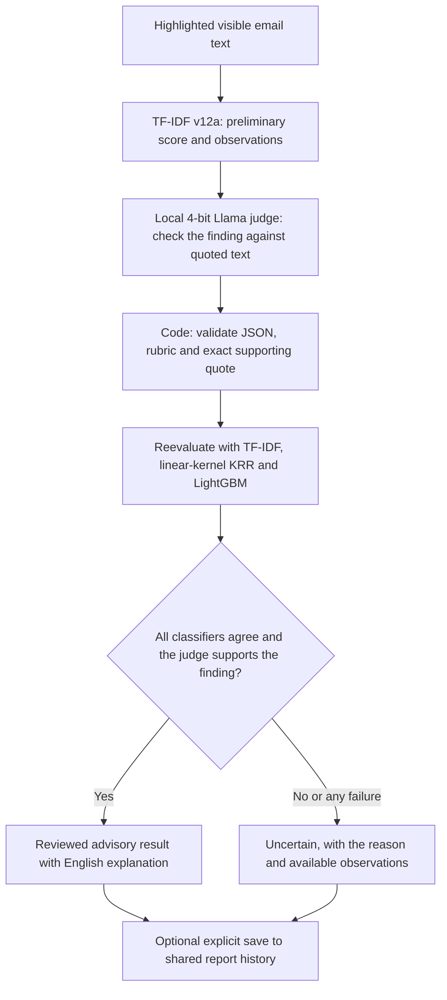

# Live AI workflow

This is the product implementation requested on 29 October 2026. It is separate
from the preserved TF-IDF benchmark; no final or reserved test emails were opened.



Every valid scan runs the LLM judge and all three classifier checks. The primary
TF-IDF value is reused during reevaluation because recomputing the same
deterministic model would add no new evidence. The LLM's generated wording never
becomes classifier input or a replacement ground-truth label.

## Run it

Use this branch's checkout. The current laptop already has the verified weights
provisioned under the ignored `extension/model-assets/` folder.

```powershell
npm run doctor
npm run phishlens -- setup-models
```

On another developer machine, install the exact public weights once:

```powershell
npm run phishlens -- setup-models --download
```

Then load `extension/` unpacked at `chrome://extensions`, highlight visible email
text, and choose **Analyze selection with PhishLens**. The download/setup command
does not send email. Chrome inference loads only packaged local code and weights.

The LLM requires WebGPU with shader-f16 support. An unavailable GPU or model
produces Uncertain; it does not silently invoke a cloud model. First use verifies
the weights, loads the engine and compiles GPU kernels. The worker stays warm
between scans and unloads after five idle minutes. Clear cancels an active scan;
closing the popup does not cancel it. A restarted service worker marks interrupted
work explicitly instead of leaving the popup loading forever.

## What each component contributes

| Component | Actual implementation |
|---|---|
| TF-IDF v12a | Existing frozen word+character LR artifact; raw margin cutoff0, displayed cutoff88.71% |
| LLM judge | `onnx-community/Llama-3.2-1B-Instruct-ONNX`, revision `14007543b6dc92de88daf96a9aa85d2f95ace6ef`, q4f16 |
| KRR | Linear-kernel ridge, alpha1, zero intercept; equivalent sparse primal solve verified numerically against explicit KRR |
| LightGBM | Actual LightGBM4.7.0 binary classifier, 100 bounded-depth trees |
| Explanations | Verbatim text observations, partial linear feature effects, LLM-selected audit rubric, and complete English software wording |

The two auxiliary models were fitted on the existing 27,391 admitted training
records. Their probability mappings use the existing 600 calibration records;
cutoffs use the existing 1,100 threshold records, including 1,000 legitimate labels,
with the 2% validation FPR ceiling. This is artifact construction, not a new accuracy
study. Build versions, role hashes and model hashes are in
`implementation/live_review/results/build_record.json`.

The judge emits compact constrained JSON (`r`, `q`) to reduce generated
tokens. Each reason code includes its audit status, avoiding contradictory fields.
Code expands the selected audit and reason codes into complete English.
Supporting quotes are selected from exact supplied spans. JSON/enum validity,
quote existence and audit/reason consistency are checked again before release.
This ensures bounded, readable output; it does not prove that the LLM's judgement
is correct. Temperature0, greedy decoding and seed42 are passed to the runtime.

No averaged "ensemble risk probability" is invented. The UI labels the original
TF-IDF research score and each auxiliary model's own score and threshold. A low
number can still exceed that model's validation-selected threshold. Unanimity
can increase Uncertain outcomes and miss attacks shared by all models. Below
threshold never authenticates the sender, unseen links or attachments.

## Saved reports and contributor integration

Scanning and opening the popup make no API call. Loading history is explicit.
Saving requires an upload checkbox and sends the original selected text only
when the user chooses Save. The matching backend must run `AI_MODE=tfidf`.

The API retains server-owned classification. It recomputes the TF-IDF/KRR/
LightGBM scores and checks the reported quote against its prepared body.
The LLM audit is explicitly stored as **browser-reported**, since the server
does not run that browser's GPU. Client-provided prediction fields remain
forbidden. `review_status` identifies released versus Uncertain full reviews;
legacy `prediction` remains the server's primary classification.

Creation uses the contributors' idempotency and create/detail/history helper.
An uncertain acknowledgement reuses the same request key, including after popup
reopening. A confirmed save remains saved if a subsequent refresh fails.
Notes/feedback/delete retain their API behavior. Feedback does not retrain models.
The shared demo history still has its existing authentication/isolation limits;
only save content authorized for that shared environment.

## Debug and package

Chrome's service-worker and popup consoles are the main debuggers. The helper is
a convenience, not a separate CLI application users must install.

```powershell
npm test
npm run lint
npm run phishlens -- records-check
python scripts/package_extension.py --include-models
```

The full ZIP includes the verified chunked weights and runs offline. A default
CI ZIP contains executable assets and the model manifest but excludes the 1.1 GB
weights; its sidecar explicitly reports that full-workflow weights are absent.
Provision weights before scanning with that developer package. Neither ZIP
contains raw training emails, private review cards or credentials.

The initial 1 GB single-file resource crashed Chrome during verification. Model
data is now split into separately hashed 4 MB resources and streamed to the model
runtime, avoiding that browser-process allocation. The required ONNX asyncify
files are packaged, and model/token/schema failures remain explicit.

The developer-only `phishlensDebug` session flag records extra runtime diagnostics
locally; leave it off when handling private mail. `phishlensDebugFailNext` simulates
one failure for a demo. See [the debugging guide](../TFIDF_DEBUGGING.md).

## Evidence and limits

The implementation result files record software checks, actual local browser
execution, and numerical export parity. See the [recorded checks](live-workflow-verification.md).
Software fixture sentences are test
inputs, not a synthetic accuracy dataset. No accuracy, bias-free certification,
new benchmark pass, human explanation-quality pass or public deployment is
claimed for this combined workflow. Historical benchmark evidence remains in
`benchmark-records/`. First-use and warm software-example times are observations,
not p95 statistics or a promise for another device.

Local database tests need a disposable PostgreSQL instance. The CI acceptance
gate includes saved creation, a fresh-session reread and deletion of the full
review metadata. No existing development, production or staging database is
needed for that test. Hosted configuration is not changed by implementing it.
