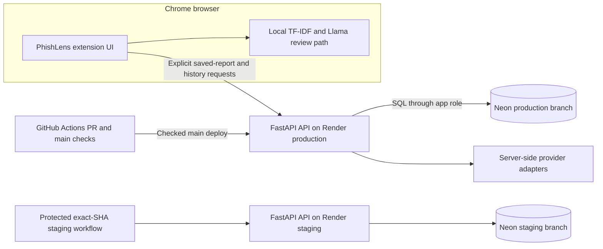
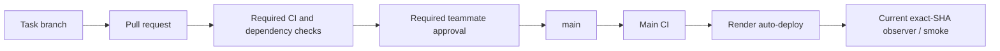

# PhishLens architecture and environment map

This is an architecture snapshot from 2026-11-14, not a claim that every hosted
service uses the described workflow or runs this revision. For the current
staging target and release limits, use the
[#251-based staging release record](devops/release-record-2026-11-22.md).
The [November 21 environment map](devops/environment-map-2026-11-21.md) is a
historical snapshot; its staging target is superseded.

## Staging integration decision — 2026-11-27

The selected staging proposal is the #251-based target carried forward by
[#266](https://github.com/kendshhh/PhishLens/pull/266). PR #251 is in `main`;
the current #266 integration preserves its staging identity. PR #268's
`phishlens-staging` / `staging-root` target and PR #281's combined branch are
separate proposals, not part of this selected integration or its ancestry.
Do not let either proposal replace the #251 mapping without an explicit
selection and new exact-SHA verification. Production remains NO-GO.

## System boundary

The extension runs its primary review locally. It does not connect directly to
PostgreSQL or send a request to a paid provider. Saving or opening shared report
history is an explicit API operation. The API owns persistence and validates or
recomputes the server-owned classification fields. External provider adapters
remain on the server side; the local extension workflow does not silently fall
back to a hosted model.

The backend is one FastAPI service, not a set of independently deployed
microservices. Neon hosts PostgreSQL. GitHub Actions runs pull-request checks and
main checks; Render auto-deploys checked `main`. The staging workflow deploys and
checks an exact candidate SHA under the protected `staging` environment.

## Environment map

| Environment | App / delivery | Database target | Status and boundary |
| --- | --- | --- | --- |
| Local development | Developer checkout; `.env` is ignored | Dedicated local/development target | `.env.example` documents app configuration without real values. Do not use hosted staging or production credentials locally. |
| Staging | Render staging service; GitHub `staging` environment gates hosted workflow | Neon project `ancient-brook-17208049`, branch `br-rough-sea-a1l6ehi1`; PostgreSQL endpoint `ep-winter-wind-a1y2r1db.ap-southeast-1.aws.neon.tech`; app/migration database `phishlens_dev`; Auth database `neondb` | This is the selected #251-based target for the #266 integration; non-secret identities are pinned in `.github/secretary.json`. Prior exact-head verification does not carry to a new head. PR #268's `phishlens-staging` / `staging-root` target and PR #281's combined branch are unselected alternatives. |
| Production | Render API; checked `main` auto-deploy | Neon `production` branch; production database name is `phishlens_dev` in the current read-only inventory | The live Render `DATABASE_URL` mapping was not freshly compared with Neon during this closeout. Verify target before writes or promotion. |

The database name `phishlens_dev` is used on more than one branch. A database
name or healthy readiness response does not uniquely identify a Neon branch.
Keep the target mapping in the host configuration and validate its branch/host
using an authorized read-only check before running a write workflow.

## Delivery path

There is no verified production deployment-ended event or owner-approved
deployment hook for an automatic changed-feature smoke. The last-mile smoke is
therefore tracked separately and is not drawn as an automatic stage. See
[PIPELINE.md](../PIPELINE.md) and the Sprint 1–3 closeout.

## Architecture decision

The recorded decision is [ADR-0001](adr/0001-application-and-deployment-architecture.md).
It records the current implementation choice; it does not assert team or
instructor sign-off that is absent from the source record.
