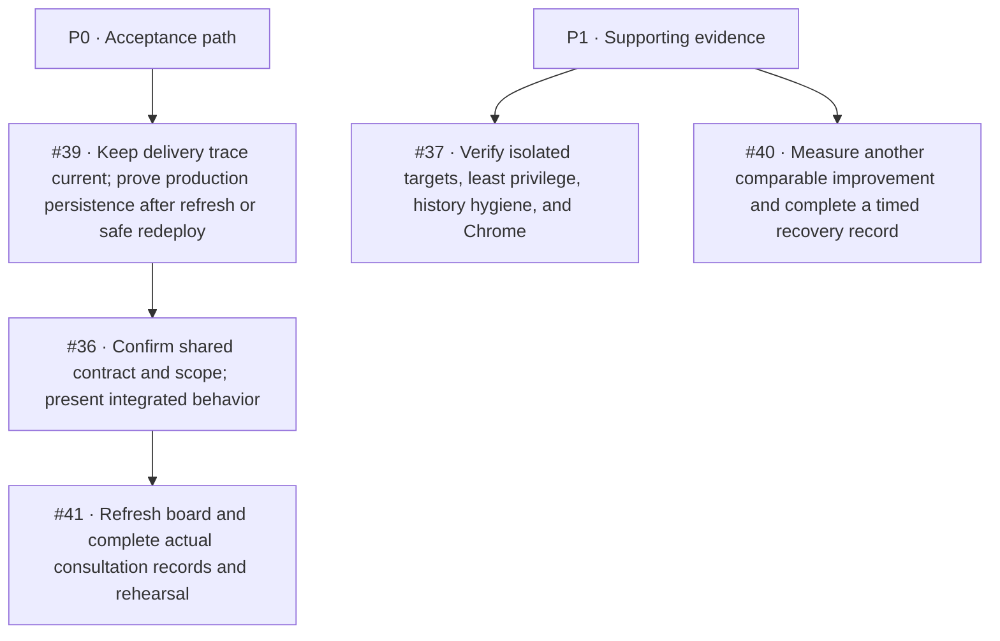

# DevOps backlog audit — October 28, 2026

This audit maps the five currently open issues assigned to Kendra to the verified
course playbooks, the sprint planning sheet, repository state, and live delivery
evidence. It is a work plan and evidence update; it does not close issues or record
team decisions that have not happened.

## Latest refresh — October 28, 2026 17:07 UTC

See the [Kendra Week 1–4 closeout](kendra-week1-4-closeout-2026-10-28.md) for the
current per-day Kendra task map. Since the earlier snapshots below, PR #86's
Hosted staging check passed and its exact merge SHA
`d46cc09ecf7258a6bd10475f00cc8da035ef5e9a` went Live on Render. Read-only
`/version`, `/health`, and `/ready` GETs returned HTTP 200 at 17:07 UTC. The
confirmed Neon branch is `pr-58-staging` / `phishlens_dev`, but a 17:05 UTC
read-only check still found excess schema and table write grants on
`phishlens_staging_app`; no staging or production CRUD write was made.

The old PR #86 head had Dependency Review skipped because the job opted in only
when `DEPENDENCY_REVIEW_ENABLED` was `true`. This branch changes the job to run
by default unless the variable is explicitly `false`; the updated-head check
has not yet run. PR #86 and Kendra's issues #36/#37/#39/#40/#41 remain open; #38
is closed. The project board remains At risk for the open write, browser,
production-persistence, recovery/optimization, real-model, and event/sign-off
gates. Week 4 is still proposed with no agreed dates or dedicated issue set.

## Source of truth

- Official course rubric and consultation guide: [`PhishLens_CI_Understanding_and_Consultation_Guide.pdf`](../../output/pdf/PhishLens_CI_Understanding_and_Consultation_Guide.pdf).
- Verified Week 2 independent-work playbook: [`PhishLens_Week_2_Verified_Independent_Work_Playbook.pdf`](../../output/pdf/PhishLens_Week_2_Verified_Independent_Work_Playbook.pdf).
- Sprint sheet: [Weekly and Daily Sprint Task Plan](https://docs.google.com/spreadsheets/d/18ppxRcZEK6mBNyZMQkZwFTLlmMyS9WHnRRoUKiPCe58/edit?gid=774483955#gid=774483955), including [Daily Tasks](https://docs.google.com/spreadsheets/d/18ppxRcZEK6mBNyZMQkZwFTLlmMyS9WHnRRoUKiPCe58/edit?gid=708811688#gid=708811688) and [Roles & Sources](https://docs.google.com/spreadsheets/d/18ppxRcZEK6mBNyZMQkZwFTLlmMyS9WHnRRoUKiPCe58/edit?gid=1253256473#gid=1253256473).
- Open assigned GitHub issues were queried on October 28: [#36](https://github.com/kendshhh/PhishLens/issues/36), [#37](https://github.com/kendshhh/PhishLens/issues/37), [#39](https://github.com/kendshhh/PhishLens/issues/39), [#40](https://github.com/kendshhh/PhishLens/issues/40), and [#41](https://github.com/kendshhh/PhishLens/issues/41). #38 is closed.
- Repository and hosted evidence at audit start: `main` at `e4ea032615a6663d787a5b44714b5fc982fc6355`; staging CRUD was previously verified on `e3c6e37fd6661aeb582bd000507ef8cac677c23f`. Current main advanced after PR #88 to `6414914dfa8eb8322839597c4cd6912145a442a0`; production and latest staging observations below supersede the earlier snapshots.

The Roles & Sources sheet defines P0 as work required for sprint acceptance and
P1 as supporting work to prioritize after P0. Kendra is the owner for CI/workflows,
quality gates, package/check scripts, environment separation, and delivery
evidence. The Daily Tasks sheet showed W2-D1/W2-D2/W2-D5 and W3-D1 verified or
complete; W2-D3/W2-D4, W3-D2/W3-D3/W3-D5 in progress; W3-D4 and W4-D1/W4-D2 not
started. The sheet says Week 2 evidence was refreshed October 28; treat older week
snapshots as planning records, not fresh verification.

## Delivery evidence checked

| Area | Evidence | What it establishes |
|---|---|---|
| Main CI and production | Current main `6414914dfa8eb8322839597c4cd6912145a442a0`; [Main CI run 40715810349](https://github.com/kendshhh/PhishLens/actions/runs/40715810349) passed Backend and Extension, and [Workflow lint run 40715810515](https://github.com/kendshhh/PhishLens/actions/runs/40715810515) passed. Render deployment `dep-dbh18p6i0phs73d1mtag` is Live on that exact SHA. | At 2026-10-28 15:39 UTC, `/version`, `/health`, and `/ready` returned HTTP 200; `/version` matched this SHA and production, and `/ready` reported the database connected. The deployment ran 73.525 seconds from Render start to finish; this is deployment duration, not merge-to-live time. The 150.607-second merge-to-live sample belongs to the earlier `e4ea032` observation and is not a measurement for this SHA. |
| Hosted staging | PR #86 Hosted staging passed. Render deployment `dep-dbh2cjnf3r2c73emoprg` is Live on exact merge SHA `d46cc09ecf7258a6bd10475f00cc8da035ef5e9a`; read-only `/version`, `/health`, and `/ready` all returned 200 at 17:07 UTC. | This proves the hosted staging gate and connected database for that merge SHA, not mutation acceptance. The mapped Neon target is `pr-58-staging/phishlens_dev`; app-role grants are above minimum. |
| Staging CRUD | Historical guarded CRUD passed on PR #83 SHA `e3c6e37`; that deployment is deactivated. | No CRUD write was run against PR #86. Re-run the guarded verifier only after the environment owner removes the role's extra grants and a read-only least-privilege check passes. Chrome acceptance is also open. |
| Existing CI cache | October 21 pip comparison was n=2 before/n=2 cached: install 9s to 7s, but whole staging job 40.5s to 44s. | No end-to-end pipeline speedup has been demonstrated. |
| Extension npm-cache trial | No-cache runs [40635217771](https://github.com/kendshhh/PhishLens/actions/runs/40635217771) and [40635212213](https://github.com/kendshhh/PhishLens/actions/runs/40635212213) each took 11s. Cold candidate [40638816002](https://github.com/kendshhh/PhishLens/actions/runs/40638816002) took 11s; warm candidate [40639539541](https://github.com/kendshhh/PhishLens/actions/runs/40639539541) took 18s. All passed; `npm ci` was 1–2s and did not get faster on the warm run. | No whole-job improvement was demonstrated in the one cold/one warm sample. The npm cache and instrumentation were removed; #40 remains open for a different comparable optimization and measured recovery. |
| Dependency alerts | GitHub Security listed 18 open Python alerts: 4 critical, 5 high, 4 moderate, 5 low. Local `npm audit --json` found 0 advisories in the JavaScript lockfile. On old head `aa91511`, Dependency Review skipped because its enable flag was unset. This branch changes the advisory job to run by default unless explicitly disabled; updated-head CI remains pending. | PR #86 raises the certifi and filelock minima and refreshes locks to patched versions; they do not affect main until merge. Backend compatibility checks are not an advisory scan. Recheck GitHub Security after merge; alert counts can lag manifest changes. |

## Priority map

| Issue | Sheet/GitHub priority | State at this audit | Next action and completion evidence |
|---|---|---|---|
| [#39 automatic main-to-production CRUD](https://github.com/kendshhh/PhishLens/issues/39) | P0 | Main CI, automatic production deploy, exact-SHA health/readiness, and guarded staging CRUD are verified. The issue's last narrative is stale and cites an older main SHA. No production CRUD write was made. | Refresh the issue's evidence after reviewing this audit. When the integrated UI and an approved synthetic production test target are ready, verify create/update/delete survives refresh or a safe redeploy. Record the exact main SHA and deployment. Do not use real user data. |
| [#36 shared contract and Sprint 2 carryover](https://github.com/kendshhh/PhishLens/issues/36) | P0 | Contract proposals, current interface limits, examples, and carryover are documented. Owner acknowledgement, instructor scope acceptance, shared board update, and integrated product demonstration remain open. | Get the API/client owners to confirm the proposed contract; capture instructor scope decision and board/sprint-log updates; demonstrate the integrated workflow with the live product. Keep proposals labeled until owners accept them. |
| [#41 Consultation 2 preparation](https://github.com/kendshhh/PhishLens/issues/41) | P0 | Requirements and evidence prep is documented. Actual standups, retrospective, whole-team rehearsal, attendance, instructor feedback, live board refresh, and integrated CRUD presentation are not evidenced. | Record real events only: two or three async standups, one retrospective, decisions/attendance, each member's technical explanation, instructor feedback, and resulting board/replan. Use the current production/staging evidence in the rehearsal. |
| [#37 environment and package verification](https://github.com/kendshhh/PhishLens/issues/37) | P1 | Render mapping remains `pr-58-staging/phishlens_dev`, with `APP_ENV=staging` and mock AI mode. PR #86's exact merge SHA is Live and its read-only endpoints passed. At 17:05 UTC, `phishlens_staging_app` still had public schema CREATE and DELETE/INSERT/REFERENCES/SELECT/TRIGGER/TRUNCATE/UPDATE on `alembic_version`, `analyzed_emails`, and `users`, beyond the documented runtime minimum. Installed-Chrome acceptance remains open. Existing public Git history includes author metadata not in GitHub's noreply form; the owner must classify it against the privacy criterion; the address is intentionally not copied here. | Have the environment owner remove unnecessary runtime grants and repeat the same read-only check. After it passes, run the guarded synthetic staging CRUD and install the exact matching ZIP in Chrome; record SHA, behavior, errors, and permissions. Complete history/package classification without rewriting shared published history. |
| [#40 optimization and recovery](https://github.com/kendshhh/PhishLens/issues/40) | P1 | The October 14 planned rollback drill restored the prior release in 35.7 seconds, but the restoration attempt timed out and the exact full recovery duration is unknown; see `incidents.md`. The separate October 21 staging migration failure was repaired in 9m09, not as a controlled drill. The October cache samples showed no whole-job gain and the extension cache was removed. | Measure a different comparable improvement with unchanged meaningful coverage. For the next necessary safe recovery, record full restoration time and known-good app/schema compatibility; do not run a production failure drill just to fill a metric. |
| [#38 disposable PostgreSQL CI gate](https://github.com/kendshhh/PhishLens/issues/38) | P0, closed | Closed. Main pipeline runs disposable PostgreSQL migration, seed, and saved-CRUD checks. | No backlog action. Reopen only if the gate regresses or scope changes. |

## Official rubric crosswalk

The guide's weighted categories sum to 100 points. The mapping below records the
evidence status, not a grade claim.

| Rubric area | Weight | Current evidence and remaining gap |
|---|---:|---|
| Pipeline design | 15 | Current stage map, CI, hosted staging, main deployment, and runbook are documented. A read-only GitHub branch-protection request returned 403 (`Resource not accessible by integration`), so current rule enforcement still needs an owner-side check. |
| Automation and quality gates | 10 | Disposable PostgreSQL CRUD, extension checks/package identity, integration, and hosted staging gates exist. Current main CI passed. |
| Measured optimization | 20 | Pip cache comparison shows no end-to-end improvement. The npm-cache trial also showed no whole-job gain and was removed. A different comparable optimization remains open. |
| Environment and secrets | 10 | Local, staging, and production boundaries are documented; values were not read. Exact staging target mapping and app-role least privilege remain owner verification items; history hygiene needs a complete current audit. |
| AI pipeline | 10 | Mock-provider checks are suitable for ordinary CI. Real-provider evaluation and scheduled smoke evidence remain separate work. |
| Release and rollback | 10 | Checked-main automatic delivery and a safe recovery procedure are documented. Full restoration duration and current schema/app compatibility evidence remain incomplete. |
| Incident handling | 10 | Existing incident evidence is retained; no new incident was invented. Keep the incident record factual and add a postmortem only for a real event. |
| Metrics and documentation | 10 | October 28 current main deploy, endpoint status/timing, staging identity drift, historical CRUD scope, and cache trial evidence is recorded in `metrics.md`, `staging.md`, and `optimizations.md`. |
| Live performance | 5 | A read-only `n=5` client-round-trip timing sample for `/health` and `/ready` is recorded in `metrics.md`; all returned 200. It is a smoke baseline, not user-flow latency, server processing time, throughput, or load evidence. |

## Work completed in this audit branch

- Refreshed `README.md` and `PIPELINE.md` to describe Sprint 2 integration and the
  current separation between API CRUD, staging, Chrome, production persistence,
  and real-AI acceptance.
- Reduced `.env.example` to local application settings plus hosted secret names;
  did not read or copy hosted values.
- Compared cold and warm npm-cache runs against the no-cache baseline. No
  whole-job gain was demonstrated, so the cache and instrumentation were removed
  while preserving `npm ci` and every extension check.
- Preserved and included the existing Secretary workflow/report edits that
  repair the workflow-contract failures observed on the first PR run.
- In this PR branch, raised the direct certifi minimum to the safe release floor
  and the AI-only filelock minimum to its patched floor. Generated locks resolve
  to certifi 2026.10.23 and filelock 4.2.4. These fixes are not on main until
  merge; recheck the dependency graph afterward.
- Confirmed the other open AI package advisories refer to versions below current
  main pins; keep the 18-alert aggregate visible until GitHub recomputes status.

Security sources: [certifi advisory GHSA-6q48-6c7w-9gw2](https://github.com/advisories/GHSA-6q48-6c7w-9gw2), [filelock advisory GHSA-v4x8-3wr5-3wq8](https://github.com/advisories/GHSA-v4x8-3wr5-3wq8), [certifi 2026.10.23 on PyPI](https://pypi.org/project/certifi/2026.10.23/), and [filelock 4.2.4 on PyPI](https://pypi.org/project/filelock/4.2.4/).
- Updated pipeline, staging, metrics, optimization, runbook, and CI-maintenance
  evidence with current main/staging observations, endpoint timing, and the
  read-only app-role grant review.
- Updated Kendra's Week 1–3 Daily Tasks evidence notes in the shared sheet,
  preserving completion states except W3-D4, which moved from Not started to
  In progress after mapping the historical October 14 rollback drill. Week 4
  remains a proposed, date-unconfirmed plan.
- Did not change GitHub issue statuses, protected environment settings, Neon
  database roles, production/staging rows, or team-event records.
