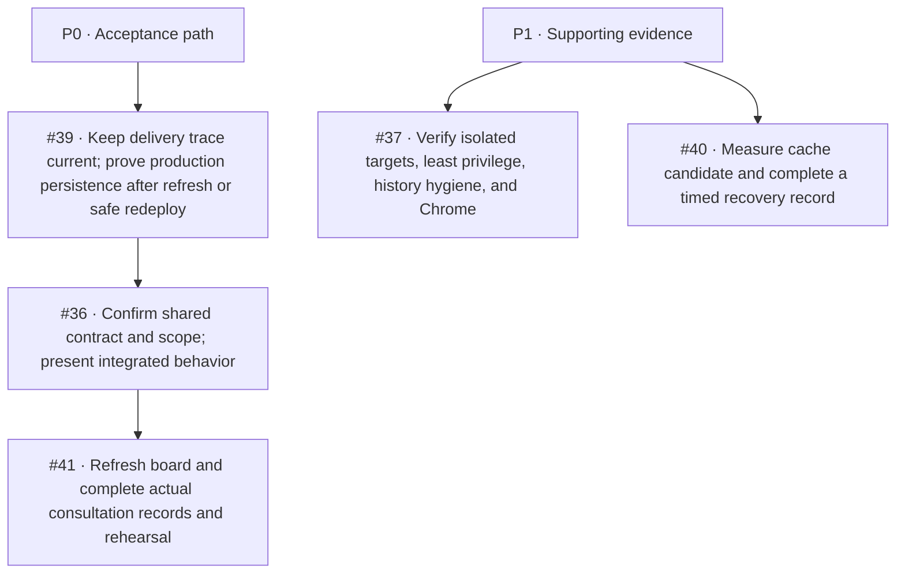

# DevOps backlog audit — October 28, 2026

This audit maps the five currently open issues assigned to Kendra to the verified
course playbooks, the sprint planning sheet, repository state, and live delivery
evidence. It is a work plan and evidence update; it does not close issues or record
team decisions that have not happened.

## Source of truth

- Official course rubric and consultation guide: [`PhishLens_CI_Understanding_and_Consultation_Guide.pdf`](../../output/pdf/PhishLens_CI_Understanding_and_Consultation_Guide.pdf).
- Verified Week 2 independent-work playbook: [`PhishLens_Week_2_Verified_Independent_Work_Playbook.pdf`](../../output/pdf/PhishLens_Week_2_Verified_Independent_Work_Playbook.pdf).
- Sprint sheet: [Weekly and Daily Sprint Task Plan](https://docs.google.com/spreadsheets/d/18ppxRcZEK6mBNyZMQkZwFTLlmMyS9WHnRRoUKiPCe58/edit?gid=774483955#gid=774483955), including [Daily Tasks](https://docs.google.com/spreadsheets/d/18ppxRcZEK6mBNyZMQkZwFTLlmMyS9WHnRRoUKiPCe58/edit?gid=708811688#gid=708811688) and [Roles & Sources](https://docs.google.com/spreadsheets/d/18ppxRcZEK6mBNyZMQkZwFTLlmMyS9WHnRRoUKiPCe58/edit?gid=1253256473#gid=1253256473).
- Open assigned GitHub issues were queried on October 28: [#36](https://github.com/kendshhh/PhishLens/issues/36), [#37](https://github.com/kendshhh/PhishLens/issues/37), [#39](https://github.com/kendshhh/PhishLens/issues/39), [#40](https://github.com/kendshhh/PhishLens/issues/40), and [#41](https://github.com/kendshhh/PhishLens/issues/41). #38 is closed.
- Repository and hosted evidence: `main` at `e4ea032615a6663d787a5b44714b5fc982fc6355`; staging at `e3c6e37fd6661aeb582bd000507ef8cac677c23f`.

The Roles & Sources sheet defines P0 as work required for sprint acceptance and
P1 as supporting work to prioritize after P0. Kendra is the owner for CI/workflows,
quality gates, package/check scripts, environment separation, and delivery
evidence. The Daily Tasks sheet showed W2-D1/W2-D2/W2-D5 and W3-D1 verified or
complete; W2-D3/W2-D4, W3-D2/W3-D3/W3-D5 in progress; W3-D4 and W4-D1/W4-D2 not
started. The sheet says Week 2 evidence was refreshed October 28; treat older week
snapshots as planning records, not fresh verification.

## Delivery evidence checked

| Area | Evidence | What it establishes |
|---|---|---|
| Main CI and production | [Main CI run 40636853223](https://github.com/kendshhh/PhishLens/actions/runs/40636853223) passed Backend and Extension checks. Render deployment `dep-dbgoa7i9lscs738tse0g` put the same `e4ea032` SHA live. | Automatic checked-main delivery is working. `/version`, `/health`, and `/ready` returned HTTP 200; readiness reported a connected database. One merge-to-live sample is 150.607 seconds. |
| Hosted staging | Deployment `dep-dbgo3v49v7es73b02igg` ran exact SHA `e3c6e37` for PR #83. `/version` identified staging; `/ready` returned HTTP 200. | The staging service is live on the intended deployment SHA. |
| Staging CRUD | `scripts/verify_crud.mjs` passed with staging identity and expected-SHA guards. It created, read/listed, updated, cleared, and deleted one synthetic record and confirmed 404 after deletion. | The staging API and database support the guarded saved-analysis CRUD flow. No production write was made. This is not installed-Chrome or production persistence evidence. |
| Existing CI cache | October 21 pip comparison was n=2 before/n=2 cached: install 9s to 7s, but whole staging job 40.5s to 44s. | No end-to-end pipeline speedup has been demonstrated. |
| Extension cache baseline | [PR #83 run 40635217771](https://github.com/kendshhh/PhishLens/actions/runs/40635217771) and [PR #84 run 40635212213](https://github.com/kendshhh/PhishLens/actions/runs/40635212213) each took 11s for Extension checks; `npm ci` took 1s and 2s at one-second timestamp resolution. Neither used npm cache. | Small, noisy no-cache baseline only. The candidate cache change needs comparable cold and warm runs before it can be called an improvement. |
| Cold npm-cache candidate | [PR #86 run 40638816002](https://github.com/kendshhh/PhishLens/actions/runs/40638816002) passed Extension checks: cache miss, `npm ci` 1s, full job 11s. | Matches the baseline; no improvement is established. Warm sample is still required. |
| Dependency alerts | GitHub's push response reported 18 alerts on default branch: 4 critical, 5 high, 4 moderate, 5 low. Local `npm audit --json` found 0 advisories in the current JavaScript lockfile. | Alert details were not exposed by the connected GitHub read tool. Check each alert in GitHub Security before changing dependency pins; do not infer that npm's result covers other ecosystems. |

## Priority map

| Issue | Sheet/GitHub priority | State at this audit | Next action and completion evidence |
|---|---|---|---|
| [#39 automatic main-to-production CRUD](https://github.com/kendshhh/PhishLens/issues/39) | P0 | Main CI, automatic production deploy, exact-SHA health/readiness, and guarded staging CRUD are verified. The issue's last narrative is stale and cites an older main SHA. No production CRUD write was made. | Refresh the issue's evidence after reviewing this audit. When the integrated UI and an approved synthetic production test target are ready, verify create/update/delete survives refresh or a safe redeploy. Record the exact main SHA and deployment. Do not use real user data. |
| [#36 shared contract and Sprint 2 carryover](https://github.com/kendshhh/PhishLens/issues/36) | P0 | Contract proposals, current interface limits, examples, and carryover are documented. Owner acknowledgement, instructor scope acceptance, shared board update, and integrated product demonstration remain open. | Get the API/client owners to confirm the proposed contract; capture instructor scope decision and board/sprint-log updates; demonstrate the integrated workflow with the live product. Keep proposals labeled until owners accept them. |
| [#41 Consultation 2 preparation](https://github.com/kendshhh/PhishLens/issues/41) | P0 | Requirements and evidence prep is documented. Actual standups, retrospective, whole-team rehearsal, attendance, instructor feedback, live board refresh, and integrated CRUD presentation are not evidenced. | Record real events only: two or three async standups, one retrospective, decisions/attendance, each member's technical explanation, instructor feedback, and resulting board/replan. Use the current production/staging evidence in the rehearsal. |
| [#37 environment and package verification](https://github.com/kendshhh/PhishLens/issues/37) | P1 | Production and staging are separate Neon branches; staging package identity and exact-SHA API smoke are checked. `.env.example` now lists local app settings and hosted secret names only. The configured database host-to-branch mapping and app-role grants could not be read through the connected Neon inspection tools. Installed-Chrome acceptance remains open. Existing public Git history includes commit author metadata that is not in GitHub's noreply form; the owner must classify it against the no-private-email criterion. Its address is intentionally not copied into this report. | Have the environment owner verify staging host-to-branch mapping and least-privilege grants in Neon/Render without sharing credential values. Complete a comprehensive history/package scan and decide the privacy remediation without rewriting shared published history. Install the exact staging ZIP in Chrome and record the SHA, visible workflow, errors, and permissions. |
| [#40 optimization and recovery](https://github.com/kendshhh/PhishLens/issues/40) | P1 | A setup-node npm download-cache candidate and cache-hit summary are on this branch; the prior pip cache had no end-to-end gain. Existing rollback exercise is documented, but full restoration duration remains unknown. | Capture a cold CI run and a warm rerun with unchanged checks, lockfile, and runner; compare full Extension job and `npm ci` duration. Keep the cache only if the whole job improves beyond timing noise. Record full safe recovery/restoration time and compatibility evidence; do not run a production failure drill just to fill a metric. |
| [#38 disposable PostgreSQL CI gate](https://github.com/kendshhh/PhishLens/issues/38) | P0, closed | Closed. Main pipeline runs disposable PostgreSQL migration, seed, and saved-CRUD checks. | No backlog action. Reopen only if the gate regresses or scope changes. |

## Official rubric crosswalk

The guide's weighted categories sum to 100 points. The mapping below records the
evidence status, not a grade claim.

| Rubric area | Weight | Current evidence and remaining gap |
|---|---:|---|
| Pipeline design | 15 | Current stage map, CI, hosted staging, main deployment, and runbook are documented. A read-only GitHub branch-protection request returned 403 (`Resource not accessible by integration`), so current rule enforcement still needs an owner-side check. |
| Automation and quality gates | 10 | Disposable PostgreSQL CRUD, extension checks/package identity, integration, and hosted staging gates exist. Current main CI passed. |
| Measured optimization | 20 | Pip cache comparison shows no end-to-end improvement. Npm cache candidate requires cold/warm full-job samples. |
| Environment and secrets | 10 | Local, staging, and production boundaries are documented; values were not read. Exact staging target mapping and app-role least privilege remain owner verification items; history hygiene needs a complete current audit. |
| AI pipeline | 10 | Mock-provider checks are suitable for ordinary CI. Real-provider evaluation and scheduled smoke evidence remain separate work. |
| Release and rollback | 10 | Checked-main automatic delivery and a safe recovery procedure are documented. Full restoration duration and current schema/app compatibility evidence remain incomplete. |
| Incident handling | 10 | Existing incident evidence is retained; no new incident was invented. Keep the incident record factual and add a postmortem only for a real event. |
| Metrics and documentation | 10 | October 28 merge-to-live, deploy, endpoint, staging CRUD, and cache baseline evidence is recorded in `metrics.md` and `optimizations.md`. |
| Live performance | 5 | Health/readiness and delivery timing are not a user-facing latency/load evaluation. Run the planned live performance check and record sample method and results. |

## Work completed in this audit branch

- Refreshed `README.md` and `PIPELINE.md` to describe Sprint 2 integration and the
  current separation between API CRUD, staging, Chrome, production persistence,
  and real-AI acceptance.
- Reduced `.env.example` to local application settings plus hosted secret names;
  did not read or copy hosted values.
- Added npm cache-hit instrumentation to CI while preserving `npm ci` and all
  extension checks. The change remains a candidate until comparable full-job
  measurements exist.
- Preserved and included the existing Secretary workflow/report edits that
  repair the workflow-contract failures observed on the first PR run.
- Recorded the aggregate default-branch Dependabot count separately from the
  clean JavaScript lockfile audit; alert-level triage remains open.
- Updated pipeline, staging, metrics, optimization, runbook, and CI-maintenance
  evidence with October 28 live results and corrected stale statuses.
- Did not modify shared Sheets, GitHub issues, protected environment settings,
  database roles, production data, or team event records.
