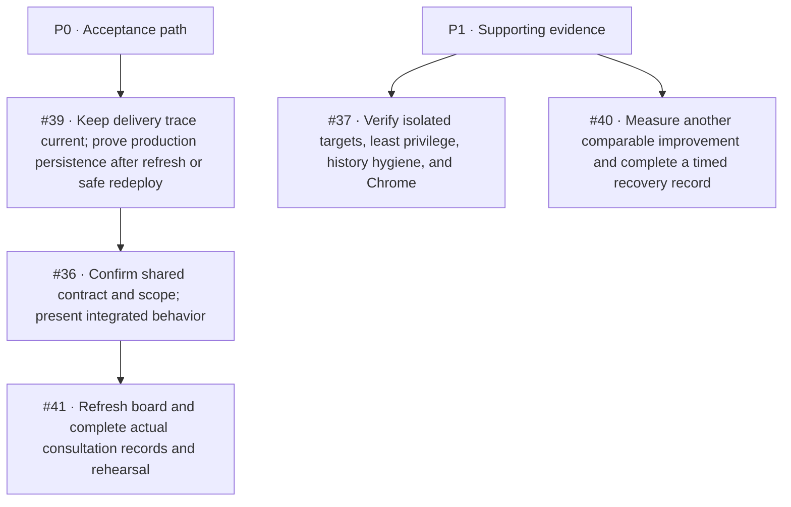

# DevOps backlog audit — October 28, 2026

This audit maps the five currently open issues assigned to Kendra to the verified
course playbooks, the sprint planning sheet, repository state, and live delivery
evidence. It is a work plan and evidence update; it does not close issues or record
team decisions that have not happened.

## Latest refresh — October 29, 2026 00:31 UTC

PR [#86](https://github.com/kendshhh/PhishLens/pull/86) merged at 00:11 UTC
as `1344fcb061272bac93ced5911f1ab8fbb3b6785d`. Production deployment
`dep-dbh8v6ivcj2c73fql7c0` is live on that commit; read-only `/version`,
`/health`, and `/ready` checks passed at 00:31 UTC. Staging deployment
`dep-dbh8s8942hec73bo7bt0` is live on candidate SHA
`fc7db9bf5441af4cd68ec2efbcbc7ac8efdc20a2`; the same endpoints passed and the
database reported connected.

The staging app role on `pr-58-staging/phishlens_dev` no longer owns the tables
or has schema CREATE. It has only CRUD on `users` and `analyzed_emails`, no
access to `alembic_version`, and no extra table privileges. The guarded
exact-SHA staging CRUD verifier passed and removed its synthetic row. Production
remains read-only; its saved-record persistence is still unverified.

Issues #36, #37, #39, #40 and #41 remain open because browser acceptance,
production persistence, measured optimization/recovery, and real team or
instructor evidence remain incomplete; #38 is closed. The board status remains
At risk. Week 4 dates, scope and issue assignments are still not agreed.

## Historical snapshot — October 28, 2026 17:31 UTC

See the [Kendra Week 1–4 closeout](kendra-week1-4-closeout-2026-10-28.md) for the
per-day Kendra task map and dated evidence. At this snapshot, PR #86 head
`dcafd2f539a3dafdc6a3c50e62cc35ae71c24d86` had all automated checks passed
except Hosted staging, pending at the protected `staging` environment; the job
diagnostics exposed no steps or reason. No deployment for this head is claimed.
The previous code head's hosted candidate remains Live on exact merge SHA
`d46cc09ecf7258a6bd10475f00cc8da035ef5e9a`; its 17:07 UTC read-only health
checks do not prove the current head. The confirmed Neon branch is
`pr-58-staging` / `phishlens_dev`, and a 17:05 UTC read-only check still found
excess schema/table write grants on `phishlens_staging_app`. No grants or data
were changed and no staging or production CRUD write was made.

The earlier PR #86 head skipped Dependency Review because the job required an
opt-in variable. This branch runs it by default unless
`DEPENDENCY_REVIEW_ENABLED` is explicitly `false`; the advisory check passed on
both e1333dc and dcafd2f. PR #86 and Kendra's issues #36/#37/#39/#40/#41 remain
open; #38 is closed. The board remains At risk for the open staging, browser,
production-persistence, recovery/optimization, real-model, and event/sign-off
gates. Week 4 is still proposed with no agreed dates or dedicated issue set.

## Pull-request checklist refresh — October 29, 2026

The live repository pull-request index contains 61 PRs: 59 closed and 2 open.
PR [#86](https://github.com/kendshhh/PhishLens/pull/86) merged at 00:11 UTC on
October 29. The two open PRs are [#59](https://github.com/kendshhh/PhishLens/pull/59)
for CRUD screens and [#61](https://github.com/kendshhh/PhishLens/pull/61) for
browser CRUD acceptance. The issue-to-PR checklist for Sprint 2 is maintained
in [week2-finish-checklist.md](week2-finish-checklist.md). The older October 28
snapshot above is retained as history, not current PR status.

The PR merge does not close the related acceptance issues by itself. Current
issue state is #36, #37, #39, #40 and #41 open; #38 closed. UI and browser
acceptance are represented by the two open PRs #59 and #61.

## Source of truth

- Official course rubric and consultation guide: [`PhishLens_CI_Understanding_and_Consultation_Guide.pdf`](../../output/pdf/PhishLens_CI_Understanding_and_Consultation_Guide.pdf).
- Verified Week 2 independent-work playbook: [`PhishLens_Week_2_Verified_Independent_Work_Playbook.pdf`](../../output/pdf/PhishLens_Week_2_Verified_Independent_Work_Playbook.pdf).
- Sprint sheet: [Weekly and Daily Sprint Task Plan](https://docs.google.com/spreadsheets/d/18ppxRcZEK6mBNyZMQkZwFTLlmMyS9WHnRRoUKiPCe58/edit?gid=774483955#gid=774483955), including [Daily Tasks](https://docs.google.com/spreadsheets/d/18ppxRcZEK6mBNyZMQkZwFTLlmMyS9WHnRRoUKiPCe58/edit?gid=708811688#gid=708811688) and [Roles & Sources](https://docs.google.com/spreadsheets/d/18ppxRcZEK6mBNyZMQkZwFTLlmMyS9WHnRRoUKiPCe58/edit?gid=1253256473#gid=1253256473).
- Open assigned GitHub issues were queried on October 28: [#36](https://github.com/kendshhh/PhishLens/issues/36), [#37](https://github.com/kendshhh/PhishLens/issues/37), [#39](https://github.com/kendshhh/PhishLens/issues/39), [#40](https://github.com/kendshhh/PhishLens/issues/40), and [#41](https://github.com/kendshhh/PhishLens/issues/41). #38 is closed.
- The repository-wide PR state and related Sprint 2 issue states were refreshed from GitHub on October 29; see the checklist above and the detailed crosswalk in [week2-finish-checklist.md](week2-finish-checklist.md).
- Repository and hosted evidence at audit start: `main` at `e4ea032615a6663d787a5b44714b5fc982fc6355`; staging CRUD was previously verified on `e3c6e37fd6661aeb582bd000507ef8cac677c23f`. At the October 28 snapshot main was `6414914dfa8eb8322839597c4cd6912145a442a0`; the current post-merge source and deployment evidence is recorded above.

The Roles & Sources sheet defines P0 as work required for sprint acceptance and
P1 as supporting work to prioritize after P0. Kendra is the owner for CI/workflows,
quality gates, package/check scripts, environment separation, and delivery
evidence. The Daily Tasks sheet showed W2-D1/W2-D2/W2-D5 and W3-D1 verified or
complete; W2-D3/W2-D4, W3-D2/W3-D3/W3-D5 in progress; W3-D4 and W4-D1/W4-D2 not
started. The sheet says Week 2 evidence was refreshed October 28; treat older week
snapshots as planning records, not fresh verification.

## Current delivery evidence — October 29, 2026 00:31 UTC

| Area | Current evidence | Remaining limit |
|---|---|---|
| Production | PR #86 merge `1344fcb061272bac93ced5911f1ab8fbb3b6785d`; Render deploy `dep-dbh8v6ivcj2c73fql7c0` Live; `/version`, `/health`, `/ready` returned HTTP 200 and connected readiness. | No production saved-record CRUD write or persistence-through-refresh proof. Production stays read-only. |
| Staging | Render deploy `dep-dbh8s8942hec73bo7bt0` Live on candidate SHA `fc7db9bf5441af4cd68ec2efbcbc7ac8efdc20a2`; all three read-only endpoints returned 200. Neon branch `pr-58-staging` / `phishlens_dev` was privately confirmed. | Installed-Chrome acceptance remains open. PostgreSQL's default TEMP privilege is still inherited from PUBLIC; the database-wide default was not changed. |
| Staging runtime role | Table owners are `neondb_owner`; app role has schema USAGE and only CRUD on `users` and `analyzed_emails`, with no `alembic_version` privileges, schema CREATE, or extra table rights. It cannot create roles/databases, replicate, or bypass RLS. | No `public` sequences exist. No database-wide ACL change was made. |
| Staging CRUD | Guarded verifier passed against the exact live candidate SHA; the synthetic row was created, read/listed, updated, cleared, deleted and confirmed absent. | This does not establish production persistence or installed-browser behavior. |

## Historical delivery evidence checked — October 28 snapshot

| Area | Evidence | What it establishes |
|---|---|---|
| Main CI and production | Current main `6414914dfa8eb8322839597c4cd6912145a442a0`; [Main CI run 40715810349](https://github.com/kendshhh/PhishLens/actions/runs/40715810349) passed Backend and Extension, and [Workflow lint run 40715810515](https://github.com/kendshhh/PhishLens/actions/runs/40715810515) passed. Render deployment `dep-dbh18p6i0phs73d1mtag` is Live on that exact SHA. | At 2026-10-28 15:39 UTC, `/version`, `/health`, and `/ready` returned HTTP 200; `/version` matched this SHA and production, and `/ready` reported the database connected. The deployment ran 73.525 seconds from Render start to finish; this is deployment duration, not merge-to-live time. The 150.607-second merge-to-live sample belongs to the earlier `e4ea032` observation and is not a measurement for this SHA. |
| Hosted staging | The previous PR code head passed Hosted staging; Render deployment `dep-dbh2cjnf3r2c73emoprg` is Live on exact merge SHA `d46cc09ecf7258a6bd10475f00cc8da035ef5e9a`; read-only `/version`, `/health`, and `/ready` returned 200 at 17:07 UTC. | This proves the prior code head's hosted gate and connected database only. PR head `dcafd2f` has its Hosted staging job pending at the protected environment; no current-head deployment or mutation acceptance is claimed. The mapped Neon target is `pr-58-staging/phishlens_dev`; app-role grants remain above minimum. |
| Staging CRUD | Historical guarded CRUD passed on PR #83 SHA `e3c6e37`; that deployment is deactivated. | No CRUD write was run against PR #86. Re-run the guarded verifier only after the environment owner removes the role's extra grants and a read-only least-privilege check passes. Chrome acceptance is also open. |
| Existing CI cache | October 21 pip comparison was n=2 before/n=2 cached: install 9s to 7s, but whole staging job 40.5s to 44s. | No end-to-end pipeline speedup has been demonstrated. |
| Extension npm-cache trial | No-cache runs [40635217771](https://github.com/kendshhh/PhishLens/actions/runs/40635217771) and [40635212213](https://github.com/kendshhh/PhishLens/actions/runs/40635212213) each took 11s. Cold candidate [40638816002](https://github.com/kendshhh/PhishLens/actions/runs/40638816002) took 11s; warm candidate [40639539541](https://github.com/kendshhh/PhishLens/actions/runs/40639539541) took 18s. All passed; `npm ci` was 1–2s and did not get faster on the warm run. | No whole-job improvement was demonstrated in the one cold/one warm sample. The npm cache and instrumentation were removed; #40 remains open for a different comparable optimization and measured recovery. |
| Dependency alerts | GitHub Security listed 18 open Python alerts: 4 critical, 5 high, 4 moderate, 5 low. Local `npm audit --json` found 0 advisories in the JavaScript lockfile. On old head `aa91511`, Dependency Review skipped because its enable flag was unset. This branch runs the advisory job by default unless explicitly disabled; it passed on e1333dc and current snapshot head dcafd2f. Hosted staging remains pending. | PR #86 raises the certifi and filelock minima and refreshes locks to patched versions; they do not affect main until merge. Backend compatibility checks are not an advisory scan. Recheck GitHub Security after merge; alert counts can lag manifest changes. |

## Priority map

| Issue | Sheet/GitHub priority | State at this audit | Next action and completion evidence |
|---|---|---|---|
| [#39 automatic main-to-production CRUD](https://github.com/kendshhh/PhishLens/issues/39) | P0 | PR #86 is merged; production is live on `1344fcb` with read-only health/readiness verified. Staging CRUD passed, but production saved-record persistence is unverified and no production write was made. | Refresh the issue's evidence. When the integrated UI and an approved synthetic production test target are ready, verify create/update/delete survives refresh or a safe redeploy. Record the exact main SHA and deployment. Do not use real user data. |
| [#36 shared contract and Sprint 2 carryover](https://github.com/kendshhh/PhishLens/issues/36) | P0 | Contract proposals, current interface limits, examples, and carryover are documented. Owner acknowledgement, instructor scope acceptance, shared board update, and integrated product demonstration remain open. | Get the API/client owners to confirm the proposed contract; capture instructor scope decision and board/sprint-log updates; demonstrate the integrated workflow with the live product. Keep proposals labeled until owners accept them. |
| [#41 Consultation 2 preparation](https://github.com/kendshhh/PhishLens/issues/41) | P0 | Requirements and evidence prep is documented. Actual standups, retrospective, whole-team rehearsal, attendance, instructor feedback, live board refresh, and integrated CRUD presentation are not evidenced. | Record real events only: two or three async standups, one retrospective, decisions/attendance, each member's technical explanation, instructor feedback, and resulting board/replan. Use the current production/staging evidence in the rehearsal. |
| [#37 environment and package verification](https://github.com/kendshhh/PhishLens/issues/37) | P1 | Staging maps to `pr-58-staging/phishlens_dev`; current candidate `fc7db9b` is Live and healthy. Runtime ownership and grants now meet the documented table/schema limits, and exact-SHA staging CRUD passed. Artifact `12861842602` source SHA and digest are verified; its manifest name is `Veriqo STAGING PR 86` and host permission is staging-only. Installed-Chrome acceptance and remaining privacy/history classification remain open. | Install the exact artifact from workflow run 40736903885 in Chrome; record browser version, manifest identity, permissions, behavior, errors and result. Complete history/package classification without rewriting shared published history. |
| [#40 optimization and recovery](https://github.com/kendshhh/PhishLens/issues/40) | P1 | The October 14 planned rollback drill restored the prior release in 35.7 seconds, but the restoration attempt timed out and the exact full recovery duration is unknown; see `incidents.md`. The separate October 21 staging migration failure was repaired in 9m09, not as a controlled drill. The October cache samples showed no whole-job gain and the extension cache was removed. | Measure a different comparable improvement with unchanged meaningful coverage. For the next necessary safe recovery, record full restoration time and known-good app/schema compatibility; do not run a production failure drill just to fill a metric. |
| [#38 disposable PostgreSQL CI gate](https://github.com/kendshhh/PhishLens/issues/38) | P0, closed | Closed. Main pipeline runs disposable PostgreSQL migration, seed, and saved-CRUD checks. | No backlog action. Reopen only if the gate regresses or scope changes. |

## Official rubric crosswalk

The guide's weighted categories sum to 100 points. The mapping below records the
evidence status, not a grade claim.

| Rubric area | Weight | Current evidence and remaining gap |
|---|---:|---|
| Pipeline design | 15 | Current stage map, CI, hosted staging, main deployment, and runbook are documented. A read-only GitHub branch-protection request returned 403 (`Resource not accessible by integration`), so current rule enforcement still needs an owner-side check. |
| Automation and quality gates | 10 | Disposable PostgreSQL CRUD, extension checks/package identity, integration, and hosted staging gates exist. Current main CI passed. |
| Measured optimization | 20 | Pip cache comparison shows no end-to-end improvement. The npm-cache trial also showed no whole-job gain and was removed. A different comparable optimization remains open. |
| Environment and secrets | 10 | Local, staging, and production boundaries are documented; values were not read. Exact staging target mapping and app-role least privilege remain owner verification items; history hygiene needs a complete current audit. |
| AI pipeline | 10 | Mock-provider checks are suitable for ordinary CI. Real-provider evaluation and scheduled smoke evidence remain separate work. |
| Release and rollback | 10 | Checked-main automatic delivery and a safe recovery procedure are documented. Full restoration duration and current schema/app compatibility evidence remain incomplete. |
| Incident handling | 10 | Existing incident evidence is retained; no new incident was invented. Keep the incident record factual and add a postmortem only for a real event. |
| Metrics and documentation | 10 | October 29 production/staging source and health checks, staging CRUD result, historical endpoint timing, and cache trial evidence is recorded in `metrics.md`, `staging.md`, and `optimizations.md`. |
| Live performance | 5 | A read-only `n=5` client-round-trip timing sample for `/health` and `/ready` is recorded in `metrics.md`; all returned 200. It is a smoke baseline, not user-flow latency, server processing time, throughput, or load evidence. |

## Work completed in this audit branch

- Refreshed `README.md` and `PIPELINE.md` to describe Sprint 2 integration and the
  current separation between API CRUD, staging, Chrome, production persistence,
  and real-AI acceptance.
- Reduced `.env.example` to local application settings plus hosted secret names;
  did not read or copy hosted values.
- Compared cold and warm npm-cache runs against the no-cache baseline. No
  whole-job gain was demonstrated, so the cache and instrumentation were removed
  while preserving `npm ci` and every extension check.
- Preserved and included the existing Secretary workflow/report edits that
  repair the workflow-contract failures observed on the first PR run.
- In this PR branch, raised the direct certifi minimum to the safe release floor
  and the AI-only filelock minimum to its patched floor. Generated locks resolve
  to certifi 2026.10.23 and filelock 4.2.4. These fixes are not on main until
  merge; recheck the dependency graph afterward.
- Confirmed the other open AI package advisories refer to versions below current
  main pins; keep the 18-alert aggregate visible until GitHub recomputes status.

Security sources: [certifi advisory GHSA-6q48-6c7w-9gw2](https://github.com/advisories/GHSA-6q48-6c7w-9gw2), [filelock advisory GHSA-v4x8-3wr5-3wq8](https://github.com/advisories/GHSA-v4x8-3wr5-3wq8), [certifi 2026.10.23 on PyPI](https://pypi.org/project/certifi/2026.10.23/), and [filelock 4.2.4 on PyPI](https://pypi.org/project/filelock/4.2.4/).
- Updated pipeline, staging, metrics, optimization, runbook, and CI-maintenance
  evidence with current main/staging observations, endpoint timing, and the
  read-only app-role grant review.
- Updated Kendra's Week 1–3 Daily Tasks evidence notes in the shared sheet,
  preserving completion states except W3-D4, which moved from Not started to
  In progress after mapping the historical October 14 rollback drill. Week 4
  remains a proposed, date-unconfirmed plan.
- Did not change GitHub issue statuses, protected environment settings, Neon
  database roles, production/staging rows, or team-event records.
