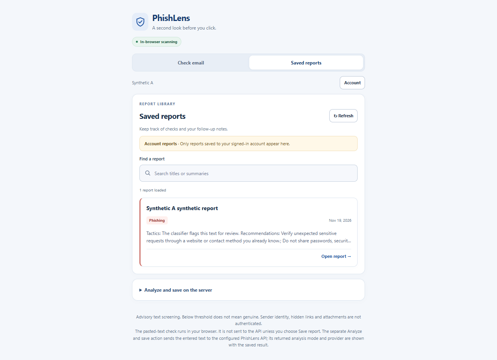

# Sprint 4 web candidate — November 19, 2026

The owner selected the web app from PR #244. The locally tested application
candidate is `ba67296af4023f89145fe2e509371ca6e9084462`, an isolated integration
of main `1805d32395ca6f96d93e41e0997517599919289a`, web #244
`4fddc770f6ccbd0a84384e07eb67de7ed8a65c63`, Auth #235
`af2895e93ce931699386adf823f6768cd5f23913`, backend #107
`cec521fdc8992b248f8fcf730d808f7bf2973e22`, and AI #245
`902bc8ea36a693cf6bed19ca360a6abba6b5a93a`, plus the web integration fix.
This freezes a review candidate; it does not select a live deployment or override
any prerequisite/review hold on those PRs.

## Changes

Public build configuration pairs a fixed environment/API and optional Neon Auth
URL with a full expected backend SHA. Same-origin Vercel Build Output API routes
proxy only saved-analysis endpoints and four diagnostic GETs; cookies are stripped
and responses are not cached. CSP permits only self and the configured Auth origin.
Local preview exercises equivalent routing, but is not proof of Vercel behavior.
See [configuration and hosted gates](../../web-release.md).

Every account CRUD request requires Neon report mode. The server rejects a demo
service mismatch before report database initialization. This prevents a personal
account client from silently writing into the shared demo collection. Persistent
web sign-out storage contains only a boolean; unavailable storage blocks automatic
restoration. Draft/result storage keeps the existing tab-local memory fallback.

## Local verification

Environment: Windows 11 build 26300, Python 3.12.10, Node 24.13.0, npm 11.6.2,
PostgreSQL 17.12, FastAPI 0.163.0, Pydantic 2.14.1, Alembic 1.20.1,
SQLAlchemy 2.1.8, Psycopg 3.3.9, Uvicorn 0.54.0, pytest 9.2.0, Ruff 0.17.0.
Python packages match the current development lock; `npm ci` used the committed lock.

| Command/check | Expected | Observed |
| --- | --- | --- |
| `alembic -c backend/alembic.ini upgrade head`, twice | Four revisions, then no upgrade | Both heads `0004_neon_auth_subject` |
| `python scripts/seed_demo.py`, twice | One unlinked synthetic user and one analysis, no repeat changes | `1/1`, subject `Synthetic account notice`, identical private row fingerprints |
| `pytest backend/tests scripts/tests -q -p no:cacheprovider` with local DB opt-in | Covered contracts pass; fixtures cleaned | 603 passed, 2 explicit opt-in skips, 157 subtests passed; final test DB `0/0` |
| Separate seed-integrity and cleanup opt-ins | Preserve fixed seed and unrelated rows | 2 passed, final seed DB `1/1` |
| `pg_dump -Fc` / `pg_restore --exit-on-error` into a new DB | Same schema head and rows | Head, counts and all row fingerprints match |
| `python -m scripts.verify_client_errors` | Safe six-status errors and manual retries | 409/422/500/502/503/504 passed, eight explicit POSTs, no automatic POST retries or false refresh; DB/provider substitutes |
| Exact AI contract inventory + frozen 40-case development run | All required contracts, valid outputs, no external provider calls | 114 tests + 36 subtests; 40 valid cases, zero provider calls; strict gate passed |
| Archived TF-IDF score replay | Frozen role/prediction hashes and alert decisions match | Six roles, 60 overlap comparisons, 3,600 archived rows; all 1,200 TF-IDF decisions reproduced |
| Ruff backend/secretary, ESLint and manifest validation | Required checks pass | Passed |
| `npm test` | All JavaScript contracts | 318 passed, zero skipped |
| `package_extension.py` + `npm run test:browser` | Shared-client regression against a packaged extension and isolated fixtures | 18 browser checks passed; this remains synthetic extension evidence |

The full suite's two warnings are retained in its local log; skipped opt-ins are
reported separately above. A broader exploratory `ruff check backend scripts`
found 19 pre-existing errors in scripts outside the required backend/secretary
lint scope. They were not silently described as passing or changed for this release.

## Actual local browser/database journey

Installed Microsoft Edge 157.0.4341.60, headless Playwright, loopback preview and
FastAPI, real TF-IDF and PostgreSQL, locally signed EdDSA JWTs. The Auth SDK/provider
and public-key retrieval were explicit test substitutes. No real Neon Auth accounts,
email, OTP, live cookie behavior or shared service were used.

Eight checks passed: local scan with no upload and same-tab reload; server save and
returned model provenance for each of two users; per-user list and foreign
GET/PATCH/DELETE 404s; notes persisted through page reload; failed remote logout
could not restore the account on reload; both reports deleted with final 404s;
and phone layout/visible keyboard focus. Both synthetic application mappings were
removed afterward; final database counts were `0 users / 0 analyses`. All local
servers stopped and temporary password/key/token fixtures were removed.

The [reproduction harness](sprint4-local-harness/README.md) includes the commands,
network assertions and cleanup procedure. The [aggregate JSON](sprint-4-web-candidate-2026-11-19.json)
contains the redacted result. Failed harness attempts and their corrections are
documented; they are not acceptance passes.

## AI provenance and quality disposition

Freeze the **AI candidate**, not a claim of production quality: TF-IDF v12a
`word_plus_char_wb_C1p0`, SHA-256
`a2f13c256dd46c3267263f8de8f4f822206c5b0ceda96658713e2523a7f9559c`.
Attribution, source-rights limits and preprocessing are in the
[model audit](../../ai/sprint-4-release-evidence.md) and
[artifact attribution](../../../extension/ai/ATTRIBUTION.md). No raw mail or private
per-message prediction is redistributed in this closeout.

The historical source-pair cohort hash is
`005a67455b0f31f7f7e59be6b8949bcfd5dadb1a539ba1af8fae8eee5f9e27de`.
Today's replay reproduced TP190/FN10/FP1/TN999; maximum margin delta
`9.77e-15`. This is reproduction of an existing study. The 40 consumed development
cases still detect only 3/16 phishing messages with 1/16 legitimate false alerts.

The [November 18 frozen synthetic diagnostic](../../ai/tfidf-synthetic-diagnostic-2026-11-18.md)
remains **1/12 primary phishing detected, 11 missed**, with 0/12 legitimate and
0/12 spam alerts. It was not rescored, retuned, relabeled or promoted into a new
holdout today. Final independent lock approval remained pending under the recorded
owner exception. Existing larger-source results do not cancel this coverage gap.
The pinned quality protocol requires at least 90% phishing recall, at most 3%
legitimate false positives, valid output for every case and adequate admitted
source/group coverage; the synthetic diagnostic is not a broad quality pass.
Unsupported distribution shift, short text, independent actual mail, real spam
coverage, and human explanation correctness remain explicit. Browser observations
are wording clues; quote grounding does not prove a correct conclusion.

This completes the provenance/reproduction audit work for #132 and #137.
Model-quality approval remains separate in #92/#153; deployment/model pairing in
#147 is still pending. No threshold was relaxed to close an audit.

## Remaining release gates

| Gate | Owner / tracking | Still needed |
| --- | --- | --- |
| Review and agreed candidate | Kendra/reviewers, #143/#153 | Review the consolidated candidate; retain all existing deployment holds |
| Vercel + live Neon Auth | Kendra/Leyan, #140/#145/#150 | Existing account/project/domain, authenticated Vercel access, exact trusted web origin, verified Render/Neon mapping/mode and idle window; complete real bounded Auth/report acceptance and cleanup |
| Backend deployment/recovery | Kendra/Trixia, #144/#148 | Exact deployed SHA, compatible schema/data baseline, save/reload/redeploy evidence and measured recovery; local dump/restore is not hosted recovery |
| AI on deployment and quality | EnviousCoal, #92/#147/#153 | Deployed model/save provenance and an honest quality decision; current source-pair success is scoped |
| Actual presentation/process | Actual participants, #148/#149/#150/#152 | Dated attendance, decisions, presentation/Q&A and retrospective evidence from people who took part |

Vercel CLI 66.2.0 reported logged out. GitHub project access is also not established
with the existing EnviousCoal token's `repo/gist/workflow` scopes. No other GitHub
account or connector was used. No shared HTTP request, startup, configuration,
deployment, Auth origin change or production operation was performed. Sprint 4
cannot be marked fully Done while these release gates remain open.
