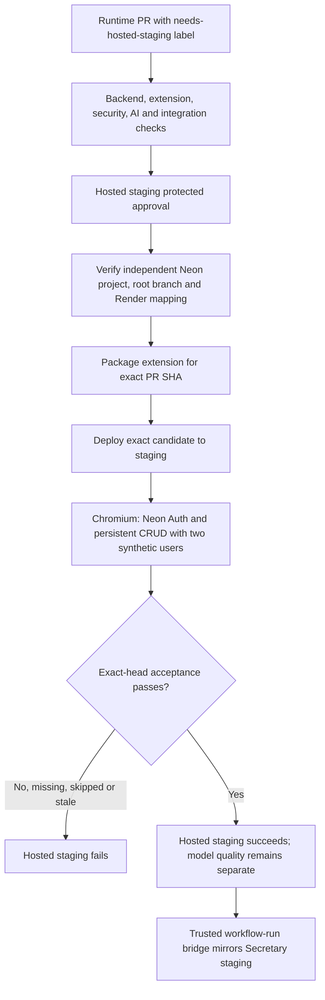

# PhishLens staging and release gates

> Architecture and rollout design reference. For the current controller observation and staging/Auth gaps, see [Secretary verification](secretary-verification.md) and the [DevOps evidence index](README.md). Treat workflow and Render settings in this guide as design assumptions unless a current control-plane observation confirms them.

This is a reporting-only pilot for Veriqo in the existing `kendshhh/PhishLens` repository. The source repository still uses the PhishLens name. Start with [the rollout checklist](secretary-verification.md) and [course mapping](secretary-course.md).

**Candidate state on 2026-11-22:** the authenticated acceptance and release-promotion path is being reconciled on a review branch. It is not active on `main`; no live acceptance run is claimed here. Keep issue #153 at **NO-GO**.

## PR acceptance flow

The required `Hosted staging` check fails closed. It verifies sign-in, saved
report create/list/read/update/delete, persistence after reload, user isolation,
ownership rejection, cleanup, anonymous-history rejection, and loading/success/
authentication/API/timeout states through the exact packaged extension and
candidate backend. The browser test uses two dedicated synthetic accounts and
blocks production and unexpected external origins. It does not use mocks for
the persistent product path. A skipped, missing, failed, or stale Hosted staging
job cannot produce a green `Secretary staging` status for a runtime change.

Product acceptance and model quality are separate decisions. The PR product path
may record CRUD acceptance while explicitly reporting `model_quality=blocked`
and `release_decision=no-go`. A release candidate additionally requires the
AI/model owner's reviewed policy and held-out evaluation report, an active
provider, and measured results meeting the approved thresholds. The policy in
`release-quality-policy.json` is pending approval; its proposed floors are not
approved evidence.

## Required isolation setup

Do not use the current `pr-58-staging` branch, a child of production, or the
restored production snapshot for hosted acceptance. Before enabling the protected
staging run, an administrator must provision and privately verify:

1. A **separate Neon project** from production, with an independent root branch
   initialized with schema only, current migrations, Neon Auth, and no production
   product rows. The workflow checks project/branch IDs, root status, endpoint
   identity, and required attestations before deployment or writes.
2. A Render staging runtime and migration URL mapped only to that project and
   branch, with separate non-owner application and migration roles. Record the
   exact staging and production project IDs, branch IDs, and hosts in protected
   GitHub environment variables; do not put database URLs or credentials in the
   repository or evidence.
3. Two dedicated empty synthetic Auth accounts and the candidate extension's
   trusted `chrome-extension://` origin. Configure the protected `staging`
   environment with reviewers and prevent self-review where available.
4. Set `SECRETARY_PREVIEW_ENABLED=true` only after the database, Render/Auth
   mapping, secrets, and protected environment are verified. A missing value,
   the existing shared/development branch, or an unverified mapping must leave
   the acceptance check red before deployment.

The browser acceptance performs test writes only after these preflights. It
deletes its own synthetic records and never reads or writes production data.
Staging artifacts contain SHA-bound, redacted evidence; credentials, email
addresses, bearer tokens, and report bodies are excluded.

## Required-status transition

`Secretary staging` is a stable required context. The PR's new
`secretary-preview.yml` is a trusted `workflow_run` bridge: it checks out only
default-branch code, reads the completed current CI run, and writes the status
only if the same current PR head passed the required CI jobs and Hosted staging.
It has no Render, Neon, or deployment credentials. A genuine documentation-only
PR can receive a successful not-applicable status after ordinary CI passes.

GitHub runs `workflow_run` workflow definitions from the default branch. Thus the
new bridge cannot replace the installed controller until a reviewed change is
on `main`; this PR does not write a status manually or bypass the existing
required-review/staging rules. The separate required `Hosted staging` job is the
PR's direct authenticated acceptance gate. Keep the `Secretary staging` status
non-green when the installed controller cannot establish the new evidence.

## Controlled release

`.github/workflows/release-promotion.yml` builds one backend image and one
extension package, records immutable digests, tests those artifacts in protected
staging, and allows production promotion only after an independent protected
environment approval and exact identity checks. Production is not deployed by
PR CI. The workflow rejects Git-backed Render targets and only deploys the exact
image digest tested in staging.

As verified read-only on 2026-11-21, Render production
`srv-db7eap25b2lc73fkelpg` has Git auto-deploy off but remains Git-backed; staging
`srv-db92irlg1s2s739404i0` is also Git-backed. Auto-deploy off is an interim
stop, not proof of immutable promotion. Render documents that changing a
service's backing source triggers a deployment. An administrator must schedule
and approve a controlled source transition or provision an image-backed
replacement; this PR does not change that production setting or deploy it.

No version tag, GitHub release, production promotion, accepted live staging
artifact, or approved model-quality report is claimed. Publish a version tag,
release record, and changelog only after all gates pass. Keep issue #153 at
NO-GO until the linked evidence supports GO.

## Code map

| File | Responsibility |
|---|---|
| `.github/workflows/ci.yml` | Stable required Hosted staging job; exact-candidate authenticated acceptance |
| `.github/workflows/secretary-preview.yml` | Trusted read-only mirror for the stable Secretary staging status |
| `scripts/secretary/hosted_status.py` | Fail-closed status decision for current runtime PRs |
| `scripts/staging_extension_acceptance.mjs` | Chromium extension, Neon Auth, CRUD, isolation, cleanup, and UX acceptance |
| `scripts/verify_neon_release_branch.py` | Read-only Neon project/branch/endpoint preflight |
| `scripts/release_readiness.py` | SHA, product-evidence, approved-model, and manifest validation |
| `.github/workflows/release-promotion.yml` | Build-once protected staging and production promotion |
| `scripts/release_render.py` | Render image-backed preflight, digest deployment, and exact-SHA smoke |
| `docs/devops/controlled-release.md` | External setup, promotion procedure, and evidence limitations |

The older `scripts/secretary/preview.py` code remains for trusted legacy
operations and helper tests. The PR's status-mirror workflow does not invoke its
deployment path. Do not follow archived instructions that point hosted acceptance
at `pr-58-staging`, use anonymous history as acceptance, or describe production
as auto-deploying after checks.
