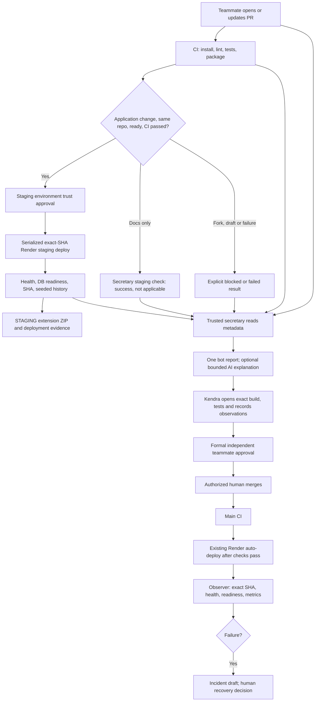

# DevOps Secretary — operator guide

This is a reporting-only pilot for Veriqo, in the existing `kendshhh/PhishLens`
repository. The source repository still uses the PhishLens name. No separate
dashboard or new hosting service is needed. Start here, then use
[the rollout checklist](secretary-verification.md) and [course mapping](secretary-course.md).

**Rollout status:** implemented on a feature branch, not activated. A workflow file
on a PR does not activate `workflow_run`, scheduled, or trusted-base reporting.
Those files must first receive human review and land on the default branch.
This document does not claim that the new preview, bot, or production observer
has run on GitHub. Existing staging is not evidence for this new implementation.

## What happens



Waiting/running/passed/failed appears in Actions and checks. The report says
`WAITING FOR CHECKS`, `BLOCKED`, `CHANGES RECOMMENDED`, or
`READY FOR KENDRA’S REVIEW`. The final phrase requests your review; it never grants
approval. A draft remains blocked. A CI run finishing later, including a rerun,
refreshes the report through `workflow_run`; `check_run` alone does not reliably
trigger workflows for GitHub Actions-created checks. A six-hour reconciliation
also refreshes open PRs, including displaced shared previews. This is eventual
status reconciliation, not continuous monitoring.

## Responsibility boundary

| Area | Automation does | Human does |
|---|---|---|
| Deterministic CI | Install, lint, mock AI tests, migrations/seed in disposable PostgreSQL, package | Fix failures; inspect coverage |
| Secretary | Read patches/evidence, flag bounded heuristics, update its own report | Assess concerns and uncovered code |
| Optional Gemini | Explain sanitized metadata, validate JSON, fall back on failure | Enable a separate capped key and approve external data policy |
| Preview | Deploy exact eligible SHA, smoke test, build staging ZIP | Approve deployment trust; test Chrome behavior |
| Review | Provide checklist and evidence links | Record manual test and submit formal review |
| Merge | Nothing | Authorized human merges after required checks/reviews |
| Production | Existing Render deployment plus read-only observer | Decide and execute rollback if needed |
| Administration | Nothing | Configure environments/secrets and verify protection |

Kendra reviewing someone else's PR can test and formally review it. When Kendra
authors a PR, she cannot approve her own work; Leyan or another appropriate
teammate supplies the independent review. A staging environment approval is about
trusting code to run with **non-production** runtime credentials; it does not
replace PR approval. No labels, issue creation, board edits, or team messages are
enabled by the bot. Optional proposed labels: `needs-manual-test`, `preview-blocked`,
`ai-evaluation-needed`. Apply them yourself only after reviewing the report.

## Files and maintenance points

| File | Purpose |
|---|---|
| `.github/secretary.json` | Allowed service IDs/origins, configured CI jobs, diff limits, AI default |
| `.github/workflows/ci.yml` | Unprivileged checks/tests; trusted environment-gated legacy staging bridge |
| `.github/workflows/secretary-report.yml` | Trusted-base report events and single writer |
| `.github/workflows/secretary-preview.yml` | Assess without secrets, then environment-controlled deploy |
| `.github/workflows/secretary-production.yml` | Observe production after main CI; preserve evidence |
| `scripts/secretary/core.py` | Recommendation policy, requirement mapping, manual checklist |
| `scripts/secretary/github_api.py` | Bounded, paginated GitHub API client |
| `scripts/secretary/report.py` | Evidence gathering, deduplication, optional Gemini |
| `scripts/secretary/preview.py` | Render controller, isolation guards, smoke, extension artifact |
| `scripts/secretary/production.py` | Version/health verification, metrics and incident drafts |
| `scripts/secretary/demo.py` | Safe offline example and demonstration ZIP |
| `scripts/tests/test_secretary.py` | Offline failure and trust-boundary tests |
| `backend/app/main.py` | `/version`: public SHA/environment only |
| `scripts/start_staging.py` | Host check before hosted staging migrations |
| `backend/tests/test_version.py` | Identity response and no secret exposure |

The secretary uses Python's standard library. No new runtime dependency or AI SDK
is needed. Existing FastAPI, SQLAlchemy, Alembic, psycopg and extension dependencies
remain in their existing lockfiles. No type checker was found; none is claimed.

## Set up locally first

1. Open the project folder in your editor. Open **Terminal → New Terminal**.
2. Run `git branch --show-current`. The implementation branch is
   `feat/devops-secretary`; do not put normal work directly on main.
3. Use your existing Python environment. From the repository root run:

   ```powershell
   python -m unittest discover -s scripts/tests -v
   python -m ruff check scripts/secretary backend
   python -m pytest backend/tests -q -p no:cacheprovider
   npm.cmd ci
   npm.cmd test
   npm.cmd run lint
   python -m scripts.secretary.demo
   ```

4. Open `output/secretary-demo/example-report.md`. It deliberately says
   **OFFLINE EXAMPLE** and uses a zero SHA. It is not hosted acceptance evidence.
   The demo ZIP exercises the actual packaging code using local extension files.
5. Compare the checked commands with `.github/workflows/ci.yml`. CI additionally
   starts disposable PostgreSQL and verifies real migrations/relationships.
   Two database-dependent backend tests may skip locally without that database.

Success means tests pass and you can explain why the bot never decides to merge.
An offline example alone does not complete cloud activation.

## One-time GitHub and Render setup — owner actions

No credentials need to be pasted in chat or committed. The repository link is
already known from `git remote`; the placeholder in the request did not block work.

1. Open **GitHub → PhishLens → Settings → Environments → New environment**.
   Create `staging`. Add a required reviewer who can validate deployment trust.
   Restrict deployment refs: `main` for the new controllers, plus reviewed PR
   merge refs during the temporary legacy bootstrap. GitHub evaluates the
   legacy job's PR ref, even though it checks out trusted main scripts. Remove
   the PR-ref allowance when retiring the bridge. Keep required reviewers on
   both paths; inspect workflow changes before deployment approval.
   Enable prevention of self-review if available.
   Environment protection availability depends on repository visibility/plan.
   If you cannot enforce reviewers, leave preview disabled until a comparable
   trusted deployment approval process exists.
2. In that environment add the **environment secret** `RENDER_STAGING_API_KEY`.
   Move/rotate the old repository-scoped key and **remove the repository secret**
   with that name. This prevents PR-edited CI from receiving it. During rollout,
   pause in-flight old jobs while moving the key. Complete the documented
   serialized bootstrap/cutover before retiring the old controller.
   The new workflow no longer executes a PR deployment script with a secret.
3. In `staging` environment variables add:
   - `SECRETARY_PREVIEW_ENABLED` = `true`, **only after** steps 4–6 are verified.
   - `SECRETARY_STAGING_DB_HOST` = the exact Neon hostname mapped to branch
     `pr-58-staging`.
   - `SECRETARY_PRODUCTION_DB_HOST` = the distinct production Neon hostname.
   These hostnames are configuration, not passwords; keep them in the environment
   UI, not public evidence. The controller compares hosts and the database name.
4. Open [Render staging](https://dashboard.render.com/web/srv-db92irlg1s2s739404i0)
   → **Environment**. Privately confirm `DATABASE_URL` belongs to Neon branch
   `pr-58-staging`, database `phishlens_dev`, and a staging-only role. Production
   and development can use the same database name, so the name alone is unsafe.
   Set `STAGING_DATABASE_HOST` to the exact hostname for `pr-58-staging`,
   `APP_ENV=staging`, and `AI_MODE=mock`. Keep AI and production keys out of
   staging. These edits can trigger a deployment; review the Render UI before
   applying them.
5. In Render staging **Settings**, retain `Auto-Deploy = Off`, the existing Python
   build command, and `python scripts/start_staging.py` as start command.
   The controller validates these settings and the allowed origin before deploying.
   Use `/health` as the HTTP health path if you choose to configure one; the
   controller independently checks `/health`, `/ready`, `/version`, and history.
6. Review the first staging deployment trust request. PR application code will run
   on Render and can access its staging runtime credentials. Check migrations,
   build/start changes and dependencies before approving. Non-production access
   is still access: use synthetic data and a restricted role. The controller cannot
   prove that a maintainer entered the correct host; that remains your inspection.
7. Create `production-observer` in GitHub Environments, restricted to `main`.
   Add `RENDER_OBSERVER_API_KEY`, using the narrowest dedicated Render account/key
   available. The code uses GET only. A Render key may have broader account powers
   than these scripts use; do not describe code-level read-only behavior as a
   provider-enforced read-only credential. This workflow does not deploy production.
8. Open [production settings](https://dashboard.render.com/web/srv-db7eap25b2lc73fkelpg)
   and confirm branch `main`, auto-deploy **After CI Checks Pass**, `/health`,
   production-only database credentials, and `APP_ENV=production`. Read-only
   inspection in this implementation found `autoDeployTrigger=checksPass`.
   No setting was changed. Production migrations remain the existing team's
   responsibility; the observer does not apply migrations or write data.
9. Review this implementation through a PR. New trusted workflows cannot run
   from main until merged. Existing required `Hosted staging` is retained as a
   temporary bridge, now environment-gated and executing only default-branch
   controller/smoke scripts. It can deploy the reviewed pilot's exact SHA before
   merge. This supplies legacy API smoke evidence, not proof that the new bot ran.
   **Do not bypass protection.** After independent review and preview testing,
   an authorized human merges the pilot. Prove `Secretary staging` on a new test
   PR and require that check before setting repository variable
   `SECRETARY_REPLACES_LEGACY_STAGING=true`. Retire the legacy job in a later
   reviewed PR. Until cutover, both controllers share a lock; running both costs
   an extra deployment, so complete the cutover promptly.
10. Once installed on main, use **Actions → DevOps Secretary → Run workflow**
    to reconcile existing open PRs. New PR events and CI completion events run
    automatically. Check the pinned SHA in the comment and deployment view.

The new controller won't deploy unrelated documentation-only PRs; it writes
`Secretary staging: success — not applicable`, avoiding a permanently pending
gate after the legacy bootstrap has been retired.
The temporary legacy job skips drafts/forks before requesting environment
access. That skip is not preview acceptance; the new controller records drafts
and relevant forks as `action_required` on its separate check after installation.
Fork application PRs get `action_required`; run ordinary fork CI without secrets,
review the work, then bring it into a trusted branch for staging. Do not switch
to privileged checkout/execution of fork code.

## Optional AI explanation

Leave it off for the first pilot. Deterministic evidence gathering is useful on
its own. To opt in later, review a PR setting `ai_enabled` to `true` in
`.github/secretary.json`, set repository variable `SECRETARY_AI_ENABLED=true`,
choose `SECRETARY_GEMINI_MODEL`, and configure secret `SECRETARY_GEMINI_KEY`.
Use a separate non-production key/account with provider limits and billing alerts.

Only sanitized filenames (up to 50), check metadata and rule-generated concerns
are sent to Google. No raw patches, PR/issue prose, source email, or logs are sent.
Redaction is best effort; filenames can still reveal project structure. Output
must be one bounded JSON summary. It cannot control recommendation policy or run
tools. One call is allowed per changed evidence snapshot; duplicate events reuse
the existing comment without calling AI, and at most two calls are attempted per
report invocation. Draft/pending CI defers calls. There is **no monthly dollar
budget implemented**: limits in this code are not a provider billing cap. A quota
or bad JSON response produces `AI unavailable`; ordinary CI still runs.

No paid calls were made during implementation. The project already supports
Gemini and optional local DistilBERT for its product AI; secretary AI is separate.
Prompt changes still need product evaluation evidence. The secretary flags that
need; it does not pretend that mocked calls measure model quality. Automatic
live evaluation and a scheduled product-AI smoke remain future work, requiring
an explicit capped-key policy.

## Review a teammate's proposed version

1. Open **Pull requests → the PR → Conversation**. Find **DevOps Secretary**.
2. Read **Reviewed head**. Compare it with the latest commit at the top of the PR.
   Read **Checks**; green CI alone doesn't prove behavior.
3. Open the linked preview run, then **Artifacts → Veriqo-Staging-Extension**.
   Extract the downloaded artifact; extract the inner extension ZIP into its own
   folder. Keep `preview-evidence.json` with your evidence.
4. Open Chrome → `chrome://extensions/` → enable **Developer mode** →
   **Load unpacked** → choose the extracted folder containing `manifest.json`.
   Use a separate test profile and synthetic email text, not a personal inbox.
5. Open the extension. Its yellow banner shows **STAGING**, PR, and full SHA.
   Compare those with the deployment/report. Open staging `/version` and confirm
   the SHA. If another PR replaced staging, rerun the PR CI; do not test an old
   artifact against the wrong backend.
6. Follow the report's feature-specific checklist. For history, expect the
   synthetic account notice, phishing, high risk, 93% confidence. For analysis,
   try synthetic text, loading, provider errors and Clear. `mode: mock` is a wiring
   result, not proof of meaningful AI. For malformed requests use staging `/docs`.
7. For UI comparisons, capture the same popup size/browser zoom with the same
   synthetic record, once with a production build/profile and once with staging.
   Label each image with build SHA, environment, timestamp and action. Do not label
   a mockup or an offline example as a real preview. No before/after screenshots
   were produced in this implementation because the proposed version is not live.
8. Add your own comment, for example:

   ```text
   Manual test — SHA <full SHA>, artifact <run link>, Chrome <version>
   Action/input: synthetic history / Analyze selection / Clear during loading
   Expected: <result>; Actual: <result>; PASS or FAIL
   Evidence: <redacted screenshots or API responses>
   Problems: <step, synthetic reproduction, file if known>
   ```

9. Use **Files changed → Review changes** for your formal review. A comment saying
   PASS is a record, **not an enforced manual-test gate**. Current enforcement is
   required checks and teammate reviews. Optional stricter enforcement would need
   a separate authenticated SHA-bound manual-test check, which this pilot does not
   enable. Never have the bot impersonate your confirmation.

For API/workflow-only changes, `/docs`, JSON responses, migration/test logs and
Actions status are the appropriate demonstrations. A website cannot show Chrome
context menus, badges, permissions or session storage.

## Recommended merge checks (owner verifies, bot never changes)

Require `Backend checks`, `Extension checks`, `Staging integration`, and
`Secretary staging` after proving the new controller. Keep `Hosted staging`
required during bootstrap until its replacement is required. Require an
up-to-date branch, resolved conversations, at least
one independent approval and dismissal of stale approvals, with no bypass.
The reporter itself is advisory and is **not** a required AI merge gate. If it
fails, use the normal documented human review process; do not infer approval.

On a new commit GitHub requires checks for that head; the bot reads current PR
state before posting. The preview controller rejects old CI attempts and checks
head again after deployment. A successful shared preview's check is changed to
`action_required` before another PR takes the staging slot. The report also marks
displaced evidence stale. There is a small unavoidable race between API reads and
a concurrent push; the next PR/CI event reconciles it. Humans must always compare
the SHA, and branch up-to-date/stale-review rules remain essential.

## Costs, public access and cleanup

Permissions are job-scoped. Reporter: repository contents/actions/checks/deployments
read and PR comments write. Preview: contents/actions/PR read plus checks/deployments
write, with the Render key only in the protected deploy job. Observer: contents,
Actions and PR read; its dedicated Render key is used for GET requests only.
No workflow has contents write, administration, merge, or issue-closing actions.

Suggested reviewers (not requested automatically): Leyan for integration, Trixia
for API/migration changes, Wilberr for AI behavior, Andrei for extension behavior.
Optional follow-up issue draft: **Verify Secretary rollout end to end**, owner
Kendra, acceptance: one current-SHA report, isolated preview/Chrome test record,
failed/rerun demonstration, independent approval and production observer artifact.
Review this draft before creating or assigning an issue or editing the board.

| Service | Pilot use and cost limit |
|---|---|
| GitHub Actions | Existing hosted runners and artifacts. Public-repo standard-runner billing differs from private quotas; check your account billing. Six-hour reconciliation plus PR events uses runner time. |
| Render | Reuses the existing free-plan staging/production services; no new paid resources are created. Free limits and sleep/cold starts apply; shared staging avoids a service per PR. |
| Neon | Reuses dedicated branch `pr-58-staging` and database `phishlens_dev`, separate from development and production; compute/storage/branch quotas still apply. Do not assume the free plan is unlimited. |
| Gemini | Disabled by default, no live CI calls. Model/account quota, pricing and data terms apply when enabled. |

Checked references: [GitHub billing](https://docs.github.com/en/billing/concepts/product-billing/github-actions),
[Render pricing](https://render.com/pricing), [Neon pricing](https://neon.com/pricing),
[Gemini pricing/data use](https://ai.google.dev/gemini-api/docs/pricing).
Confirm prices before enabling a paid service; none is guaranteed free by this code.

Staging is currently public HTTPS. It has no new login layer. Keep only synthetic
data there. If sensitive data or private testing is needed, add authentication
before use; a hard-to-guess URL is not access control. Test builds contain only
the public API origin, never database/provider credentials. Artifacts expire
after seven days (production evidence: 30 days). Download consultation evidence
before expiry. The shared service persists; closing a PR creates no per-PR
resource to delete. Remove the test extension/profile when done. Don't delete
Neon branches or records as an automatic cleanup action.

## Troubleshoot, maintain, disable

- **No comment:** confirm trusted workflows are on main; Actions enabled; token
  can write PR comments; open Actions → DevOps Secretary. Dispatch it again.
- **Missing check after rollout:** check Secretary preview's assess job and
  environment approval queue. Confirm CI workflow name is still `CI` and job
  names match `.github/secretary.json`. Draft/fork results are intentional.
- **Staging refused:** check service ID/origin, auto-deploy off, startup command,
  APP_ENV, mock mode and both database host declarations. Never loosen a guard
  merely to get green checks. Read secret values privately in provider dashboards.
- **Preview shows another SHA:** another PR replaced the shared service. Rerun CI
  for the intended PR, wait for a fresh deployment and download its fresh artifact.
- **`/version` 404:** the target branch lacks this endpoint. Update the PR with
  the reviewed pilot base before testing; old hosted code isn't new evidence.
- **AI unavailable:** inspect model/key/quota privately. CI remains independent.
  Don't paste provider error bodies or keys into PR comments.
- **Production observer red:** see its summary, metrics and incident draft, then
  Render's exact deployment logs. A good older revision is not success for a new
  failing deployment. Follow the existing [runbook](runbook.md); human decides
  rollback after checking migration compatibility.
- **Monthly maintenance:** review trusted workflow permissions/pins, dependency
  updates, provider prices, API compatibility, artifact retention and CI flakiness.
  Re-run secretary tests after changing policy. Measure optimizations before
  claiming them; no performance improvement is claimed here.
- **Disable AI:** set `SECRETARY_AI_ENABLED=false`; no CI/deploy changes needed.
- **Pause previews:** set staging environment variable
  `SECRETARY_PREVIEW_ENABLED=false`. Applicable preview checks fail explicitly;
  protected merges should stop until an approved alternative exists.
- **Disable the pilot:** Actions → each secretary workflow → menu → Disable
  workflow. Keep ordinary CI. Required staging checks must have a reviewed
  replacement; do not bypass it to merge. Remove/revoke keys only through the
  owner after stopping workflows. The bot makes no protection/secret changes.

Current limitations: bounded heuristic code inspection, no full security scan,
no autonomous visual test, no enforced manual-test acknowledgement, no scheduled
live product-AI smoke, and no automatic rollback. Reports display missing evidence
rather than claiming those capabilities.
