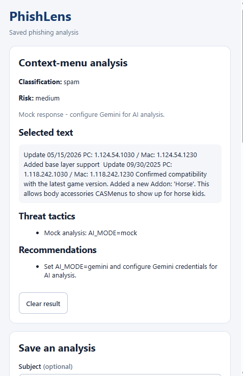
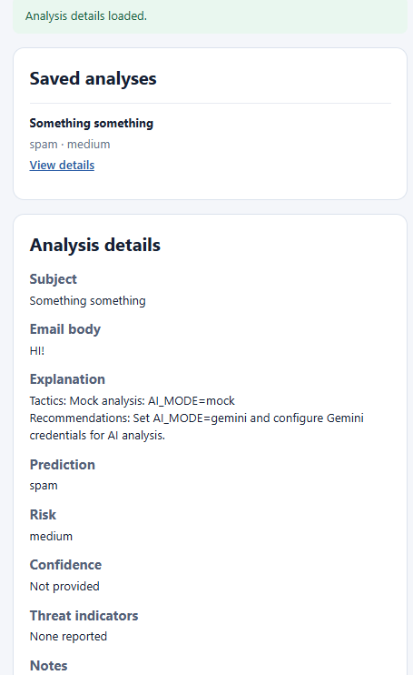
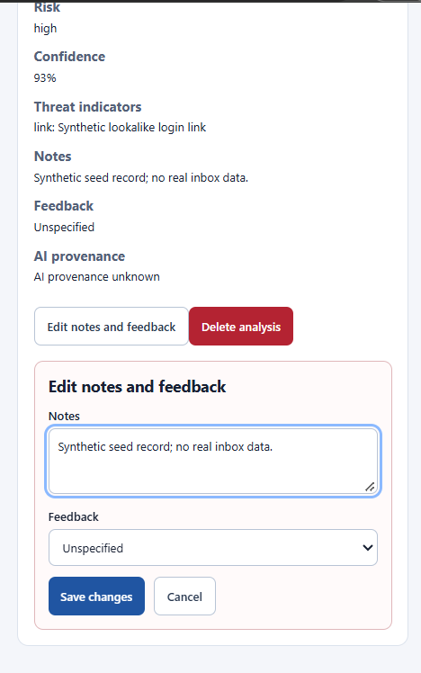
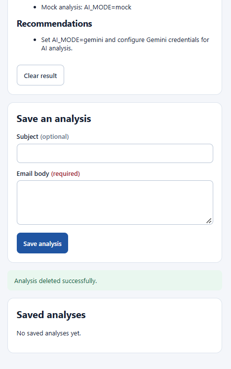

# Issue #47 — installed-browser CRUD evidence

Date updated: 2026-11-03 (Asia/Manila)
Branch: `test/47-verify-installed-browser-crud`
PR: [#61](https://github.com/kendshhh/PhishLens/pull/61)
Owner: Andrei (`JupitraxNeptuna`)

## Preview artifact identity

The `Veriqo-Staging-Extension` Actions artifact contains the inner extension ZIP
and `Veriqo-Staging-Extension.zip.sha256`. Verify the ZIP using that adjacent
sidecar (or `Get-FileHash -Algorithm SHA256` on the downloaded ZIP). The digest
GitHub displays for the Actions artifact is for the enclosing artifact archive;
it is not the inner extension ZIP digest. Confirm `preview-info.json` inside the
extension ZIP records the expected PR source SHA, and independently confirm the
staging `/version` SHA before browser testing. The sidecar establishes ZIP
integrity, while `preview-info.json` and `/version` establish the reported
source/deployment identities.

## November 6 coordination and acceptance status

Trixia requested a repeat installed-Chrome run using the extension artifact matched
to the deployed backend SHA. Leyan is invited to review the resulting client/API
evidence. The latest supplied run reports that Save was blocked because the
matching TF-IDF save service was unavailable; consequently no synthetic record
was created and full CRUD, reopen persistence/deletion, and Network evidence are
still incomplete. No current staging SHA or artifact pairing is asserted here.

Before any record-changing run, Kendra must confirm staging readiness and
explicitly authorize the synthetic write. At that point, record the full backend
`/version` SHA and environment, CI artifact/run and source SHA, extension ZIP
SHA-256, Chrome version, and timestamp. Stop if backend and artifact identities
do not match or `/ready` fails. Confirm `/model-info` reports `provider_mode` as
`tfidf`, `accepts_tfidf_reports` as true, and the exact bundled TF-IDF model SHA;
if not, do not attempt Save. Manual create/view/edit/delete behavior requires the
service to accept the extension's required model header too.

On the matched installed artifact, use only synthetic content and one uniquely
identifiable test record. Capture create and detail, edit notes/feedback and
reread, close and reopen the popup and confirm the edits remain, delete, then
close/reopen and confirm the deleted record is absent. Capture screenshots and
redacted DevTools Network evidence for the relevant GET/POST/PATCH/DELETE
requests and statuses. Remove credentials, cookies, authorization headers,
tokens, and personal data. Attach the artifacts to PR #61 and ask Leyan to review
the client/API evidence. The CI Playwright scenarios use a local synthetic API;
they improve regression coverage but do not replace this installed-Chrome run or
prove staging database persistence.

Until these observations and evidence exist, the installed CRUD acceptance stays
pending and the matching-model failure remains an environment readiness blocker.

## Evidence status

## Pre-test staging change — 2026-11-03

The identified staging package was built for `b294a91eb19f46f8434ff5b987931911e58137db`. Before Chrome testing, a fresh `/version` check reported staging SHA `2f32881982a67c9d070bdecd2ef981965ae4125e`, so no Chrome CRUD or persistence run was performed against the mismatched backend. This note records the reason for the fresh CI and staging preview; use the new artifact only after its SHA matches the live `/version` response.


The local/package checks and staging API run documented below are historical snapshots from source `23e2973dcc4f4030cc9f58e894116179cb992365`; the older 2026-10-22 PR screenshots came from source `f8691e6c5b4e16bea99982a8c9b466b13ddb5e17`. The reviewed PR head at the time was `5c217fad69067574894e844c5e0ed4ef8d1aafc`, followed by popup code-fix commit `454754c`. The four screenshots supplied on 2026-11-02 and embedded below replace those older images in the PR presentation. Their source/package identity is not visible and is not inferred. They show visible UI states only; they do not establish persistence or deletion after reopening the popup.

## New Chrome screenshots supplied 2026-11-03

The following screenshots were supplied by the tester and copied into this evidence directory. The matching preview evidence identifies PR #61 source SHA `efed115457dc4fdc212f6205199096266a71e9f1`; its preview smoke and the supplied staging `/version` both reported that same SHA. The staging deployment identifier was `dep-dbkvbjjncjis73feqai0`.

Follow-up identity check on 2026-11-04 (Asia/Manila): the downloaded inner ZIP was found at `Downloads/Veriqo-Staging-Extension/Veriqo-Staging-Extension.zip`. Its SHA-256 is `221bb5c3c36089ecee3568d378f30cc66d273ff40ae0054770d8636348f994b8`. Chrome `chrome://version` reported Google Chrome `156.0.8078.80` (Official Build, 64-bit) on Windows 11 25H2. The live staging `/version` page was opened in Edge immediately before testing and returned `{"commit":"efed115457dc4fdc212f6205199096266a71e9f1","environment":"staging"}`, matching the package source SHA. The package was initially not yet loaded; the Chrome selected-text check is described below.

The package was then loaded in Chrome. Selected-text analysis was performed on a synthetic email selection from a local `data:` page. The context-menu action opened the extension result, whose banner identified PR #61/source `efed115457dc4fdc212f6205199096266a71e9f1`; TF-IDF returned `99.94%` against the frozen `88.71%` threshold and the result clearly reported that the local LLM judge was unavailable or unusable. This verifies that the selected-text action and result view work in Chrome for this package. It does not establish a reviewed verdict, model acceptance, saved-report success, or CRUD. No Chrome screenshot file or Network capture was saved for this follow-up. The popup is at the Save an analysis form; CRUD submission and persistence/deletion after reopening remain pending.

One synthetic **Save an analysis** create attempt returned: `Could not save analysis: The matching TF-IDF save service is unavailable. Your input is still here.` No record ID or success state was produced; the input remained in the form. No retry was made. This blocks create/view/edit/delete and the subsequent reopen persistence/deletion checks. Staging must restore the matching TF-IDF save service before another create attempt. A screenshot and Network capture of this error were not saved.

The tester initially reported Windows 11 64-bit, Chrome Update stream Early Access, Core `138.0.6044.65`, and Chromium `154.0.8037.99`. A later direct `chrome://version` check for this acceptance run reported Google Chrome `156.0.8078.80` (Official Build, 64-bit), Windows 11 25H2. The package metadata says `package_status: partial` and excludes `model-assets/llama/`; the local LLM judge was unavailable or unusable in the captured result. This is local scan/UI evidence, not real local Llama or complete AI acceptance.

| Screenshot | What it shows | SHA-256 |
|---|---|---|
| [Local scan overview](evidence/pr61-2026-11-03/01-local-scan-overview.png) | PR #61 staging banner with source SHA; uncertain result; TF-IDF v12a score and alert threshold | `498290e5fdc3f18cfc446ae7f2c26e09abe42302ca90f2821144909496f6afe6` |
| [Local LLM and model results](evidence/pr61-2026-11-03/02-local-llm-and-model-results.png) | Local LLM unavailable; three-model reevaluation panel | `047e72c5c8ed74f7c472cbd8ff348b55ee4d101f10a536b7e56e52ba068fa839` |
| [Save report form](evidence/pr61-2026-11-03/03-save-report-form.png) | Optional report form before save, with consent unchecked | `80c3837fc56a6ea6203eba7bb33cbf5c0d8479c65ce0d1ce10b9a404541ecea6` |
| [Save timeout](evidence/pr61-2026-11-03/04-save-timeout.png) | `PR61 test`, consent checked, save signal timed out; no automatic retry | `22888b8d2c2bca77afc20e22a5b055cb948f81b22e6ee66049445607d185c371` |

The tester also reported that saving is disabled until the server has the matching TF-IDF v12a model. The save attempt therefore does not establish a created report. Retry is expected to reuse the same request key, including after reopening; no retry was made. Screenshots do not show the saved-analysis create/view/edit/delete flow, notes/feedback persistence after reopening, deletion absence after reopening, or DevTools Network details. No Network capture was supplied, so redacted Network results remain pending. Treat the Chrome/package hash and the requested persistence/deletion acceptance as **incomplete** until those checks are captured against a runnable matching package.

### Current acceptance snapshot

| Field | Reported evidence |
|---|---|
| PR source SHA | `efed115457dc4fdc212f6205199096266a71e9f1` |
| Staging `/version` SHA immediately before the supplied run | `efed115457dc4fdc212f6205199096266a71e9f1` (tester supplied) |
| Preview smoke / deployment | Passed for that SHA; deployment `dep-dbkvbjjncjis73feqai0` |
| Extension inner ZIP SHA-256 | `221bb5c3c36089ecee3568d378f30cc66d273ff40ae0054770d8636348f994b8` |
| Browser version | Chrome `156.0.8078.80` Official Build (64-bit), confirmed at `chrome://version`; Windows 11 25H2 |
| Selected-text analysis | Chrome action/result passed for synthetic text; TF-IDF `99.94%`, local LLM unavailable; screenshot still needed |
| Save / CRUD | Chrome create attempt blocked: matching TF-IDF save service unavailable; no record created; no retry; view/edit/delete not run |
| Notes/feedback persistence and deleted-record absence after reopen | Pending |
| Redacted Network results | Pending; no Network capture supplied |

This update records supplied browser observations only. It does not claim the reviewer’s requested Chrome CRUD/reopen/Network acceptance is complete and does not request re-review yet.

| Evidence | Status | Recorded value |
|---|---|---|
| Source revision for recorded local/package checks | Historical snapshot | `23e2973dcc4f4030cc9f58e894116179cb992365` |
| Production archive recorded for that snapshot | Rebuilt locally at that snapshot | `PhishLens-Extension.zip`; SHA-256 `41ca3b82650d2dcf1e93dc4bc37552b5a62c3e71b1a28f2806bb11d12da46d9e`; includes `extension/js/api.js`, `extension/background.js`, CRUD popup assets, and result-view assets |
| Staging package recorded for that snapshot | Local temporary package | Built from source `23e2973dcc4f4030cc9f58e894116179cb992365` for `https://phishlens-staging.onrender.com`; SHA-256 `c52a2d020db71613cefe84ff56ee1f6a14ceff06f5d11e18fe977c38ec3dae78`; 10 runtime files, staging manifest/host, no tests |
| Earlier PR screenshots | Superseded in PR description | Historical 2026-10-22 set; source/package provenance is retained in the prior evidence record, not used for current acceptance |
| Screenshots supplied 2026-11-02 | Visible UI states only; source/package identity unverified | Context-menu mock result, saved-analysis detail, edit form, delete success and empty list; files below |
| UI states shown in those screenshots | Completed on earlier revision | Create/list and detail view; edit notes/feedback form; delete confirmation and visible delete-success state |
| Selected-text analysis in Chrome | Pending current revision | No browser result/error view captured against the current PR head/package |
| CRUD flow in Chrome using current packaged extension | Pending | Current exact-head package has not completed a browser run against staging |
| Notes/feedback persistence after popup reopen | Pending | Not established by existing screenshots or API runner |
| Deletion absent after popup reopen | Pending | Not established by existing screenshots or API runner |
| DevTools Network evidence | Pending | No current-head Network capture/HAR |
| Staging API observed during the historical run | Deployed API verified at that time | `/version` SHA `57da457be77fcf7a132e3a5e2f0d704c676040d6`; `/ready` ready, database connected |
| Staging synthetic CRUD recorded for that run | Passed against deployed API at that time | Guarded client run created and cleaned up synthetic record `854787a0-b7d9-41d6-94a8-1f8fff8cff34` |

### Screenshots replacing the earlier PR images

The following four user-supplied screenshots, dated 2026-11-02, replace the older 2026-10-22 images in the PR description. They show these visible states:

1. Context-menu analysis result with selected text and mock-mode notice.
2. Saved-analysis detail view.
3. Edit notes and feedback form.
4. Delete-success message and empty saved-analysis list.

The screenshots do not visibly identify the source commit, installed package checksum, or Chrome version. They are recorded as supplied visual evidence; they do not establish which package produced them. They show UI states, not a complete create-to-delete run. In particular, they do not demonstrate notes/feedback persistence after closing and reopening the popup, deleted-record absence after reopening, or Network request/response details.









These images supersede the earlier-revision screenshots in the PR presentation. Their provenance is not inferred from their appearance.

## Implementation and local verification at the recorded snapshot

At source snapshot `23e2973dcc4f4030cc9f58e894116179cb992365`, the popup aligned notes with the API's 2,000-character maximum, preserved null feedback during notes-only edits, ignored stale detail responses, and retained the context-menu selected-text result/error view and Clear control alongside CRUD. Production used the five-method API client; the test-only in-memory client was excluded from packaged assets.

The source commit for these checks is `23e2973dcc4f4030cc9f58e894116179cb992365`, not reviewed PR head `5c217fad69067574894e844c5e0ed4ef8d1aafc` or subsequent popup code-fix commit `454754c`. The regenerated production ZIP from that snapshot was configured for the production API; the separately built staging ZIP was configured for staging. Do not install the production ZIP for synthetic staging writes.

Local verification on this source revision:

```text
npm test          PASS — 132 tests
npm run lint      PASS
npm run package   PASS — package and manifest/assets validation
git diff --check  PASS (rerun before commit)
```

The root ZIP was inspected and contains both `extension/js/api.js` and `extension/background.js`, plus the CRUD and context-result UI assets. Packaging evidence in `output/extension/evidence.json` records source/tested commit `23e2973dcc4f4030cc9f58e894116179cb992365`; packaging explicitly does not claim Chrome acceptance.

## Deployed staging API verification

The staging identity observed during this historical run was `57da457be77fcf7a132e3a5e2f0d704c676040d6`; readiness reported `ready` and database `connected` at that time. The guarded runner passed using the real `extension/js/api.js` client from the recorded source snapshot:

```powershell
node scripts/verify_crud.mjs --base-url https://phishlens-staging.onrender.com --environment staging --expected-sha 57da457be77fcf7a132e3a5e2f0d704c676040d6 --allow-writes
```

It verified create/list/detail, notes and feedback patching including null feedback, read-after-write, delete, and post-delete 404, then cleaned up only its own synthetic record `854787a0-b7d9-41d6-94a8-1f8fff8cff34`. This is deployed **API** evidence. It is not a packaged-extension browser run and does not satisfy the persistence-after-reopen or deletion-after-reopen browser checks.

## Historical staging and browser screenshot evidence

The staging run recorded here tested PR code revision `40f67d720270d05cb64d9f616fc3d16400ffc960`, which was the PR head when run 41424692539 executed. This is historical evidence for that revision; it does not identify the current PR head. Later documentation and screenshot updates do not change which code revision the run tested.

The four screenshots supplied on 2026-11-02 are included above and replace the older images in the PR description. They show selected-text result content in mock mode, a saved-analysis detail, the edit form, and delete success with an empty list. The images do not expose package identity or Chrome version, so their exact installed-package provenance is unverified.

The PR's Hosted staging run [41424692539](https://github.com/kendshhh/PhishLens/actions/runs/41424692539) passed for code revision `40f67d720270d05cb64d9f616fc3d16400ffc960`; it deployed merge candidate `8b5f292bfb318bf41a3c41fdafa113198facf67e` and produced a staging artifact. This automated deployment evidence does not tie the supplied screenshots to that artifact or establish an installed-Chrome run.

Still pending:

- Verify create, view, edit-save, and delete with the current staging package in Chrome.
- Confirm saved notes and feedback persist after closing and reopening the popup.
- Confirm a deleted record remains absent after closing and reopening the popup.
- Capture redacted Network evidence with request methods, paths, statuses, and response envelopes. Exclude cookies, authorization values, tokens, and personal data.
- Complete the browser run using the identified package; the ZIP SHA-256, Chrome version, and package-to-source identity have now been recorded above, but no Chrome interaction has yet been performed.

The earlier 2026-10-22 screenshots have been superseded in the PR description. The new images are useful visual evidence, but they do not satisfy the pending persistence or Network checks.

## Run record / handoff

| Field | Result |
|---|---|
| Historical evidence source SHA / PR | `23e2973dcc4f4030cc9f58e894116179cb992365` / [PR #61](https://github.com/kendshhh/PhishLens/pull/61); not the reviewed or later PR head |
| Historical local tests/lint/package | Passed for the recorded snapshot as listed above |
| Historical deployed staging API | Passed on staging SHA `57da457be77fcf7a132e3a5e2f0d704c676040d6` at that time |
| Chrome current-head selected-text and CRUD | Pending; extension was not loaded in the attempted session |
| Persistence after popup reopen | Pending |
| Deletion absence after popup reopen | Pending |
| Network evidence | Pending |
| 2026-11-04 package/staging/browser identity | ZIP SHA-256 and Chrome `156.0.8078.80` recorded above; staging SHA matched package source SHA `efed115457dc4fdc212f6205199096266a71e9f1`; Chrome selected-text check passed for synthetic text; CRUD not performed |
| Existing PR screenshots | Earlier revision; links and scope recorded above |
| Public presentation arrangement | Pending Kendra/instructor confirmation |
| Reviewer / required checks / board update | Pending; no merge or deployment claim |

Do not claim #47 fully accepted until current-head packaged-extension browser verification, the three pending evidence items, review, and required checks are complete.
