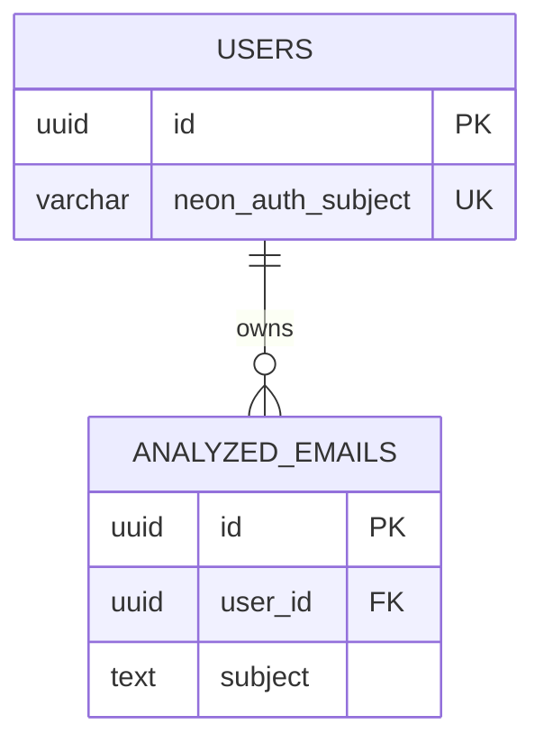

# Development database schema

PhishLens stores users and saved analyses in PostgreSQL. Alembic migrations are the
source of truth for the database schema; SQLAlchemy models describe the current
application mapping. For a first setup or a migration rehearsal, use a disposable
local database. Do not use production data or credentials. Never put real inbox data
in a development database or demo seed.

The checked-in migration chain is linear:

| Revision | Change |
| --- | --- |
| `0001_initial_schema` | Creates `users` and `analyzed_emails`, the owner foreign key, confidence check, and per-user history index. |
| `0002_analysis_provenance` | Adds nullable `analysis_mode` and JSONB `analysis_provenance`; constrains mode to `mock`, `real`, or `unknown`. |
| `0003_saved_analysis_idempotency` | Adds nullable `idempotency_key` and unique `(user_id, idempotency_key)` constraint. |
| `0004_neon_auth_subject` | Adds nullable `users.neon_auth_subject` and a unique constraint for subject mapping. |
| `0005_ai_request_quota` | Adds PostgreSQL quota buckets keyed by scope, hashed subject, and window start. |

The checked-in migration head is `0005_ai_request_quota`. Verify the applied revision separately for each database.

## Saved-report ownership

Every saved report has one owner. One user can own zero or more reports.
In Neon Auth mode, the API validates the access token, maps its subject to
`users.neon_auth_subject`, and scopes each report operation to the resolved
`users.id`. The quota table is independent of report ownership and has no
foreign key to either table.

## `users`

| Column | PostgreSQL type | Rules |
| --- | --- | --- |
| `id` | `uuid` | Primary key; generated by the application. |
| `email` | `varchar(320)` | Required, unique. |
| `created_at` | `timestamptz` | Required; database default `now()`. |
| `neon_auth_subject` | `varchar(255)` | Nullable; unique when present. Added by `0004_neon_auth_subject`; maps a verified Auth subject to this internal user. |

## `analyzed_emails`

| Column | PostgreSQL type | Rules |
| --- | --- | --- |
| `id` | `uuid` | Primary key; generated by the application. |
| `user_id` | `uuid` | Required foreign key to `users.id`. |
| `subject` | `text` | Required. |
| `body` | `text` | Required. |
| `prediction` | `varchar(20)` | Nullable until inference is available; intended values are `phishing` or `legitimate`. |
| `confidence` | `numeric(5,4)` | Nullable; if present, must be from 0 through 1. |
| `risk_level` | `varchar(20)` | Nullable until risk scoring is available. |
| `indicators` | `jsonb` | Nullable; intended to hold an array of structured risk indicators. |
| `explanation` | `text` | Nullable until explanations are available. |
| `notes` | `text` | Nullable; user-editable. |
| `feedback` | `text` | Nullable; user-editable. |
| `analysis_mode` | `varchar(20)` | Nullable; when present, one of `mock`, `real`, or `unknown`. |
| `analysis_provenance` | `jsonb` | Nullable; provider/model provenance recorded with the saved analysis. |
| `idempotency_key` | `varchar(255)` | Nullable; unique per `user_id` when present. |
| `created_at` | `timestamptz` | Required; database default `now()`. |

Deleting a saved analysis deletes that `analyzed_emails` row only. Deleting a user cascades
to that user's saved analyses through `ON DELETE CASCADE`; the database enforces the foreign
key. An index on `(user_id, created_at)` supports per-user history queries.

Schema changes must use Alembic migrations. Do not replace migrations with `drop_all()` or
`create_all()` against an existing database.

## `ai_request_quota_buckets`

The composite primary key is `(scope, subject_hash, window_start)`. The migration
stores a request count, a cost upper bound and an update timestamp per bucket.
The supported scopes are `ip_minute`, `ip_day`, `user_day`, and `daily_spend`.
An index on `window_start` supports time-window queries. Quota enforcement is
applied by backend code when the provider and environment settings enable it.

## Disposable local setup

The repository CI currently uses Python 3.12 and PostgreSQL 17. A local migration
rehearsal should use the same major versions and an empty throwaway database. The
root `README.md` has macOS/Linux and Windows PowerShell commands to create the Python
environment, apply migrations, seed the synthetic demo, and start the API. Set
`DATABASE_URL` only to the disposable local PostgreSQL instance for this exercise.

Applying `alembic upgrade head` changes the selected database schema. Running
`scripts/seed_demo.py` writes only the fixed synthetic demo user and analysis. It is
idempotent for those records, refuses a database not named `phishlens_dev`, refuses
to use a demo user linked to a Neon Auth subject, and restores the expected subject
`Synthetic account notice` if that fixed demo analysis already exists with a different
subject. A repeated seed is therefore a write-capable reconciliation, not a read-only
check. Do not run it against a shared or hosted database as part of local setup.

For schema troubleshooting, inspect the migration chain and `backend/models.py` first.
The ORM metadata is not a substitute for migrations and must not be used to recreate
an existing database. To rehearse from scratch, discard the disposable database and
create a new empty one; do not downgrade a shared database to reset it.

Local setup demonstrates migration and seed behavior only. It does not prove a hosted
database target, runtime grants, deployment state, Auth configuration, or browser
acceptance. Record those as separate evidence when they are performed.

The local Python 3.12/PostgreSQL 17.12 migration and seed rehearsal is recorded in
[`docs/database-setup-verification-2026-11-15.md`](database-setup-verification-2026-11-15.md).
